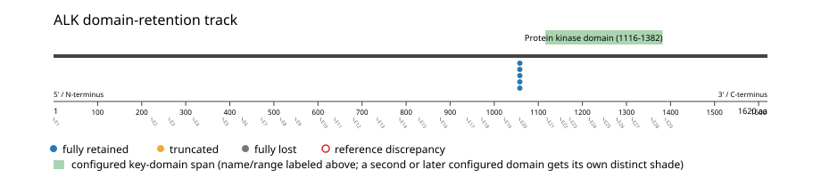
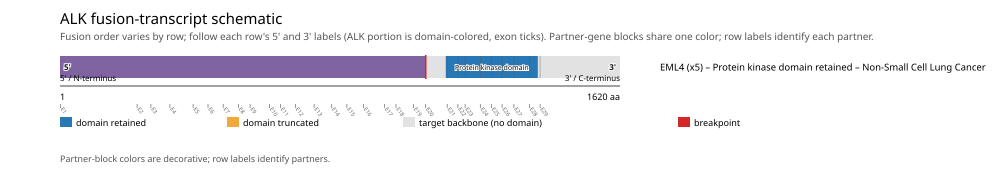

# ALK real-data fusion benchmark: luad_tcga_pan_can_atlas_2018

Retrieved from public cBioPortal and Genome Nexus on 2026-10-29.

## Results

- Structural variants returned for ALK: 5
- Protein-fusion records found: 5
- Protein-fusion records mapped: 5
- Malformed/unmappable fusion records skipped: 0
- In-frame among known-frame events: 5/5 (100.0%)
- Unknown frame status: 0/5
- Protein kinase domain (1116-1382 aa) retained: 5/5 (100.0%)
- In-frame and Protein kinase domain-retained: 5/5
- Fisher exact test (one-sided): odds ratio unavailable, p=1
- Breakpoint-permutation empirical p-value: 0.82018
- Contingency table `[[retained/in-frame, retained/other], [not-retained/in-frame, not-retained/other]]`: `[[5, 0], [0, 0]]`

- Mutation/CNA co-occurrence: not computed (ALK has no mutual_exclusivity_targets configured; co-occurrence/mutual-exclusivity analysis was skipped.)

### Mechanistic interpretation

**Curated mechanism:** Partner-driven constitutive oligomerization, not domain loss per se: loss of ALK's extracellular ligand-binding region is permissive (it removes the requirement for ALKAL1/ALKAL2 and untethers the kinase from the membrane) but not by itself activating -- an isolated ALK intracellular domain held in the monomeric state is not transforming. The partner's N-terminal self-association domain (e.g. EML4's trimerization domain, historically described as a coiled-coil, in EML4-ALK) is the necessary activating event: it forces ligand-independent self-association and trans-autophosphorylation of the ALK kinase domain, independent of any ligand. Ectopic promoter-driven expression in a tissue where ALK is normally silent contributes but is not itself the activating step.

**Protein kinase domain retention:** nominal support not established (nominal p=1, odds ratio=unavailable; FDR not assessed). No counter-pattern classification was made.

### Domain retention and discrepancies

*Domain-retention positions for analyzed fusion events; red outlines mark reference discrepancies.*

### Fusion-transcript schematic

*One row per recurrent partner/breakpoint group, sharing one amino-acid x-axis for ALK's full protein length; the partner-contributed portion is colored per partner, the retained target-gene portion is colored by domain-retention status, and a red line marks the breakpoint.*

## Method

The cBioPortal `luad_tcga_pan_can_atlas_2018_structural_variants` structural-variant profile was queried by the configured Entrez gene ID. Fusion-annotated records were adapted to the production SV schema and normalized; when `site2EffectOnFrame=NA`, frame status was resolved from `Event_Info`, not copied into `FusionEvent.Frame_status`.

ALK genomic breakpoints were mapped against the Genome Nexus canonical transcript, and retention was classified against its returned Protein kinase domain coordinates. Counts are event-level with no patient deduplication. In-frame percentage uses only events explicitly called in-frame or out-of-frame; unknown-frame events are reported separately and excluded from that denominator. The Fisher comparison's `other` column combines out-of-frame and unknown-frame events, as pre-specified by the domain-retention algorithm.

For each fusion, breakpoint selection preferred the Genome Nexus canonical transcript's exon-spanned target locus over cBioPortal site labels; malformed rows with no unambiguous target-locus coordinate were skipped and listed in Warnings.

## Full-suite highlights

- Registered algorithms executed: composite_score, confidence_stats, cutpoint_detection, domain_disruption, domain_retention, exon_retention, expression_association, frequency, genomic_position_recurrence, joint_partner, junction_concentration, mechanistic_interpretation, mutation_cooccurrence, window_detection
- Cutpoint detection: not determinable (fewer than 2 distinct breakpoint positions to scan).
- Genomic-position recurrence: All 5 events sharing protein position 1058 aa share the exact same genomic breakpoint -- consistent with a real DNA-level recurrent breakpoint, not just a protein-coordinate coincidence.
- Top composite score: EML4 (5 events), 0.551852.
- Expression association: ALK: fusion-positive-vs-negative expression comparison skipped; no sample had both established SV assay coverage and measured expression, so no fusion-negative group could be defined.

## Partners

EML4 (5)

## Warnings

- Expression comparison: 510 measured samples excluded from the fusion-positive/negative denominator because SV gene coverage was not established.

## Interpretation

These values describe the live study named above.
