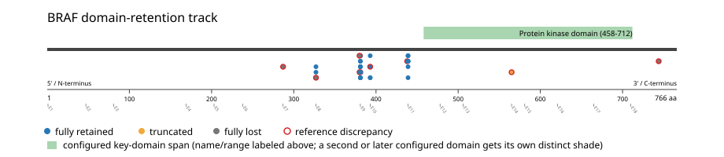
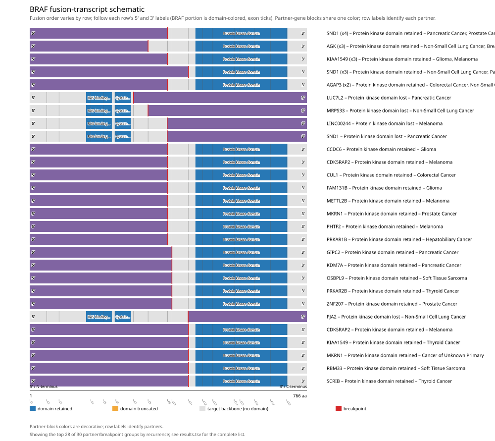
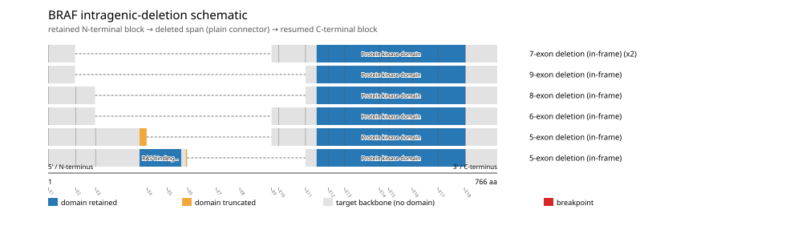
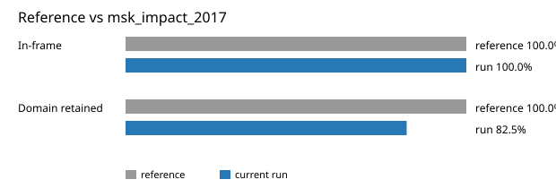

# BRAF real-data fusion benchmark: msk_impact_2017

Retrieved from public cBioPortal and Genome Nexus on 2026-10-29.

## Results

- Structural variants returned for BRAF: 48
- Protein-fusion records found: 41
- Protein-fusion records mapped: 40
- Malformed/unmappable fusion records skipped: 1
- In-frame among known-frame events: 33/33 (100.0%)
- Unknown frame status: 7/40
- Protein kinase domain (458-712 aa) retained: 33/40 (82.5%)
- In-frame and Protein kinase domain-retained: 31/33
- Fisher exact test (one-sided): odds ratio 38.75, p=0.00060718
- Breakpoint-permutation empirical p-value: 0.001998
- Contingency table `[[retained/in-frame, retained/other], [not-retained/in-frame, not-retained/other]]`: `[[31, 2], [2, 5]]`

The Protein kinase domain appears to be required for retention.
The RAS-binding domain and Cysteine-rich domain appear to require loss or disruption rather than retention.

- BRAF fusions are not significantly associated with BRAF point_mutation (V600E) across 10945 cohort samples and tend toward mutual exclusivity with it (2x2 table [[1, 40], [294, 10610]]; odds ratio 0.902, Fisher's exact two-sided p=1).

### Mechanistic interpretation

**Curated mechanism:** Loss-of-autoinhibition, not a novel gain-of-function. Full-length BRAF is held inactive by an intramolecular clamp: CR1 (the RAS-binding and cysteine-rich domains) together with CR2 (containing the S365 14-3-3 docking site) restrain the CR3 kinase domain until active RAS displaces them. The KIAA1549::BRAF fusion deletes CR1 and CR2 while preserving CR3 (exons 11-18) intact, leaving a pre-activated kinase that homodimerizes and signals to MEK/ERK independently of upstream RAS -- the same RAS-independent, dimer-dependent ("class II") activation state as BRAF V600E, reached structurally instead of by point mutation. The truncation itself is sufficient: unlike EML4-ALK-style fusions, BRAF fusions do not require a dimerization motif from the partner -- at least eight structurally unrelated 5' partners are interchangeable, consistent with the partner's role being deletion of the regulatory region rather than supplying a dimerization domain of its own.

**Protein kinase domain retention:** nominal Fisher support (nominal p=0.00060718, odds ratio=38.75; FDR not assessed), but 2/33 in-frame events (6.1%) show the opposite status.

Spread across distinct partner genes with no partner recurring 2+ times among them. The descriptive recurrence threshold is unmet; this does not establish that these events are passengers or background noise.

| Event | Sample | Partner | Breakpoint (aa) | Status |
|---|---|---|---:|---|
| EVT-P-0003502-T01-IM5-19 | P-0003502-T01-IM5 | PJA2 | 438 | lost |
| EVT-P-0002197-T01-IM3-44 | P-0002197-T01-IM3 | SND1 | 380 | lost |

**RAS-binding domain disruption:** nominal Fisher support (nominal p=0.0049969, odds ratio=20.6667; FDR not assessed), but 2/33 in-frame events (6.1%) show the opposite status.

Spread across distinct partner genes with no partner recurring 2+ times among them. The descriptive recurrence threshold is unmet; this does not establish that these events are passengers or background noise.

| Event | Sample | Partner | Breakpoint (aa) | Status |
|---|---|---|---:|---|
| EVT-P-0003502-T01-IM5-19 | P-0003502-T01-IM5 | PJA2 | 438 | retained |
| EVT-P-0002197-T01-IM3-44 | P-0002197-T01-IM3 | SND1 | 380 | retained |

### Domain retention and discrepancies

*Domain-retention positions for analyzed fusion events; red outlines mark reference discrepancies.*

### Fusion-transcript schematic

*One row per recurrent partner/breakpoint group, sharing one amino-acid x-axis for BRAF's full protein length; the partner-contributed portion is colored per partner, the retained target-gene portion is colored by domain-retention status, and a red line marks the breakpoint.*

### Intragenic-deletion schematic

*Same-gene (Site1==Site2==BRAF) intragenic-deletion-style SV records: a retained N-terminal block, a plain connector line for the deleted span, and a resumed C-terminal block.*

## Method

The cBioPortal `msk_impact_2017_structural_variants` structural-variant profile was queried by the configured Entrez gene ID. Fusion-annotated records were adapted to the production SV schema and normalized; when `site2EffectOnFrame=NA`, frame status was resolved from `Event_Info`, not copied into `FusionEvent.Frame_status`.

BRAF genomic breakpoints were mapped against the Genome Nexus canonical transcript, and retention was classified against its returned Protein kinase domain coordinates. Counts are event-level with no patient deduplication. In-frame percentage uses only events explicitly called in-frame or out-of-frame; unknown-frame events are reported separately and excluded from that denominator. The Fisher comparison's `other` column combines out-of-frame and unknown-frame events, as pre-specified by the domain-retention algorithm.

For each fusion, breakpoint selection preferred the Genome Nexus canonical transcript's exon-spanned target locus over cBioPortal site labels; malformed rows with no unambiguous target-locus coordinate were skipped and listed in Warnings.

## Full-suite highlights

- Registered algorithms executed: composite_score, confidence_stats, cutpoint_detection, domain_disruption, domain_retention, exon_retention, expression_association, frequency, genomic_position_recurrence, joint_partner, junction_concentration, mechanistic_interpretation, mutation_cooccurrence, window_detection
- Cutpoint detection (descriptive): inferred breakpoint 380 aa (exon 8); label-permutation p=0.016983, not a selection test.
- Genomic-position recurrence: The 2 events sharing protein position 380 aa use 2 distinct genomic positions spanning 4081 bp -- the protein-position recurrence is broader than any single genomic hotspot, consistent with independent intronic breakpoints mapped (or clamped) onto the same protein/exon boundary rather than one shared DNA lesion.
- Top composite score: SND1 (8 events), 0.379292.
- Expression association: No mRNA expression data was available for BRAF in this cohort; expression-association analysis was skipped.

## Partners

AGAP3 (2), AGK (3), CCDC6 (1), CDK5RAP2 (2), CUL1 (1), FAM131B (1), GIPC2 (1), KDM7A (1), KIAA1549 (4), LINC00244 (1), LUC7L2 (1), METTL2B (1), MKRN1 (3), MRPS33 (1), OSBPL9 (1), PARP12 (1), PHTF2 (1), PJA2 (1), PRKAR1B (1), PRKAR2B (1), RBM33 (1), SCRIB (1), SND1 (8), VIPR2 (1), ZNF207 (1)

## Warnings

- Skipped EVT-P-0010083-T01-IM5-35 (PARP12-BRAF): ValueError: BRAF fusion has no site breakpoint within target locus 140434279-140624564: Site1=-1, Site2=-1

## Reference comparison

| Metric | PMC5461196 | This run |
|---|---:|---:|
| In-frame | 100.0% | 100.0% |
| Domain retained | 100.0% | 82.5% |

*Published reference percentages compared with this run.*

## Interpretation

These values describe the live study named above.
