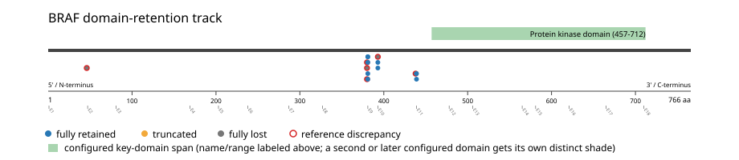
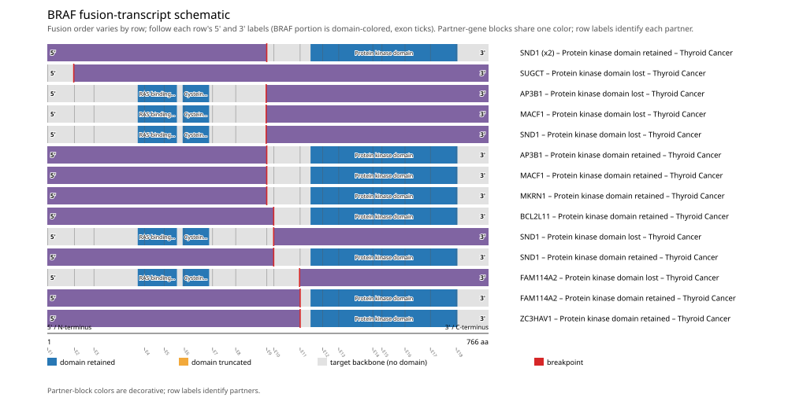
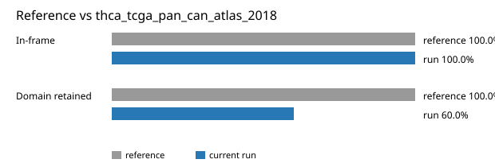

# BRAF real-data fusion benchmark: thca_tcga_pan_can_atlas_2018

Retrieved from public cBioPortal and Genome Nexus on 2026-10-29.

## Results

- Structural variants returned for BRAF: 15
- Protein-fusion records found: 15
- Protein-fusion records mapped: 15
- Malformed/unmappable fusion records skipped: 0
- In-frame among known-frame events: 15/15 (100.0%)
- Unknown frame status: 0/15
- Protein kinase domain (457-712 aa) retained: 9/15 (60.0%)
- In-frame and Protein kinase domain-retained: 9/15
- Fisher exact test (one-sided): odds ratio unavailable, p=1
- Breakpoint-permutation empirical p-value: 0.100899
- Contingency table `[[retained/in-frame, retained/other], [not-retained/in-frame, not-retained/other]]`: `[[8, 0], [2, 0]]`

- Mutation/CNA co-occurrence: not computed (No jointly assessed samples for BRAF point_mutation (V600E); skipped.)

### Mechanistic interpretation

**Curated mechanism:** Loss-of-autoinhibition, not a novel gain-of-function. Full-length BRAF is held inactive by an intramolecular clamp: CR1 (the RAS-binding and cysteine-rich domains) together with CR2 (containing the S365 14-3-3 docking site) restrain the CR3 kinase domain until active RAS displaces them. The KIAA1549::BRAF fusion deletes CR1 and CR2 while preserving CR3 (exons 11-18) intact, leaving a pre-activated kinase that homodimerizes and signals to MEK/ERK independently of upstream RAS -- the same RAS-independent, dimer-dependent ("class II") activation state as BRAF V600E, reached structurally instead of by point mutation. The truncation itself is sufficient: unlike EML4-ALK-style fusions, BRAF fusions do not require a dimerization motif from the partner -- at least eight structurally unrelated 5' partners are interchangeable, consistent with the partner's role being deletion of the regulatory region rather than supplying a dimerization domain of its own.

**Protein kinase domain retention:** nominal support not established (nominal p=1, odds ratio=unavailable; FDR not assessed). No counter-pattern classification was made.

**RAS-binding domain disruption:** nominal support not established (nominal p=1, odds ratio=unavailable; FDR not assessed). No counter-pattern classification was made.

### Domain retention and discrepancies

*Domain-retention positions for analyzed fusion events; red outlines mark reference discrepancies.*

### Fusion-transcript schematic

*One row per recurrent partner/breakpoint group, sharing one amino-acid x-axis for BRAF's full protein length; the partner-contributed portion is colored per partner, the retained target-gene portion is colored by domain-retention status, and a red line marks the breakpoint.*

## Method

The cBioPortal `thca_tcga_pan_can_atlas_2018_structural_variants` structural-variant profile was queried by the configured Entrez gene ID. Fusion-annotated records were adapted to the production SV schema and normalized; when `site2EffectOnFrame=NA`, frame status was resolved from `Event_Info`, not copied into `FusionEvent.Frame_status`.

BRAF genomic breakpoints were mapped against the Genome Nexus canonical transcript, and retention was classified against its returned Protein kinase domain coordinates. Counts are event-level with no patient deduplication. In-frame percentage uses only events explicitly called in-frame or out-of-frame; unknown-frame events are reported separately and excluded from that denominator. The Fisher comparison's `other` column combines out-of-frame and unknown-frame events, as pre-specified by the domain-retention algorithm.

For each fusion, breakpoint selection preferred the Genome Nexus canonical transcript's exon-spanned target locus over cBioPortal site labels; malformed rows with no unambiguous target-locus coordinate were skipped and listed in Warnings.

## Full-suite highlights

- Registered algorithms executed: composite_score, confidence_stats, cutpoint_detection, domain_disruption, domain_retention, exon_retention, expression_association, frequency, genomic_position_recurrence, joint_partner, junction_concentration, mechanistic_interpretation, mutation_cooccurrence, window_detection
- Cutpoint detection (descriptive): inferred breakpoint 380 aa (exon 8); label-permutation p=0.346653, not a selection test.
- Genomic-position recurrence: All 5 events sharing protein position 381 aa share the exact same genomic breakpoint -- consistent with a real DNA-level recurrent breakpoint, not just a protein-coordinate coincidence.
- Top composite score: SND1 (5 events), 0.228417.
- Expression association: Among fusion-positive samples, BRAF expression is not significantly higher in kinase-domain-retained fusions (n=8) than not-retained fusions (n=2) (mann_whitney_u, p=0.533).

## Partners

AP3B1 (2), BCL2L11 (1), FAM114A2 (2), MACF1 (2), MKRN1 (1), SND1 (5), SUGCT (1), ZC3HAV1 (1)

## Warnings

- BRAF point_mutation: 500 cohort samples excluded because joint gene/assay coverage was not established.
- Kept one of several distinct BRAF fusions in 5 patient(s), dropping 5 so each patient counts once in inferential tests.
- Expression comparison: 498 measured samples excluded from the fusion-positive/negative denominator because SV gene coverage was not established.

## Reference comparison

| Metric | PMC5461196 | This run |
|---|---:|---:|
| In-frame | 100.0% | 100.0% |
| Domain retained | 100.0% | 60.0% |

*Published reference percentages compared with this run.*

## Interpretation

These values describe the live study named above.
