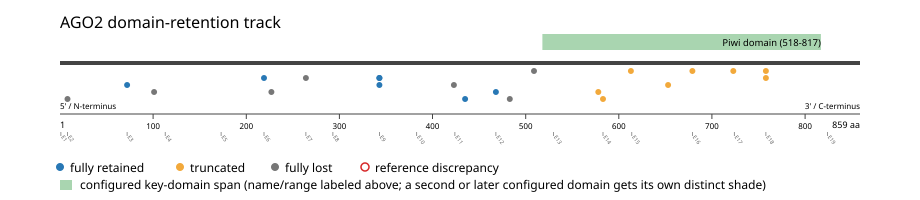
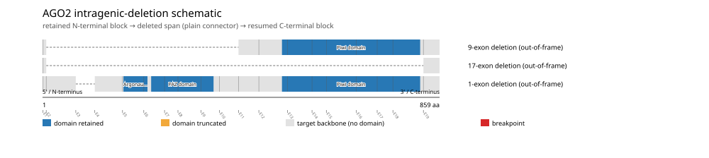

# AGO2 real-data fusion benchmark: msk_impact_50k_2026

Retrieved from public cBioPortal and Genome Nexus on 2026-10-26.

## Results

- Structural variants returned for AGO2: 49
- Protein-fusion records found: 23
- Protein-fusion records mapped: 22
- Malformed/unmappable fusion records skipped: 1
- In-frame among known-frame events: 6/13 (46.2%)
- Unknown frame status: 9/22
- Piwi domain (518-817 aa) retained: 7/22 (31.8%)
- In-frame and Piwi domain-retained: 3/6
- Fisher exact test (one-sided): odds ratio 3.66667, p=0.225232
- Breakpoint-permutation empirical p-value: 0.841584
- Contingency table `[[retained/in-frame, retained/other], [not-retained/in-frame, not-retained/other]]`: `[[3, 3], [3, 11]]`

- Mutation/CNA co-occurrence: not computed (AGO2 has no mutual_exclusivity_targets configured; co-occurrence/mutual-exclusivity analysis was skipped.)

### Mechanistic interpretation

**Piwi domain retention:** nominal support not established (nominal p=0.225232, odds ratio=3.66667; q=1; does not pass FDR). No counter-pattern classification was made.

**Argonaute linker 1 domain disruption:** nominal support not established (nominal p=0.314241, odds ratio=2.66667; q=1; does not pass FDR). No counter-pattern classification was made.

### Domain retention and discrepancies

*Domain-retention positions for analyzed fusion events; red outlines mark reference discrepancies.*

### Fusion-transcript schematic

*One row per recurrent partner/breakpoint group, sharing one amino-acid x-axis for AGO2's full protein length; the partner-contributed portion is colored per partner, the retained target-gene portion is colored by domain-retention status, and a red line marks the breakpoint.*

### Intragenic-deletion schematic

*Same-gene (Site1==Site2==AGO2) intragenic-deletion-style SV records: a retained N-terminal block, a plain connector line for the deleted span, and a resumed C-terminal block.*

## Method

The cBioPortal `msk_impact_50k_2026_structural_variants` structural-variant profile was queried by the configured Entrez gene ID. Fusion-annotated records were adapted to the production SV schema and normalized; when `site2EffectOnFrame=NA`, frame status was resolved from `Event_Info`, not copied into `FusionEvent.Frame_status`.

AGO2 genomic breakpoints were mapped against the Genome Nexus canonical transcript, and retention was classified against its returned Piwi domain coordinates. Counts are event-level with no patient deduplication. In-frame percentage uses only events explicitly called in-frame or out-of-frame; unknown-frame events are reported separately and excluded from that denominator. The Fisher comparison's `other` column combines out-of-frame and unknown-frame events, as pre-specified by the domain-retention algorithm.

For each fusion, breakpoint selection preferred the Genome Nexus canonical transcript's exon-spanned target locus over cBioPortal site labels; malformed rows with no unambiguous target-locus coordinate were skipped and listed in Warnings.

## Full-suite highlights

- Registered algorithms executed: composite_score, confidence_stats, cutpoint_detection, domain_disruption, domain_retention, exon_retention, expression_association, frequency, genomic_position_recurrence, joint_partner, junction_concentration, mechanistic_interpretation, mutation_cooccurrence, window_detection
- Cutpoint detection (descriptive): inferred breakpoint 468 aa (exon 11/12 boundary); label-permutation p=0.0559441, not a selection test.
- Genomic-position recurrence: The 2 events sharing protein position 343 aa use 2 distinct genomic positions spanning 151 bp -- the protein-position recurrence is broader than any single genomic hotspot, consistent with independent intronic breakpoints mapped (or clamped) onto the same protein/exon boundary rather than one shared DNA lesion.
- Top composite score: TRAPPC9 (12 events), 0.251827.
- Expression association: No mRNA expression data was available for AGO2 in this cohort; expression-association analysis was skipped.

## Partners

COL22A1 (1), FER1L6 (1), MRPL48 (1), POLB (1), PTK2 (5), SAMD12 (1), SLX4 (1), TRAPPC9 (12)

## Warnings

- Skipped EVT-P-0015476-T01-IM6-38 (SLX4-AGO2): ValueError: could not determine 5'/3' role for AGO2 in EVT-P-0015476-T01-IM6-38; Event_Info='Protein fusion: out of frame (EIF2C2-BTBD12)'
- Collapsed 2 repeated observation(s) of the same fusion in 2 patient(s) before inferential tests (observation_unit='patient_gene').

## Interpretation

These values describe the live study named above.
