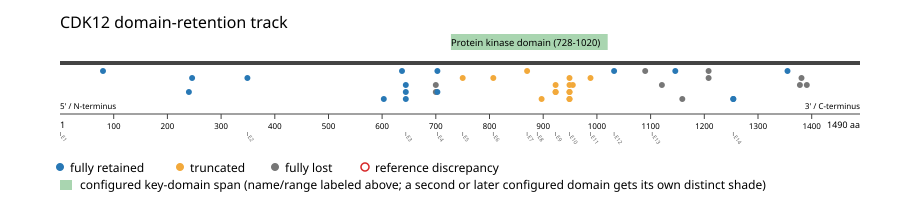

# CDK12 real-data fusion benchmark: msk_impact_50k_2026

Retrieved from public cBioPortal and Genome Nexus on 2026-10-26.

## Results

- Structural variants returned for CDK12: 101
- Protein-fusion records found: 43
- Protein-fusion records mapped: 41
- Malformed/unmappable fusion records skipped: 2
- In-frame among known-frame events: 7/14 (50.0%)
- Unknown frame status: 27/41
- Protein kinase domain (728-1020 aa) retained: 16/41 (39.0%)
- In-frame and Protein kinase domain-retained: 5/7
- Fisher exact test (one-sided): odds ratio 3.6, p=0.17342
- Breakpoint-permutation empirical p-value: 0.108911
- Contingency table `[[retained/in-frame, retained/other], [not-retained/in-frame, not-retained/other]]`: `[[4, 10], [2, 18]]`

- Mutation/CNA co-occurrence: not computed (CDK12 has no mutual_exclusivity_targets configured; co-occurrence/mutual-exclusivity analysis was skipped.)

### Mechanistic interpretation

**Protein kinase domain retention:** nominal support not established (nominal p=0.17342, odds ratio=3.6; q=1; does not pass FDR). No counter-pattern classification was made.

### Domain retention and discrepancies

*Domain-retention positions for analyzed fusion events; red outlines mark reference discrepancies.*

### Fusion-transcript schematic

*One row per recurrent partner/breakpoint group, sharing one amino-acid x-axis for CDK12's full protein length; the partner-contributed portion is colored per partner, the retained target-gene portion is colored by domain-retention status, and a red line marks the breakpoint.*

## Method

The cBioPortal `msk_impact_50k_2026_structural_variants` structural-variant profile was queried by the configured Entrez gene ID. Fusion-annotated records were adapted to the production SV schema and normalized; when `site2EffectOnFrame=NA`, frame status was resolved from `Event_Info`, not copied into `FusionEvent.Frame_status`.

CDK12 genomic breakpoints were mapped against the Genome Nexus canonical transcript, and retention was classified against its returned Protein kinase domain coordinates. Counts are event-level with no patient deduplication. In-frame percentage uses only events explicitly called in-frame or out-of-frame; unknown-frame events are reported separately and excluded from that denominator. The Fisher comparison's `other` column combines out-of-frame and unknown-frame events, as pre-specified by the domain-retention algorithm.

For each fusion, breakpoint selection preferred the Genome Nexus canonical transcript's exon-spanned target locus over cBioPortal site labels; malformed rows with no unambiguous target-locus coordinate were skipped and listed in Warnings.

## Full-suite highlights

- Registered algorithms executed: composite_score, confidence_stats, cutpoint_detection, domain_disruption, domain_retention, exon_retention, expression_association, frequency, genomic_position_recurrence, joint_partner, junction_concentration, mechanistic_interpretation, mutation_cooccurrence, window_detection
- Cutpoint detection (descriptive): inferred breakpoint 644 aa (exon 2/3 boundary); label-permutation p=0.002997, not a selection test.
- Genomic-position recurrence: The 2 events sharing protein position 644 aa use 2 distinct genomic positions spanning 6628 bp -- the protein-position recurrence is broader than any single genomic hotspot, consistent with independent intronic breakpoints mapped (or clamped) onto the same protein/exon boundary rather than one shared DNA lesion.
- Top composite score: ADCY9 (2 events), 0.287403.
- Expression association: No mRNA expression data was available for CDK12 in this cohort; expression-association analysis was skipped.

## Partners

ADCY9 (2), AKAP8L (1), ANKFN1 (1), CACNA1G (1), COLEC12 (1), CSF3 (1), ERBB2 (3), FAM222B (1), FBXL20 (6), FGFR4 (1), GRB7 (1), HTR1E (2), IGFBP4 (1), IKZF3 (2), MAP3K3 (2), MED13 (1), MTRES1 (1), ODAD4 (1), RECQL4 (1), RPS6KB1 (1), SEC31A (1), SKAP1 (1), SNF8 (1), SPON1 (1), STAT5B (4), SYNRG (1), TBKBP1 (1), USP6 (1), VMP1 (1)

## Warnings

- Skipped EVT-P-0034157-T01-IM6-60 (CDK12-MAP3K3): ValueError: could not determine 5'/3' role for CDK12 in EVT-P-0034157-T01-IM6-60; Event_Info='Antisense Fusion'
- Skipped EVT-P-0034157-T02-IM6-61 (CDK12-MAP3K3): ValueError: could not determine 5'/3' role for CDK12 in EVT-P-0034157-T02-IM6-61; Event_Info='Antisense Fusion'
- Collapsed 5 repeated observation(s) of the same fusion in 3 patient(s) before inferential tests (observation_unit='patient_gene').
- Kept one of several distinct CDK12 fusions in 2 patient(s), dropping 2 so each patient counts once in inferential tests.

## Interpretation

These values describe the live study named above.
