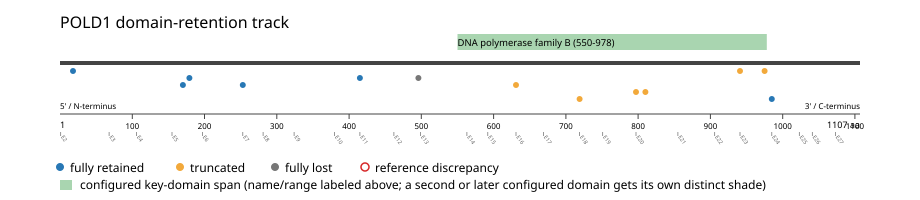
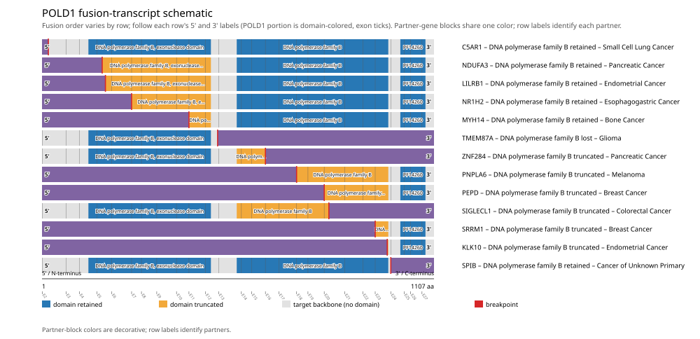
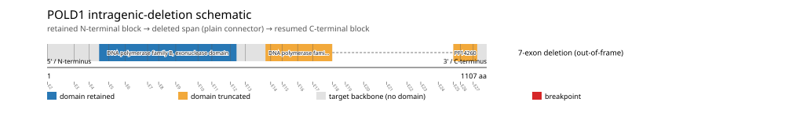

# POLD1 real-data fusion benchmark: msk_impact_50k_2026

Retrieved from public cBioPortal and Genome Nexus on 2026-10-26.

## Results

- Structural variants returned for POLD1: 37
- Protein-fusion records found: 16
- Protein-fusion records mapped: 13
- Malformed/unmappable fusion records skipped: 3
- In-frame among known-frame events: 2/6 (33.3%)
- Unknown frame status: 7/13
- DNA polymerase family B (550-978 aa) retained: 6/13 (46.2%)
- In-frame and DNA polymerase family B-retained: 2/2
- Fisher exact test (one-sided): odds ratio unavailable, p=0.192308
- Breakpoint-permutation empirical p-value: 0.031968
- Contingency table `[[retained/in-frame, retained/other], [not-retained/in-frame, not-retained/other]]`: `[[2, 4], [0, 7]]`

- Mutation/CNA co-occurrence: not computed (POLD1 has no mutual_exclusivity_targets configured; co-occurrence/mutual-exclusivity analysis was skipped.)

### Mechanistic interpretation

**DNA polymerase family B retention:** nominal support not established (nominal p=0.192308, odds ratio=unavailable; q=1; does not pass FDR). No counter-pattern classification was made.

**DNA polymerase family B, exonuclease domain disruption:** nominal support not established (nominal p=0.871795, odds ratio=0.571429; q=1; does not pass FDR). No counter-pattern classification was made.

### Domain retention and discrepancies

*Domain-retention positions for analyzed fusion events; red outlines mark reference discrepancies.*

### Fusion-transcript schematic

*One row per recurrent partner/breakpoint group, sharing one amino-acid x-axis for POLD1's full protein length; the partner-contributed portion is colored per partner, the retained target-gene portion is colored by domain-retention status, and a red line marks the breakpoint.*

### Intragenic-deletion schematic

*Same-gene (Site1==Site2==POLD1) intragenic-deletion-style SV records: a retained N-terminal block, a plain connector line for the deleted span, and a resumed C-terminal block.*

## Method

The cBioPortal `msk_impact_50k_2026_structural_variants` structural-variant profile was queried by the configured Entrez gene ID. Fusion-annotated records were adapted to the production SV schema and normalized; when `site2EffectOnFrame=NA`, frame status was resolved from `Event_Info`, not copied into `FusionEvent.Frame_status`.

POLD1 genomic breakpoints were mapped against the Genome Nexus canonical transcript, and retention was classified against its returned DNA polymerase family B coordinates. Counts are event-level with no patient deduplication. In-frame percentage uses only events explicitly called in-frame or out-of-frame; unknown-frame events are reported separately and excluded from that denominator. The Fisher comparison's `other` column combines out-of-frame and unknown-frame events, as pre-specified by the domain-retention algorithm.

For each fusion, breakpoint selection preferred the Genome Nexus canonical transcript's exon-spanned target locus over cBioPortal site labels; malformed rows with no unambiguous target-locus coordinate were skipped and listed in Warnings.

## Full-suite highlights

- Registered algorithms executed: composite_score, confidence_stats, cutpoint_detection, domain_disruption, domain_retention, exon_retention, expression_association, frequency, genomic_position_recurrence, joint_partner, junction_concentration, mechanistic_interpretation, mutation_cooccurrence, window_detection
- Cutpoint detection (descriptive): inferred breakpoint 415 aa (exon 11); label-permutation p=0.010989, not a selection test.
- Genomic-position recurrence: No protein-junction position was shared by two or more events with a known genomic breakpoint, so genomic-vs-protein clustering could not be compared.
- Top composite score: MYH14 (2 events), 0.262289.
- Expression association: No mRNA expression data was available for POLD1 in this cohort; expression-association analysis was skipped.

## Partners

ADAMTSL1 (1), C5AR1 (1), CIC (1), KLK10 (1), LILRB1 (1), MYH14 (2), NDUFA3 (1), NR1H2 (1), PEPD (1), PNPLA6 (1), SIGLECL1 (1), SPIB (1), SRRM1 (1), TMEM87A (1), ZNF284 (1)

## Warnings

- Skipped EVT-P-0005493-T01-IM5-2 (CIC-POLD1): ValueError: could not determine 5'/3' role for POLD1 in EVT-P-0005493-T01-IM5-2; Event_Info='Antisense fusion'
- Skipped EVT-P-0005034-T01-IM5-3 (MYH14-POLD1): ValueError: could not determine 5'/3' role for POLD1 in EVT-P-0005034-T01-IM5-3; Event_Info='Antisense fusion'
- Skipped EVT-P-0019280-T01-IM6-8 (POLD1-ADAMTSL1): ValueError: could not determine 5'/3' role for POLD1 in EVT-P-0019280-T01-IM6-8; Event_Info='Antisense Fusion'

## Interpretation

These values describe the live study named above.
