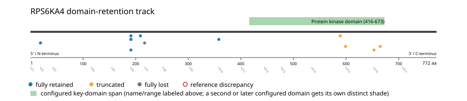

# RPS6KA4 real-data fusion benchmark: msk_impact_50k_2026

Retrieved from public cBioPortal and Genome Nexus on 2026-10-26.

## Results

- Structural variants returned for RPS6KA4: 22
- Protein-fusion records found: 13
- Protein-fusion records mapped: 12
- Malformed/unmappable fusion records skipped: 1
- In-frame among known-frame events: 5/8 (62.5%)
- Unknown frame status: 4/12
- Protein kinase domain (416-673 aa) retained: 7/12 (58.3%)
- In-frame and Protein kinase domain-retained: 4/5
- Fisher exact test (one-sided): odds ratio 6, p=0.261905
- Breakpoint-permutation empirical p-value: 0.415842
- Contingency table `[[retained/in-frame, retained/other], [not-retained/in-frame, not-retained/other]]`: `[[3, 2], [1, 4]]`

- Mutation/CNA co-occurrence: not computed (RPS6KA4 has no mutual_exclusivity_targets configured; co-occurrence/mutual-exclusivity analysis was skipped.)

### Mechanistic interpretation

**Protein kinase domain retention:** nominal support not established (nominal p=0.261905, odds ratio=6; q=1; does not pass FDR). No counter-pattern classification was made.

**Protein kinase domain disruption:** nominal support not established (nominal p=0.97619, odds ratio=0.166667; q=1; does not pass FDR). No counter-pattern classification was made.

### Domain retention and discrepancies

*Domain-retention positions for analyzed fusion events; red outlines mark reference discrepancies.*

### Fusion-transcript schematic

*One row per recurrent partner/breakpoint group, sharing one amino-acid x-axis for RPS6KA4's full protein length; the partner-contributed portion is colored per partner, the retained target-gene portion is colored by domain-retention status, and a red line marks the breakpoint.*

## Method

The cBioPortal `msk_impact_50k_2026_structural_variants` structural-variant profile was queried by the configured Entrez gene ID. Fusion-annotated records were adapted to the production SV schema and normalized; when `site2EffectOnFrame=NA`, frame status was resolved from `Event_Info`, not copied into `FusionEvent.Frame_status`.

RPS6KA4 genomic breakpoints were mapped against the Genome Nexus canonical transcript, and retention was classified against its returned Protein kinase domain coordinates. Counts are event-level with no patient deduplication. In-frame percentage uses only events explicitly called in-frame or out-of-frame; unknown-frame events are reported separately and excluded from that denominator. The Fisher comparison's `other` column combines out-of-frame and unknown-frame events, as pre-specified by the domain-retention algorithm.

For each fusion, breakpoint selection preferred the Genome Nexus canonical transcript's exon-spanned target locus over cBioPortal site labels; malformed rows with no unambiguous target-locus coordinate were skipped and listed in Warnings.

## Full-suite highlights

- Registered algorithms executed: composite_score, confidence_stats, cutpoint_detection, domain_disruption, domain_retention, exon_retention, expression_association, frequency, genomic_position_recurrence, joint_partner, junction_concentration, mechanistic_interpretation, mutation_cooccurrence, window_detection
- Cutpoint detection (descriptive): inferred breakpoint 209 aa (exon 6); label-permutation p=0.0719281, not a selection test.
- Genomic-position recurrence: The 2 events sharing protein position 191 aa use 2 distinct genomic positions spanning 2 bp -- the protein-position recurrence is broader than any single genomic hotspot, consistent with independent intronic breakpoints mapped (or clamped) onto the same protein/exon boundary rather than one shared DNA lesion.
- Top composite score: BAD (2 events), 0.102014.
- Expression association: No mRNA expression data was available for RPS6KA4 in this cohort; expression-association analysis was skipped.

## Partners

BAD (2), DOCK2 (1), EEFSEC (1), FERMT3 (1), GPR137 (1), MACROD1 (1), MARK2 (1), PLEKHA7 (1), RPLP0P2 (1), SLC22A9 (1), STIP1 (1), TTYH2 (1)

## Warnings

- Skipped EVT-P-0009813-T01-IM5-9 (RPLP0P2-RPS6KA4): ValueError: could not determine 5'/3' role for RPS6KA4 in EVT-P-0009813-T01-IM5-9; Event_Info='Antisense fusion'
- Collapsed 1 repeated observation(s) of the same fusion in 1 patient(s) before inferential tests (observation_unit='patient_gene').
- Kept one of several distinct RPS6KA4 fusions in 1 patient(s), dropping 1 so each patient counts once in inferential tests.

## Interpretation

These values describe the live study named above.
