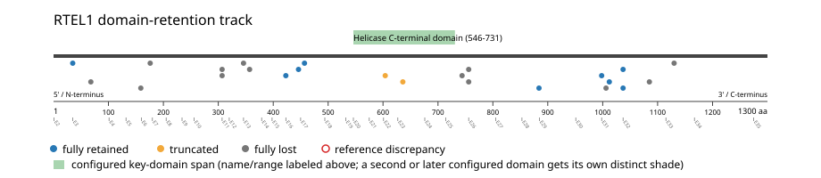
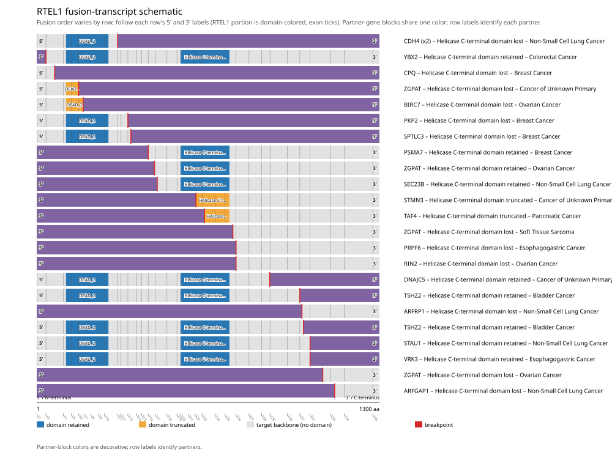
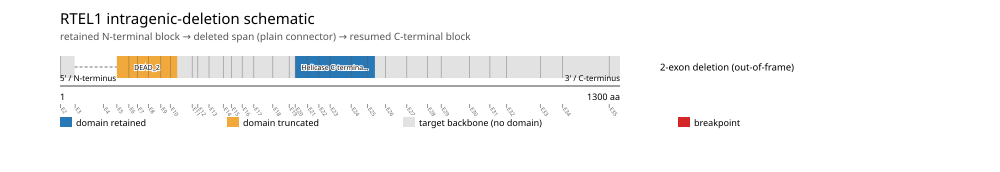

# RTEL1 real-data fusion benchmark: msk_impact_50k_2026

Retrieved from public cBioPortal and Genome Nexus on 2026-10-26.

## Results

- Structural variants returned for RTEL1: 57
- Protein-fusion records found: 24
- Protein-fusion records mapped: 24
- Malformed/unmappable fusion records skipped: 0
- In-frame among known-frame events: 5/10 (50.0%)
- Unknown frame status: 14/24
- Helicase C-terminal domain (546-731 aa) retained: 9/24 (37.5%)
- In-frame and Helicase C-terminal domain-retained: 3/5
- Fisher exact test (one-sided): odds ratio 7.8, p=0.116746
- Breakpoint-permutation empirical p-value: 0.0609391
- Contingency table `[[retained/in-frame, retained/other], [not-retained/in-frame, not-retained/other]]`: `[[3, 5], [1, 13]]`

- Mutation/CNA co-occurrence: not computed (RTEL1 has no mutual_exclusivity_targets configured; co-occurrence/mutual-exclusivity analysis was skipped.)

### Mechanistic interpretation

**Helicase C-terminal domain retention:** nominal support not established (nominal p=0.116746, odds ratio=7.8; q=1; does not pass FDR). No counter-pattern classification was made.

**DEAD_2 disruption:** nominal support not established (nominal p=0.990431, odds ratio=0.128205; q=1; does not pass FDR). No counter-pattern classification was made.

### Domain retention and discrepancies

*Domain-retention positions for analyzed fusion events; red outlines mark reference discrepancies.*

### Fusion-transcript schematic

*One row per recurrent partner/breakpoint group, sharing one amino-acid x-axis for RTEL1's full protein length; the partner-contributed portion is colored per partner, the retained target-gene portion is colored by domain-retention status, and a red line marks the breakpoint.*

### Intragenic-deletion schematic

*Same-gene (Site1==Site2==RTEL1) intragenic-deletion-style SV records: a retained N-terminal block, a plain connector line for the deleted span, and a resumed C-terminal block.*

## Method

The cBioPortal `msk_impact_50k_2026_structural_variants` structural-variant profile was queried by the configured Entrez gene ID. Fusion-annotated records were adapted to the production SV schema and normalized; when `site2EffectOnFrame=NA`, frame status was resolved from `Event_Info`, not copied into `FusionEvent.Frame_status`.

RTEL1 genomic breakpoints were mapped against the Genome Nexus canonical transcript, and retention was classified against its returned Helicase C-terminal domain coordinates. Counts are event-level with no patient deduplication. In-frame percentage uses only events explicitly called in-frame or out-of-frame; unknown-frame events are reported separately and excluded from that denominator. The Fisher comparison's `other` column combines out-of-frame and unknown-frame events, as pre-specified by the domain-retention algorithm.

For each fusion, breakpoint selection preferred the Genome Nexus canonical transcript's exon-spanned target locus over cBioPortal site labels; malformed rows with no unambiguous target-locus coordinate were skipped and listed in Warnings.

## Full-suite highlights

- Registered algorithms executed: composite_score, confidence_stats, cutpoint_detection, domain_disruption, domain_retention, exon_retention, expression_association, frequency, genomic_position_recurrence, joint_partner, junction_concentration, mechanistic_interpretation, mutation_cooccurrence, window_detection
- Cutpoint detection (descriptive): inferred breakpoint 357 aa (exon 13); label-permutation p=0.653347, not a selection test.
- Genomic-position recurrence: The 2 events sharing protein position 756 aa use 2 distinct genomic positions spanning 68 bp -- the protein-position recurrence is broader than any single genomic hotspot, consistent with independent intronic breakpoints mapped (or clamped) onto the same protein/exon boundary rather than one shared DNA lesion.
- Top composite score: ZGPAT (4 events), 0.139458.
- Expression association: No mRNA expression data was available for RTEL1 in this cohort; expression-association analysis was skipped.

## Partners

ARFGAP1 (1), ARFRP1 (1), BIRC7 (1), CDH4 (2), CPQ (1), DNAJC5 (1), PKP2 (1), PRPF6 (1), PSMA7 (1), RIN2 (1), SEC23B (1), SPTLC3 (1), STAU1 (1), STMN3 (1), TAF4 (1), TSHZ2 (2), VRK3 (1), YBX2 (1), ZGPAT (4)

## Warnings

- Collapsed 1 repeated observation(s) of the same fusion in 1 patient(s) before inferential tests (observation_unit='patient_gene').
- Kept one of several distinct RTEL1 fusions in 1 patient(s), dropping 1 so each patient counts once in inferential tests.

## Interpretation

These values describe the live study named above.
