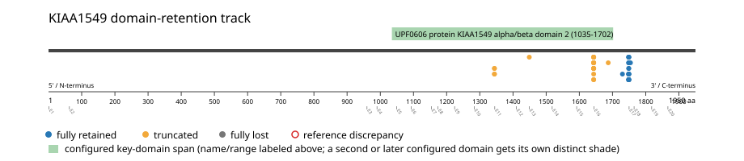

# KIAA1549 real-data fusion benchmark: msk_impact_50k_2026

Retrieved from public cBioPortal and Genome Nexus on 2026-10-29.

## Results

- Structural variants returned for KIAA1549: 44
- Protein-fusion records found: 44
- Protein-fusion records mapped: 44
- Malformed/unmappable fusion records skipped: 0
- In-frame among known-frame events: 40/41 (97.6%)
- Unknown frame status: 3/44
- UPF0606 protein KIAA1549 alpha/beta domain 2 (1035-1702 aa) retained: 22/44 (50.0%)
- In-frame and UPF0606 protein KIAA1549 alpha/beta domain 2-retained: 19/40
- Fisher exact test (one-sided): odds ratio 0.352941, p=0.927235
- Breakpoint-permutation empirical p-value: 9.9999e-06
- Contingency table `[[retained/in-frame, retained/other], [not-retained/in-frame, not-retained/other]]`: `[[18, 3], [17, 1]]`

- Mutation/CNA co-occurrence: not computed (KIAA1549 has no mutual_exclusivity_targets configured; co-occurrence/mutual-exclusivity analysis was skipped.)

### Mechanistic interpretation

**UPF0606 protein KIAA1549 alpha/beta domain 2 retention:** nominal support not established (nominal p=0.927235, odds ratio=0.352941; q=1; does not pass FDR). No counter-pattern classification was made.

### Domain retention and discrepancies

*Domain-retention positions for analyzed fusion events; red outlines mark reference discrepancies.*

### Fusion-transcript schematic

*One row per recurrent partner/breakpoint group, sharing one amino-acid x-axis for KIAA1549's full protein length; the partner-contributed portion is colored per partner, the retained target-gene portion is colored by domain-retention status, and a red line marks the breakpoint.*

## Method

The cBioPortal `msk_impact_50k_2026_structural_variants` structural-variant profile was queried by the configured Entrez gene ID. Fusion-annotated records were adapted to the production SV schema and normalized; when `site2EffectOnFrame=NA`, frame status was resolved from `Event_Info`, not copied into `FusionEvent.Frame_status`.

KIAA1549 genomic breakpoints were mapped against the Genome Nexus canonical transcript, and retention was classified against its returned UPF0606 protein KIAA1549 alpha/beta domain 2 coordinates. Counts are event-level with no patient deduplication. In-frame percentage uses only events explicitly called in-frame or out-of-frame; unknown-frame events are reported separately and excluded from that denominator. The Fisher comparison's `other` column combines out-of-frame and unknown-frame events, as pre-specified by the domain-retention algorithm.

For each fusion, breakpoint selection preferred the Genome Nexus canonical transcript's exon-spanned target locus over cBioPortal site labels; malformed rows with no unambiguous target-locus coordinate were skipped and listed in Warnings.

## Full-suite highlights

- Registered algorithms executed: composite_score, confidence_stats, cutpoint_detection, domain_disruption, domain_retention, exon_retention, expression_association, frequency, genomic_position_recurrence, joint_partner, junction_concentration, mechanistic_interpretation, mutation_cooccurrence, window_detection
- Cutpoint detection (descriptive): inferred breakpoint 1687 aa (exon 16); label-permutation p=0.000999001, not a selection test.
- Genomic-position recurrence: The 19 events sharing protein position 1749 aa use 19 distinct genomic positions spanning 8465 bp -- the protein-position recurrence is broader than any single genomic hotspot, consistent with independent intronic breakpoints mapped (or clamped) onto the same protein/exon boundary rather than one shared DNA lesion.
- Top composite score: BRAF (43 events), 0.621393.
- Expression association: No mRNA expression data was available for KIAA1549 in this cohort; expression-association analysis was skipped.

## Partners

BRAF (43), STK11 (1)

## Warnings

- Collapsed 5 repeated observation(s) of the same fusion in 5 patient(s) before inferential tests (observation_unit='patient_gene').

## Interpretation

These values describe the live study named above.
