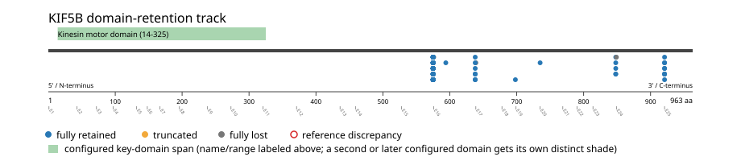
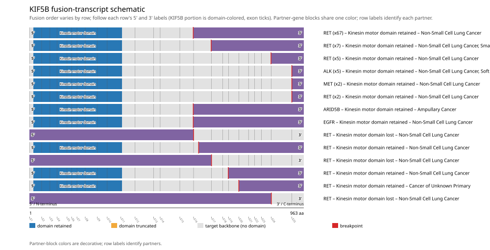

# KIF5B real-data fusion benchmark: msk_impact_50k_2026

Retrieved from public cBioPortal and Genome Nexus on 2026-10-29.

## Results

- Structural variants returned for KIF5B: 96
- Protein-fusion records found: 96
- Protein-fusion records mapped: 96
- Malformed/unmappable fusion records skipped: 0
- In-frame among known-frame events: 85/87 (97.7%)
- Unknown frame status: 9/96
- Kinesin motor domain (14-325 aa) retained: 93/96 (96.9%)
- In-frame and Kinesin motor domain-retained: 83/85
- Fisher exact test (one-sided): odds ratio 4.25, p=0.307781
- Breakpoint-permutation empirical p-value: 9.9999e-06
- Contingency table `[[retained/in-frame, retained/other], [not-retained/in-frame, not-retained/other]]`: `[[68, 8], [2, 1]]`

- Mutation/CNA co-occurrence: not computed (KIF5B has no mutual_exclusivity_targets configured; co-occurrence/mutual-exclusivity analysis was skipped.)

### Mechanistic interpretation

**Kinesin motor domain retention:** nominal support not established (nominal p=0.307781, odds ratio=4.25; q=1; does not pass FDR). No counter-pattern classification was made.

### Domain retention and discrepancies

*Domain-retention positions for analyzed fusion events; red outlines mark reference discrepancies.*

### Fusion-transcript schematic

*One row per recurrent partner/breakpoint group, sharing one amino-acid x-axis for KIF5B's full protein length; the partner-contributed portion is colored per partner, the retained target-gene portion is colored by domain-retention status, and a red line marks the breakpoint.*

## Method

The cBioPortal `msk_impact_50k_2026_structural_variants` structural-variant profile was queried by the configured Entrez gene ID. Fusion-annotated records were adapted to the production SV schema and normalized; when `site2EffectOnFrame=NA`, frame status was resolved from `Event_Info`, not copied into `FusionEvent.Frame_status`.

KIF5B genomic breakpoints were mapped against the Genome Nexus canonical transcript, and retention was classified against its returned Kinesin motor domain coordinates. Counts are event-level with no patient deduplication. In-frame percentage uses only events explicitly called in-frame or out-of-frame; unknown-frame events are reported separately and excluded from that denominator. The Fisher comparison's `other` column combines out-of-frame and unknown-frame events, as pre-specified by the domain-retention algorithm.

For each fusion, breakpoint selection preferred the Genome Nexus canonical transcript's exon-spanned target locus over cBioPortal site labels; malformed rows with no unambiguous target-locus coordinate were skipped and listed in Warnings.

## Full-suite highlights

- Registered algorithms executed: composite_score, confidence_stats, cutpoint_detection, domain_disruption, domain_retention, exon_retention, expression_association, frequency, genomic_position_recurrence, joint_partner, junction_concentration, mechanistic_interpretation, mutation_cooccurrence, window_detection
- Cutpoint detection (descriptive): inferred breakpoint 575 aa (exon 15); label-permutation p=0.022977, not a selection test.
- Genomic-position recurrence: The 56 events sharing protein position 575 aa use 55 distinct genomic positions spanning 4992 bp -- the protein-position recurrence is broader than any single genomic hotspot, consistent with independent intronic breakpoints mapped (or clamped) onto the same protein/exon boundary rather than one shared DNA lesion.
- Top composite score: RET (87 events), 0.738914.
- Expression association: No mRNA expression data was available for KIF5B in this cohort; expression-association analysis was skipped.

## Partners

ALK (5), ARID5B (1), EGFR (1), MET (2), RET (87)

## Warnings

- Collapsed 16 repeated observation(s) of the same fusion in 15 patient(s) before inferential tests (observation_unit='patient_gene').
- Kept one of several distinct KIF5B fusions in 1 patient(s), dropping 1 so each patient counts once in inferential tests.

## Interpretation

These values describe the live study named above.
