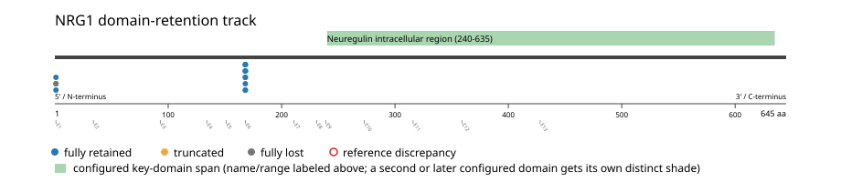

# NRG1 real-data fusion benchmark: msk_impact_50k_2026

Retrieved from public cBioPortal and Genome Nexus on 2026-10-29.

## Results

- Structural variants returned for NRG1: 16
- Protein-fusion records found: 15
- Protein-fusion records mapped: 15
- Malformed/unmappable fusion records skipped: 0
- In-frame among known-frame events: 8/8 (100.0%)
- Unknown frame status: 7/15
- Neuregulin intracellular region (240-635 aa) retained: 13/15 (86.7%)
- In-frame and Neuregulin intracellular region-retained: 8/8
- Fisher exact test (one-sided): odds ratio unavailable, p=0.227273
- Breakpoint-permutation empirical p-value: 0.732673
- Contingency table `[[retained/in-frame, retained/other], [not-retained/in-frame, not-retained/other]]`: `[[6, 4], [0, 2]]`

- Mutation/CNA co-occurrence: not computed (NRG1 has no mutual_exclusivity_targets configured; co-occurrence/mutual-exclusivity analysis was skipped.)

### Mechanistic interpretation

**Neuregulin intracellular region retention:** nominal support not established (nominal p=0.227273, odds ratio=unavailable; q=1; does not pass FDR). No counter-pattern classification was made.

**Immunoglobulin I-set domain disruption:** nominal support not established (nominal p=0.772727, odds ratio=1; q=1; does not pass FDR). No counter-pattern classification was made.

### Domain retention and discrepancies

*Domain-retention positions for analyzed fusion events; red outlines mark reference discrepancies.*

### Fusion-transcript schematic

*One row per recurrent partner/breakpoint group, sharing one amino-acid x-axis for NRG1's full protein length; the partner-contributed portion is colored per partner, the retained target-gene portion is colored by domain-retention status, and a red line marks the breakpoint.*

## Method

The cBioPortal `msk_impact_50k_2026_structural_variants` structural-variant profile was queried by the configured Entrez gene ID. Fusion-annotated records were adapted to the production SV schema and normalized; when `site2EffectOnFrame=NA`, frame status was resolved from `Event_Info`, not copied into `FusionEvent.Frame_status`.

NRG1 genomic breakpoints were mapped against the Genome Nexus canonical transcript, and retention was classified against its returned Neuregulin intracellular region coordinates. Counts are event-level with no patient deduplication. In-frame percentage uses only events explicitly called in-frame or out-of-frame; unknown-frame events are reported separately and excluded from that denominator. The Fisher comparison's `other` column combines out-of-frame and unknown-frame events, as pre-specified by the domain-retention algorithm.

For each fusion, breakpoint selection preferred the Genome Nexus canonical transcript's exon-spanned target locus over cBioPortal site labels; malformed rows with no unambiguous target-locus coordinate were skipped and listed in Warnings.

## Full-suite highlights

- Registered algorithms executed: composite_score, confidence_stats, cutpoint_detection, domain_disruption, domain_retention, exon_retention, expression_association, frequency, genomic_position_recurrence, joint_partner, junction_concentration, mechanistic_interpretation, mutation_cooccurrence, window_detection
- Cutpoint detection (descriptive): inferred breakpoint 1 aa (exon 1); label-permutation p=0.0909091, not a selection test.
- Genomic-position recurrence: The 4 events sharing protein position 1 aa use 4 distinct genomic positions spanning 370123 bp -- the protein-position recurrence is broader than any single genomic hotspot, consistent with independent intronic breakpoints mapped (or clamped) onto the same protein/exon boundary rather than one shared DNA lesion.
- Top composite score: CD74 (9 events), 0.292785.
- Expression association: No mRNA expression data was available for NRG1 in this cohort; expression-association analysis was skipped.

## Partners

CD74 (9), FOXA1 (1), NSD3 (2), PAK1 (1), RAD51C (1), VTCN1 (1)

## Warnings

- Collapsed 3 repeated observation(s) of the same fusion in 2 patient(s) before inferential tests (observation_unit='patient_gene').

## Interpretation

These values describe the live study named above.
