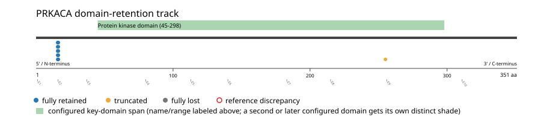

# PRKACA real-data fusion benchmark: msk_impact_50k_2026

Retrieved from public cBioPortal and Genome Nexus on 2026-10-29.

## Results

- Structural variants returned for PRKACA: 35
- Protein-fusion records found: 35
- Protein-fusion records mapped: 30
- Malformed/unmappable fusion records skipped: 5
- In-frame among known-frame events: 24/25 (96.0%)
- Unknown frame status: 5/30
- Protein kinase domain (45-298 aa) retained: 29/30 (96.7%)
- In-frame and Protein kinase domain-retained: 24/24
- Fisher exact test (one-sided): odds ratio unavailable, p=0.214286
- Breakpoint-permutation empirical p-value: 9.9999e-06
- Contingency table `[[retained/in-frame, retained/other], [not-retained/in-frame, not-retained/other]]`: `[[22, 5], [0, 1]]`

- Mutation/CNA co-occurrence: not computed (PRKACA has no mutual_exclusivity_targets configured; co-occurrence/mutual-exclusivity analysis was skipped.)

### Mechanistic interpretation

**Protein kinase domain retention:** nominal support not established (nominal p=0.214286, odds ratio=unavailable; q=1; does not pass FDR). No counter-pattern classification was made.

### Domain retention and discrepancies

*Domain-retention positions for analyzed fusion events; red outlines mark reference discrepancies.*

### Fusion-transcript schematic

*One row per recurrent partner/breakpoint group, sharing one amino-acid x-axis for PRKACA's full protein length; the partner-contributed portion is colored per partner, the retained target-gene portion is colored by domain-retention status, and a red line marks the breakpoint.*

## Method

The cBioPortal `msk_impact_50k_2026_structural_variants` structural-variant profile was queried by the configured Entrez gene ID. Fusion-annotated records were adapted to the production SV schema and normalized; when `site2EffectOnFrame=NA`, frame status was resolved from `Event_Info`, not copied into `FusionEvent.Frame_status`.

PRKACA genomic breakpoints were mapped against the Genome Nexus canonical transcript, and retention was classified against its returned Protein kinase domain coordinates. Counts are event-level with no patient deduplication. In-frame percentage uses only events explicitly called in-frame or out-of-frame; unknown-frame events are reported separately and excluded from that denominator. The Fisher comparison's `other` column combines out-of-frame and unknown-frame events, as pre-specified by the domain-retention algorithm.

For each fusion, breakpoint selection preferred the Genome Nexus canonical transcript's exon-spanned target locus over cBioPortal site labels; malformed rows with no unambiguous target-locus coordinate were skipped and listed in Warnings.

## Full-suite highlights

- Registered algorithms executed: composite_score, confidence_stats, cutpoint_detection, domain_disruption, domain_retention, exon_retention, expression_association, frequency, genomic_position_recurrence, joint_partner, junction_concentration, mechanistic_interpretation, mutation_cooccurrence, window_detection
- Cutpoint detection (descriptive): inferred breakpoint 16 aa (exon 1/2 boundary); label-permutation p=0.038961, not a selection test.
- Genomic-position recurrence: The 27 events sharing protein position 16 aa use 27 distinct genomic positions spanning 9981 bp -- the protein-position recurrence is broader than any single genomic hotspot, consistent with independent intronic breakpoints mapped (or clamped) onto the same protein/exon boundary rather than one shared DNA lesion.
- Top composite score: DNAJB1 (34 events), 0.774154.
- Expression association: No mRNA expression data was available for PRKACA in this cohort; expression-association analysis was skipped.

## Partners

DNAJB1 (34), PIK3R2 (1)

## Warnings

- Skipped EVT-P-0021511-T02-IM6-12 (PRKACA-DNAJB1): ValueError: PRKACA fusion has no site breakpoint within target locus 14202500-14228556: Site1=14229680, Site2=14628294
- Skipped EVT-P-0020620-T01-IM6-15 (PRKACA-DNAJB1): ValueError: PRKACA fusion has no site breakpoint within target locus 14202500-14228556: Site1=14229613, Site2=14627759
- Skipped EVT-P-0020620-T02-IM6-16 (PRKACA-DNAJB1): ValueError: PRKACA fusion has no site breakpoint within target locus 14202500-14228556: Site1=14229613, Site2=14627759
- Skipped EVT-P-0021511-T03-IM6-18 (PRKACA-DNAJB1): ValueError: PRKACA fusion has no site breakpoint within target locus 14202500-14228556: Site1=14229680, Site2=14628294
- Skipped EVT-P-0029745-T01-IM6-24 (PRKACA-DNAJB1): ValueError: PRKACA fusion has no site breakpoint within target locus 14202500-14228556: Site1=14228843, Site2=14628196
- Collapsed 2 repeated observation(s) of the same fusion in 2 patient(s) before inferential tests (observation_unit='patient_gene').

## Interpretation

These values describe the live study named above.
