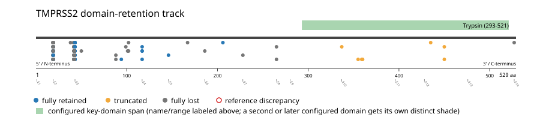
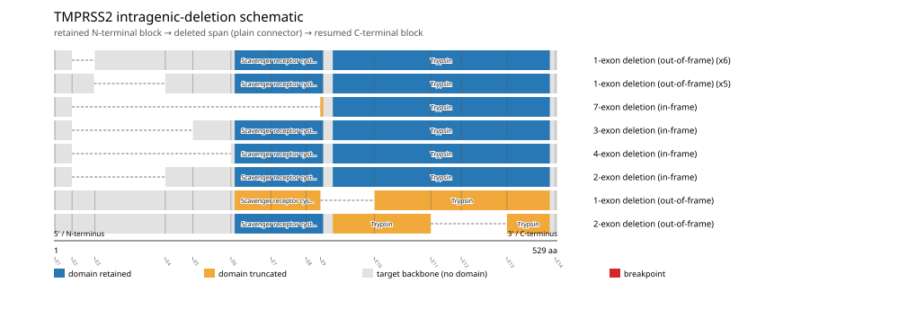

# TMPRSS2 real-data fusion benchmark: msk_impact_50k_2026

Retrieved from public cBioPortal and Genome Nexus on 2026-10-29.

## Results

- Structural variants returned for TMPRSS2: 1132
- Protein-fusion records found: 867
- Protein-fusion records mapped: 849
- Malformed/unmappable fusion records skipped: 18
- In-frame among known-frame events: 260/780 (33.3%)
- Unknown frame status: 69/849
- Trypsin (293-521 aa) retained: 53/849 (6.2%)
- In-frame and Trypsin-retained: 23/260
- Fisher exact test (one-sided): odds ratio 1.68549, p=0.0849513
- Breakpoint-permutation empirical p-value: 1
- Contingency table `[[retained/in-frame, retained/other], [not-retained/in-frame, not-retained/other]]`: `[[16, 23], [201, 487]]`

- Mutation/CNA co-occurrence: not computed (TMPRSS2 has no mutual_exclusivity_targets configured; co-occurrence/mutual-exclusivity analysis was skipped.)

### Mechanistic interpretation

**Trypsin retention:** nominal support not established (nominal p=0.0849513, odds ratio=1.68549; q=1; does not pass FDR). No counter-pattern classification was made.

**Scavenger receptor cysteine-rich domain disruption:** nominal support not established (nominal p=0.930168, odds ratio=0.647552; q=1; does not pass FDR). No counter-pattern classification was made.

### Domain retention and discrepancies

*Domain-retention positions for analyzed fusion events; red outlines mark reference discrepancies.*

### Truncated domain: does the partner supply the rest?

7 fusion(s) cut TMPRSS2's key domain; in 1 the partner carries the same Pfam family. Spans are in domain coordinates (0 = start, 1 = end); a negative gap is an overlap.

| Fusion | Sample | Frame | 5' keeps | 3' keeps | Gap (aa) | Mid-exon breaks | Reading |
|---|---|---|---|---|---|---|---|
| KLK3-TMPRSS2 | P-0049439-T01-IM6 | unknown | - | - | - | TMPRSS2 | partner's copy is cut away |

*A complementary pair forms a hybrid domain only if the junction is in frame. Breakpoints come from DNA: a mid-exon break cannot be spliced as called, and a junction inside sequence two paralogs share complements by construction, so confirm with RNA before reading this as selection.*

### Fusion-transcript schematic

*One row per recurrent partner/breakpoint group, sharing one amino-acid x-axis for TMPRSS2's full protein length; the partner-contributed portion is colored per partner, the retained target-gene portion is colored by domain-retention status, and a red line marks the breakpoint.*

### Intragenic-deletion schematic

*Same-gene (Site1==Site2==TMPRSS2) intragenic-deletion-style SV records: a retained N-terminal block, a plain connector line for the deleted span, and a resumed C-terminal block.*

## Method

The cBioPortal `msk_impact_50k_2026_structural_variants` structural-variant profile was queried by the configured Entrez gene ID. Fusion-annotated records were adapted to the production SV schema and normalized; when `site2EffectOnFrame=NA`, frame status was resolved from `Event_Info`, not copied into `FusionEvent.Frame_status`.

TMPRSS2 genomic breakpoints were mapped against the Genome Nexus canonical transcript, and retention was classified against its returned Trypsin coordinates. Counts are event-level with no patient deduplication. In-frame percentage uses only events explicitly called in-frame or out-of-frame; unknown-frame events are reported separately and excluded from that denominator. The Fisher comparison's `other` column combines out-of-frame and unknown-frame events, as pre-specified by the domain-retention algorithm.

For each fusion, breakpoint selection preferred the Genome Nexus canonical transcript's exon-spanned target locus over cBioPortal site labels; malformed rows with no unambiguous target-locus coordinate were skipped and listed in Warnings.

## Full-suite highlights

- Registered algorithms executed: composite_score, confidence_stats, cutpoint_detection, domain_disruption, domain_retention, exon_retention, expression_association, frequency, genomic_position_recurrence, joint_partner, junction_concentration, mechanistic_interpretation, mutation_cooccurrence, window_detection
- Cutpoint detection (descriptive): inferred breakpoint 42 aa (exon 2); label-permutation p=0.000999001, not a selection test.
- Genomic-position recurrence: The 210 events sharing protein position 42 aa use 203 distinct genomic positions spanning 3493 bp -- the protein-position recurrence is broader than any single genomic hotspot, consistent with independent intronic breakpoints mapped (or clamped) onto the same protein/exon boundary rather than one shared DNA lesion.
- Top composite score: ERG (764 events), 0.586976.
- Expression association: No mRNA expression data was available for TMPRSS2 in this cohort; expression-association analysis was skipped.

## Partners

ABCC4 (1), ABCG1 (1), ACP3 (1), ADHFE1 (1), AFDN (1), AIRE (1), ARF4 (1), ARHGAP26 (1), ARRB1 (1), BACH1 (1), BRAF (4), BRCA2 (1), C2CD2 (1), CASZ1 (1), CCN6 (1), CERS6 (1), CHAF1B (1), CHD3 (3), CHST12 (1), CSK (1), CYP3A43 (1), CYP4Z1 (1), DENND3 (1), DMD (1), DSCAM (3), DYM (1), DYRK1A (1), ELAPOR1 (1), ENPP6 (1), ERG (764), ETV1 (14), ETV4 (3), ETV5 (4), FIRRM (1), FOXP1 (1), GCOM1 (1), KLK3 (1), KRTAP10-4 (1), LSS (1), MAD1L1 (2), MGA (1), MRPS6 (1), MX1 (2), MYL5 (1), NLGN1 (2), NR3C2 (2), NSUN4 (1), OSBPL1A (1), OSBPL2 (1), PALS1 (1), PAXBP1 (1), PGM5 (1), PLCD3 (1), POLDIP3 (1), PRDM15 (1), PREX2 (1), RBPMS2 (1), RCN1 (1), RIPK4 (3), RSL24D1 (1), SEPTIN11 (1), SETD4 (1), SGMS2 (1), SH3BGR (1), SH3GL3 (1), SIK1 (1), SIMC1 (1), SKIL (1), SLC60A1 (1), TSPAN4 (1), TUT7 (1), U2AF1 (1), ZNF827 (1)

## Warnings

- Skipped EVT-P-0020141-T01-IM6-9 (DMD-TMPRSS2): ValueError: could not determine 5'/3' role for TMPRSS2 in EVT-P-0020141-T01-IM6-9; Event_Info='Antisense Fusion'
- Skipped EVT-P-0005081-T01-IM5-71 (ERG-TMPRSS2): ValueError: could not determine 5'/3' role for TMPRSS2 in EVT-P-0005081-T01-IM5-71; Event_Info='Antisense fusion'
- Skipped EVT-P-0006057-T01-IM5-89 (ERG-TMPRSS2): ValueError: could not determine 5'/3' role for TMPRSS2 in EVT-P-0006057-T01-IM5-89; Event_Info='Antisense fusion'
- Skipped EVT-P-0012322-T01-IM5-186 (ERG-TMPRSS2): ValueError: could not determine 5'/3' role for TMPRSS2 in EVT-P-0012322-T01-IM5-186; Event_Info='Antisense fusion'
- Skipped EVT-P-0013858-T02-IM5-215 (ERG-TMPRSS2): ValueError: could not determine 5'/3' role for TMPRSS2 in EVT-P-0013858-T02-IM5-215; Event_Info='Antisense fusion'
- Skipped EVT-P-0018791-T01-IM6-286 (ERG-TMPRSS2): ValueError: could not determine 5'/3' role for TMPRSS2 in EVT-P-0018791-T01-IM6-286; Event_Info='Antisense Fusion'
- Skipped EVT-P-0018812-T01-IM6-288 (ERG-TMPRSS2): ValueError: could not determine 5'/3' role for TMPRSS2 in EVT-P-0018812-T01-IM6-288; Event_Info='Antisense Fusion'
- Skipped EVT-P-0025793-T01-IM6-369 (ERG-TMPRSS2): ValueError: could not determine 5'/3' role for TMPRSS2 in EVT-P-0025793-T01-IM6-369; Event_Info='Antisense Fusion'
- Skipped EVT-P-0028090-T01-IM6-395 (ERG-TMPRSS2): ValueError: could not determine 5'/3' role for TMPRSS2 in EVT-P-0028090-T01-IM6-395; Event_Info='Antisense Fusion'
- Skipped EVT-P-0050022-T02-IM6-483 (ERG-TMPRSS2): ValueError: could not determine 5'/3' role for TMPRSS2 in EVT-P-0050022-T02-IM6-483; Event_Info='Antisense Fusion'
- Skipped EVT-P-0050541-T01-IM6-484 (ERG-TMPRSS2): ValueError: could not determine 5'/3' role for TMPRSS2 in EVT-P-0050541-T01-IM6-484; Event_Info='Antisense Fusion'
- Skipped EVT-P-0052874-T01-IM6-487 (ERG-TMPRSS2): ValueError: could not determine 5'/3' role for TMPRSS2 in EVT-P-0052874-T01-IM6-487; Event_Info='Antisense Fusion'
- Skipped EVT-P-0064423-T01-IM7-497 (ERG-TMPRSS2): ValueError: could not determine 5'/3' role for TMPRSS2 in EVT-P-0064423-T01-IM7-497; Event_Info='Antisense Fusion'
- Skipped EVT-P-0025988-T01-IM6-546 (TMPRSS2-BRAF): ValueError: could not determine 5'/3' role for TMPRSS2 in EVT-P-0025988-T01-IM6-546; Event_Info='Antisense Fusion'
- Skipped EVT-P-0023930-T01-IM6-563 (TMPRSS2-DYM): ValueError: could not determine 5'/3' role for TMPRSS2 in EVT-P-0023930-T01-IM6-563; Event_Info='Antisense Fusion'
- Skipped EVT-P-0025355-T01-IM6-954 (TMPRSS2-RIPK4): ValueError: could not determine 5'/3' role for TMPRSS2 in EVT-P-0025355-T01-IM6-954; Event_Info='Antisense Fusion'
- Skipped EVT-P-0016548-T01-IM6-957 (TMPRSS2-RSL24D1): ValueError: could not determine 5'/3' role for TMPRSS2 in EVT-P-0016548-T01-IM6-957; Event_Info='Antisense Fusion'
- Skipped EVT-P-0036826-T01-IM6-1126 (TMPRSS2-TUT7): ValueError: could not determine 5'/3' role for TMPRSS2 in EVT-P-0036826-T01-IM6-1126; Event_Info='Antisense Fusion'
- Collapsed 103 repeated observation(s) of the same fusion in 85 patient(s) before inferential tests (observation_unit='patient_gene').
- Kept one of several distinct TMPRSS2 fusions in 17 patient(s), dropping 19 so each patient counts once in inferential tests.

## Interpretation

These values describe the live study named above.
