# Genome-wide fusion-hotspot analysis of msk_impact_50k_2026

## Abstract

This manuscript synthesizes a genome-wide fusion-hotspot cohort scan of msk_impact_50k_2026: 3919 genes carried at least one structural-variant record in the cohort, of which 544 passed the >= 5-distinct-patient recurrence gate. All 544 gated genes were attempted: 10 using hand-curated gene configs and 528 auto-configured, with 4 gated-in gene(s) left unresolvable; 538 of the 544 attempted genes were successfully analyzed with the full registered algorithm suite. 17 genes reached genome-wide Benjamini-Hochberg FDR significance (q < 0.05): BRAF (179 events, 92.6% in-frame, 91.6% domain-retained, Fisher p=0.0371318, q=0.000624279); CD74 (67 events, 68.4% in-frame, 89.4% domain-retained, Fisher p=0.270083, q=0.000624279); EGFR (55 events, 70.0% in-frame, 74.5% domain-retained, Fisher p=0.018443, q=0.000624279); EML4 (223 events, 97.5% in-frame, 53.4% domain-retained, Fisher p=0.999931, q=0.000624279); ETV6 (90 events, 81.0% in-frame, 77.3% domain-retained, Fisher p=0.000290182, q=0.000624279); FGFR2 (136 events, 93.1% in-frame, 85.8% domain-retained, Fisher p=0.00226743, q=0.000624279); FGFR3 (152 events, 97.4% in-frame, 94.0% domain-retained, Fisher p=0.0194679, q=0.000624279); KIAA1549 (44 events, 97.6% in-frame, 50.0% domain-retained, Fisher p=0.927235, q=0.000624279); KIF5B (96 events, 97.7% in-frame, 96.9% domain-retained, Fisher p=0.307781, q=0.000624279); PRKACA (35 events, 96.0% in-frame, 96.7% domain-retained, Fisher p=0.214286, q=0.000624279); RET (194 events, 85.4% in-frame, 92.3% domain-retained, Fisher p=0.00256613, q=0.000624279); TMPRSS2 (867 events, 33.3% in-frame, 6.2% domain-retained, Fisher p=0.0849513, q=0.000624279); ATF1 (30 events, 84.0% in-frame, 90.0% domain-retained, Fisher p=0.704212, q=0.00109249); TPM3 (14 events, 100.0% in-frame, 64.3% domain-retained, Fisher p=1, q=0.00109249); ROS1 (122 events, 72.7% in-frame, 90.7% domain-retained, Fisher p=0.186019, q=0.0019422); NAB2 (72 events, 71.4% in-frame, 69.0% domain-retained, Fisher p=0.179862, q=0.00919908); ALK (272 events, 97.4% in-frame, 96.3% domain-retained, Fisher p=0.00057792, q=0.016646). 15 additional genes form a highly ranked non-FDR-significant tier flagged for targeted follow-up (see Honorable mentions, below).

## Methods

Structural-variant records were retrieved from the msk_impact_50k_2026 cBioPortal study and gated to genes with at least 5 distinct patient(s) carrying a structural-variant record (544 of 3919 genes passed the gate). All 544 gated genes were attempted: 10 using hand-curated gene configs and 528 auto-configured from Genome Nexus canonical-transcript/Pfam-domain data, with 4 gated-in gene(s) left unresolvable; 538 of the 544 attempted genes were successfully analyzed. Each successfully analyzed gene was run through the algorithm suite recorded for this scan (composite_score, confidence_stats, cutpoint_detection, domain_disruption, domain_retention, exon_retention, expression_association, frequency, genomic_position_recurrence, joint_partner, junction_concentration, mechanistic_interpretation, mutation_cooccurrence, window_detection). Domain-retention and domain-disruption significance were assessed per gene with Fisher's exact test and a breakpoint-position permutation test; the resulting p-values across the 285 genes that produced at least one computable p-value were jointly corrected with Benjamini-Hochberg false-discovery-rate correction at q < 0.05.

## Results

### Genome-wide summary

Genome-wide summary of 285 scanned genes with an FDR-adjusted q-value, ranked left-to-right by composite evidence score; the dashed line marks the q=0.05 significance threshold, with 17 genes above it.

### FDR-significant and honorable-mention genes

| gene_symbol | tier | n_events_analyzed | in_frame_percent | domain_retention_percent | fisher_p_value | min_fdr_adjusted_q_value |
|---|---|---|---|---|---|---|
| BRAF | FDR-significant | 179 | 92.64 | 91.57 | 0.03713 | 0.0006243 |
| CD74 | FDR-significant | 67 | 68.42 | 89.39 | 0.2701 | 0.0006243 |
| EGFR | FDR-significant | 55 | 70 | 74.55 | 0.01844 | 0.0006243 |
| EML4 | FDR-significant | 223 | 97.51 | 53.36 | 0.9999 | 0.0006243 |
| ETV6 | FDR-significant | 90 | 81.01 | 77.27 | 0.0002902 | 0.0006243 |
| FGFR2 | FDR-significant | 136 | 93.1 | 85.82 | 0.002267 | 0.0006243 |
| FGFR3 | FDR-significant | 152 | 97.37 | 94.04 | 0.01947 | 0.0006243 |
| KIAA1549 | FDR-significant | 44 | 97.56 | 50 | 0.9272 | 0.0006243 |
| KIF5B | FDR-significant | 96 | 97.7 | 96.88 | 0.3078 | 0.0006243 |
| PRKACA | FDR-significant | 35 | 96 | 96.67 | 0.2143 | 0.0006243 |
| RET | FDR-significant | 194 | 85.38 | 92.27 | 0.002566 | 0.0006243 |
| TMPRSS2 | FDR-significant | 867 | 33.33 | 6.243 | 0.08495 | 0.0006243 |
| ATF1 | FDR-significant | 30 | 84 | 90 | 0.7042 | 0.001092 |
| TPM3 | FDR-significant | 14 | 100 | 64.29 | 1 | 0.001092 |
| ROS1 | FDR-significant | 122 | 72.73 | 90.68 | 0.186 | 0.001942 |
| NAB2 | FDR-significant | 72 | 71.43 | 69.01 | 0.1799 | 0.009199 |
| ALK | FDR-significant | 272 | 97.41 | 96.31 | 0.0005779 | 0.01665 |
| CDKN2B | Honorable mention | 12 | 66.67 | 20 | 0.02222 | 0.5249 |
| NTRK1 | Honorable mention | 78 | 72.73 | 84.21 | 0.05145 | 0.3201 |
| NTRK3 | Honorable mention | 58 | 98.21 | 96.49 | 0.05556 | 0.07592 |
| IKBKE | Honorable mention | 12 | 50 | 36.36 | 0.06667 | 1 |
| FLI1 | Honorable mention | 118 | 68.22 | 94.02 | 0.07688 | 1 |
| RTEL1 | Honorable mention | 24 | 50 | 37.5 | 0.1167 | 1 |
| KDM5A | Honorable mention | 10 | 50 | 55.56 | 0.119 | 1 |
| FH | Honorable mention | 16 | 16.67 | 13.33 | 0.1429 | 1 |
| CDK12 | Honorable mention | 43 | 50 | 39.02 | 0.1734 | 1 |
| POLD1 | Honorable mention | 16 | 33.33 | 46.15 | 0.1923 | 0.7353 |
| AGO2 | Honorable mention | 23 | 46.15 | 31.82 | 0.2252 | 1 |
| NRG1 | Honorable mention | 15 | 100 | 86.67 | 0.2273 | 1 |
| MTAP | Honorable mention | 4 | 33.33 | 25 | 0.25 | 1 |
| RPS6KA4 | Honorable mention | 13 | 62.5 | 58.33 | 0.2619 | 1 |
| PLK2 | Honorable mention | 7 | 50 | 57.14 | 0.2857 | 1 |

### Gene highlights

#### BRAF (FDR-significant, Curated gene config)

BRAF was analyzed across 179 fusion events, 92.6% in-frame and 91.6% domain-retained. Domain-retention Fisher's exact test on BRAF's own fusion events alone gives p=0.0371318 (statistically significant at alpha=0.05). The Protein kinase domain appears to be required for retention. Among 285 genes scanned genome-wide in this cohort run, BRAF's Benjamini-Hochberg-adjusted q=0.000624279 (reaches genome-wide FDR significance).

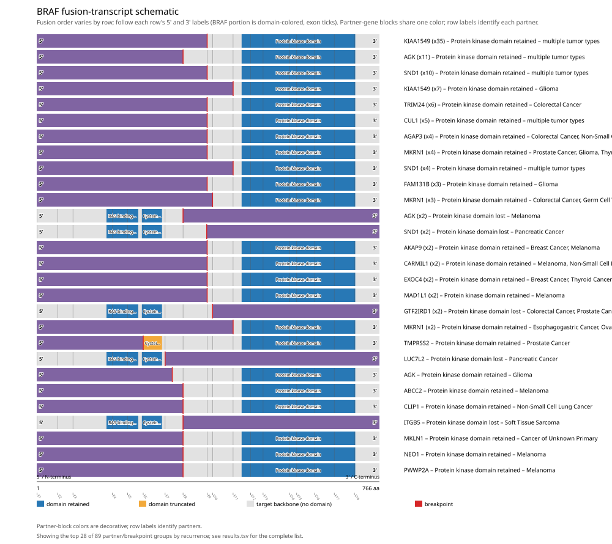

Full per-gene detail: [gene_reports/braf/report.md](gene_reports/braf/report.md)

#### CD74 (FDR-significant)

CD74 was analyzed across 67 fusion events, 68.4% in-frame and 89.4% domain-retained. Domain-retention Fisher's exact test on CD74's own fusion events alone gives p=0.270083 (not statistically significant at alpha=0.05). Among 285 genes scanned genome-wide in this cohort run, CD74's Benjamini-Hochberg-adjusted q=0.000624279 (reaches genome-wide FDR significance).

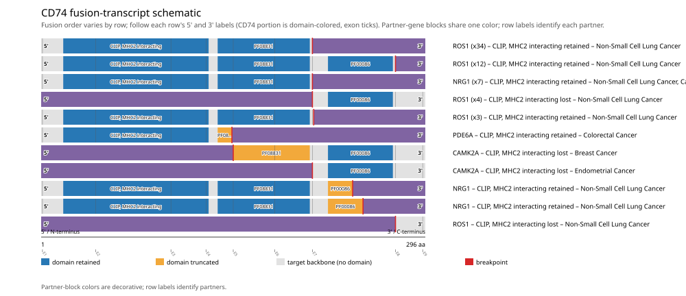

Full per-gene detail: [gene_reports/cd74/report.md](gene_reports/cd74/report.md)

#### EGFR (FDR-significant)

EGFR was analyzed across 55 fusion events, 70.0% in-frame and 74.5% domain-retained. Domain-retention Fisher's exact test on EGFR's own fusion events alone gives p=0.018443 (statistically significant at alpha=0.05). The Protein tyrosine and serine/threonine kinase appears to be required for retention. Among 285 genes scanned genome-wide in this cohort run, EGFR's Benjamini-Hochberg-adjusted q=0.000624279 (reaches genome-wide FDR significance).

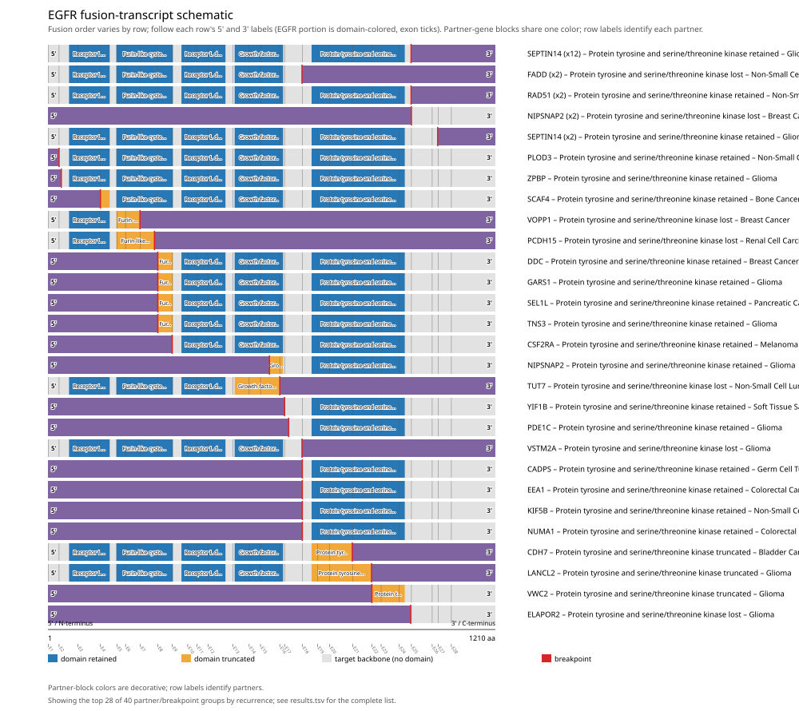

Full per-gene detail: [gene_reports/egfr/report.md](gene_reports/egfr/report.md)

#### EML4 (FDR-significant)

EML4 was analyzed across 223 fusion events, 97.5% in-frame and 53.4% domain-retained. Domain-retention Fisher's exact test on EML4's own fusion events alone gives p=0.999931 (not statistically significant at alpha=0.05). Among 285 genes scanned genome-wide in this cohort run, EML4's Benjamini-Hochberg-adjusted q=0.000624279 (reaches genome-wide FDR significance).

Full per-gene detail: [gene_reports/eml4/report.md](gene_reports/eml4/report.md)

#### ETV6 (FDR-significant, Curated gene config)

ETV6 was analyzed across 90 fusion events, 81.0% in-frame and 77.3% domain-retained. Domain-retention Fisher's exact test on ETV6's own fusion events alone gives p=0.000290182 (statistically significant at alpha=0.05). The Sterile alpha motif (SAM)/Pointed domain appears to be required for retention. Among 285 genes scanned genome-wide in this cohort run, ETV6's Benjamini-Hochberg-adjusted q=0.000624279 (reaches genome-wide FDR significance).

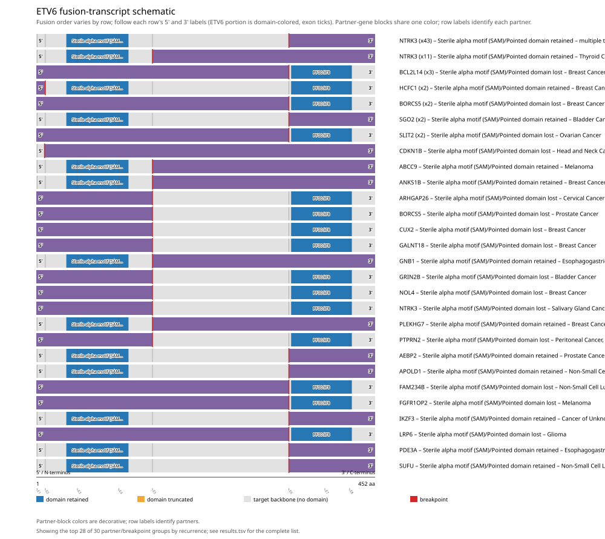

Full per-gene detail: [gene_reports/etv6/report.md](gene_reports/etv6/report.md)

#### FGFR2 (FDR-significant, Curated gene config)

FGFR2 was analyzed across 136 fusion events, 93.1% in-frame and 85.8% domain-retained. Domain-retention Fisher's exact test on FGFR2's own fusion events alone gives p=0.00226743 (statistically significant at alpha=0.05). The Protein kinase domain appears to be required for retention. Among 285 genes scanned genome-wide in this cohort run, FGFR2's Benjamini-Hochberg-adjusted q=0.000624279 (reaches genome-wide FDR significance).

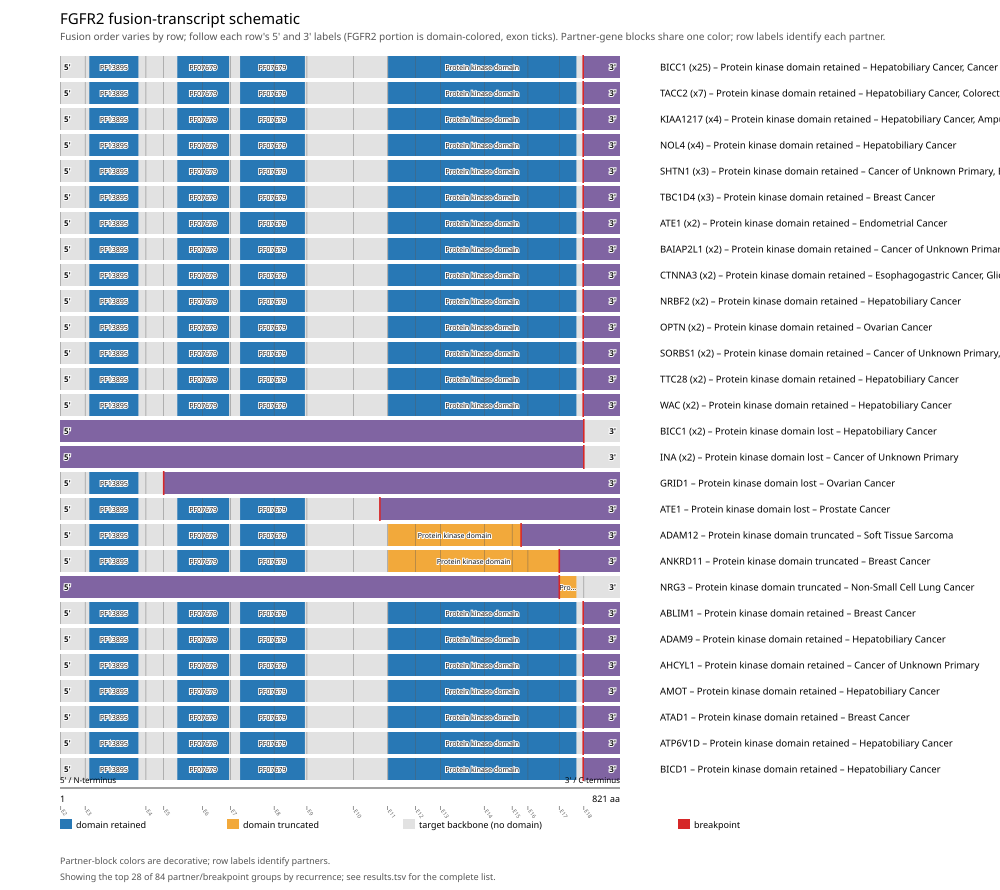

Full per-gene detail: [gene_reports/fgfr2/report.md](gene_reports/fgfr2/report.md)

#### FGFR3 (FDR-significant)

FGFR3 was analyzed across 152 fusion events, 97.4% in-frame and 94.0% domain-retained. Domain-retention Fisher's exact test on FGFR3's own fusion events alone gives p=0.0194679 (statistically significant at alpha=0.05). The Protein tyrosine and serine/threonine kinase appears to be required for retention. Among 285 genes scanned genome-wide in this cohort run, FGFR3's Benjamini-Hochberg-adjusted q=0.000624279 (reaches genome-wide FDR significance).

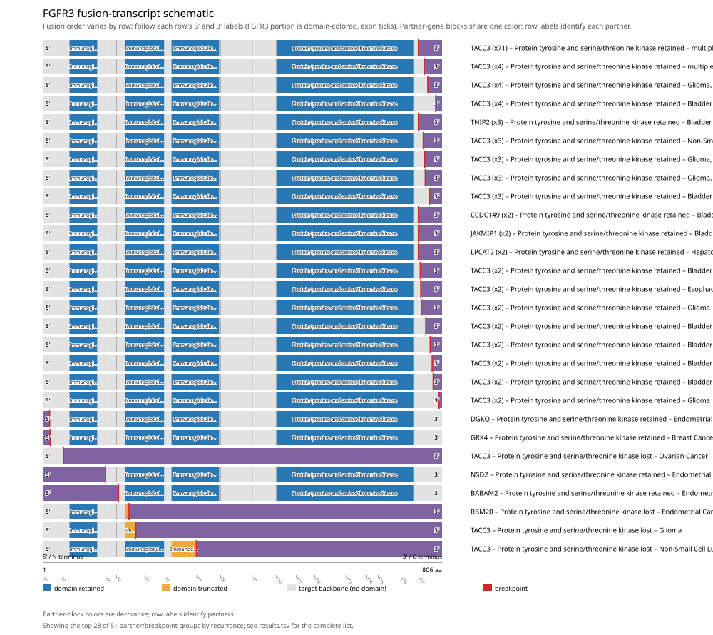

Full per-gene detail: [gene_reports/fgfr3/report.md](gene_reports/fgfr3/report.md)

#### KIAA1549 (FDR-significant)

KIAA1549 was analyzed across 44 fusion events, 97.6% in-frame and 50.0% domain-retained. Domain-retention Fisher's exact test on KIAA1549's own fusion events alone gives p=0.927235 (not statistically significant at alpha=0.05). Among 285 genes scanned genome-wide in this cohort run, KIAA1549's Benjamini-Hochberg-adjusted q=0.000624279 (reaches genome-wide FDR significance).

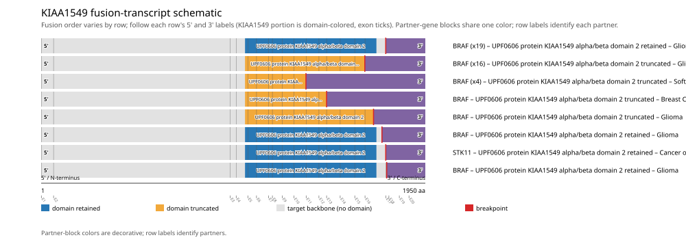

Full per-gene detail: [gene_reports/kiaa1549/report.md](gene_reports/kiaa1549/report.md)

#### KIF5B (FDR-significant)

KIF5B was analyzed across 96 fusion events, 97.7% in-frame and 96.9% domain-retained. Domain-retention Fisher's exact test on KIF5B's own fusion events alone gives p=0.307781 (not statistically significant at alpha=0.05). Among 285 genes scanned genome-wide in this cohort run, KIF5B's Benjamini-Hochberg-adjusted q=0.000624279 (reaches genome-wide FDR significance).

Full per-gene detail: [gene_reports/kif5b/report.md](gene_reports/kif5b/report.md)

#### PRKACA (FDR-significant)

PRKACA was analyzed across 35 fusion events, 96.0% in-frame and 96.7% domain-retained. Domain-retention Fisher's exact test on PRKACA's own fusion events alone gives p=0.214286 (not statistically significant at alpha=0.05). Among 285 genes scanned genome-wide in this cohort run, PRKACA's Benjamini-Hochberg-adjusted q=0.000624279 (reaches genome-wide FDR significance).

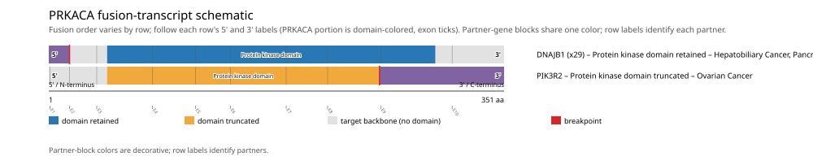

Full per-gene detail: [gene_reports/prkaca/report.md](gene_reports/prkaca/report.md)

#### RET (FDR-significant, Curated gene config)

RET was analyzed across 194 fusion events, 85.4% in-frame and 92.3% domain-retained. Domain-retention Fisher's exact test on RET's own fusion events alone gives p=0.00256613 (statistically significant at alpha=0.05). The Protein kinase domain appears to be required for retention. Among 285 genes scanned genome-wide in this cohort run, RET's Benjamini-Hochberg-adjusted q=0.000624279 (reaches genome-wide FDR significance). The Cadherin domain appears to require loss or disruption rather than retention.

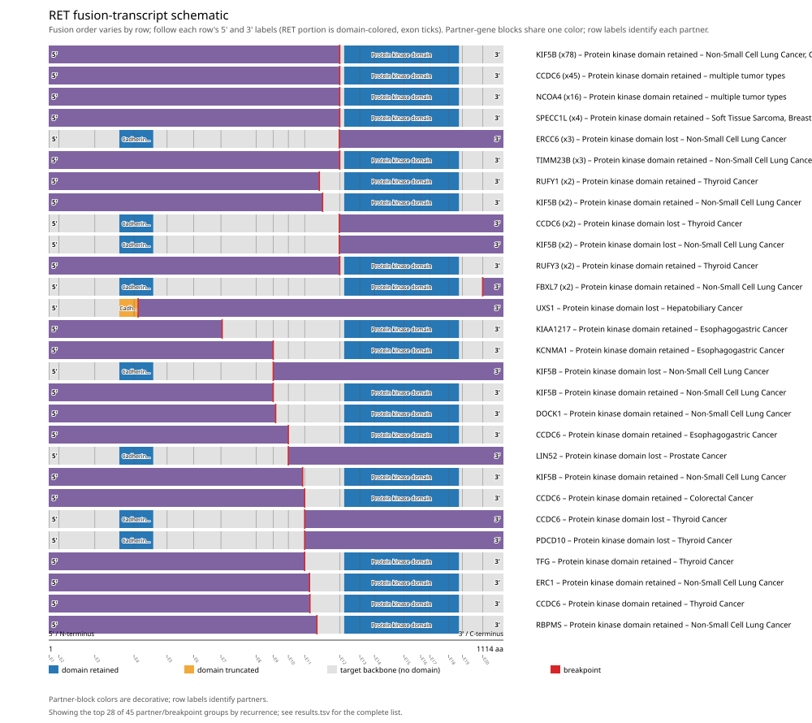

Full per-gene detail: [gene_reports/ret/report.md](gene_reports/ret/report.md)

#### TMPRSS2 (FDR-significant)

TMPRSS2 was analyzed across 867 fusion events, 33.3% in-frame and 6.2% domain-retained. Domain-retention Fisher's exact test on TMPRSS2's own fusion events alone gives p=0.0849513 (not statistically significant at alpha=0.05). Among 285 genes scanned genome-wide in this cohort run, TMPRSS2's Benjamini-Hochberg-adjusted q=0.000624279 (reaches genome-wide FDR significance).

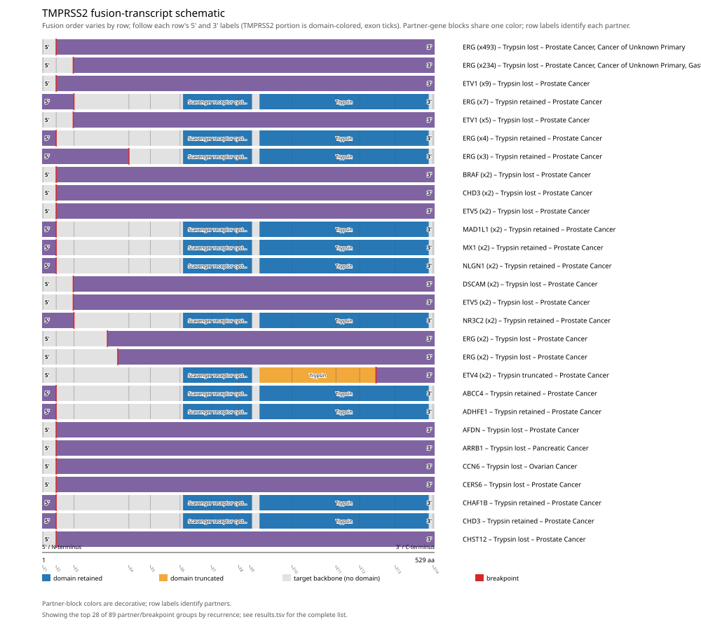

Full per-gene detail: [gene_reports/tmprss2/report.md](gene_reports/tmprss2/report.md)

#### ATF1 (FDR-significant)

ATF1 was analyzed across 30 fusion events, 84.0% in-frame and 90.0% domain-retained. Domain-retention Fisher's exact test on ATF1's own fusion events alone gives p=0.704212 (not statistically significant at alpha=0.05). Among 285 genes scanned genome-wide in this cohort run, ATF1's Benjamini-Hochberg-adjusted q=0.00109249 (reaches genome-wide FDR significance).

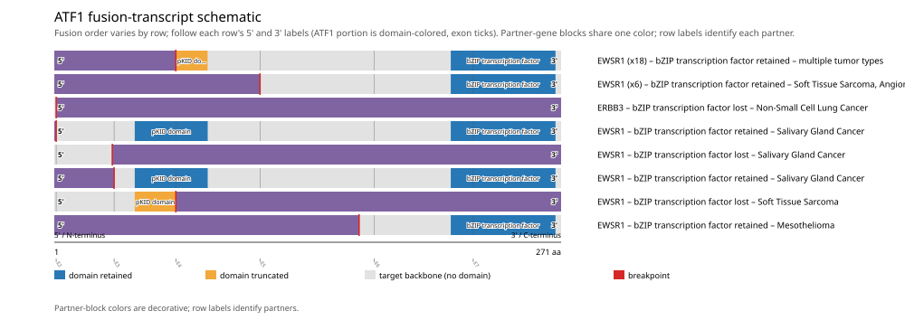

Full per-gene detail: [gene_reports/atf1/report.md](gene_reports/atf1/report.md)

#### TPM3 (FDR-significant)

TPM3 was analyzed across 14 fusion events, 100.0% in-frame and 64.3% domain-retained. Domain-retention Fisher's exact test on TPM3's own fusion events alone gives p=1 (not statistically significant at alpha=0.05). Among 285 genes scanned genome-wide in this cohort run, TPM3's Benjamini-Hochberg-adjusted q=0.00109249 (reaches genome-wide FDR significance).

Full per-gene detail: [gene_reports/tpm3/report.md](gene_reports/tpm3/report.md)

#### ROS1 (FDR-significant, Curated gene config)

ROS1 was analyzed across 122 fusion events, 72.7% in-frame and 90.7% domain-retained. Domain-retention Fisher's exact test on ROS1's own fusion events alone gives p=0.186019 (not statistically significant at alpha=0.05). Among 285 genes scanned genome-wide in this cohort run, ROS1's Benjamini-Hochberg-adjusted q=0.0019422 (reaches genome-wide FDR significance).

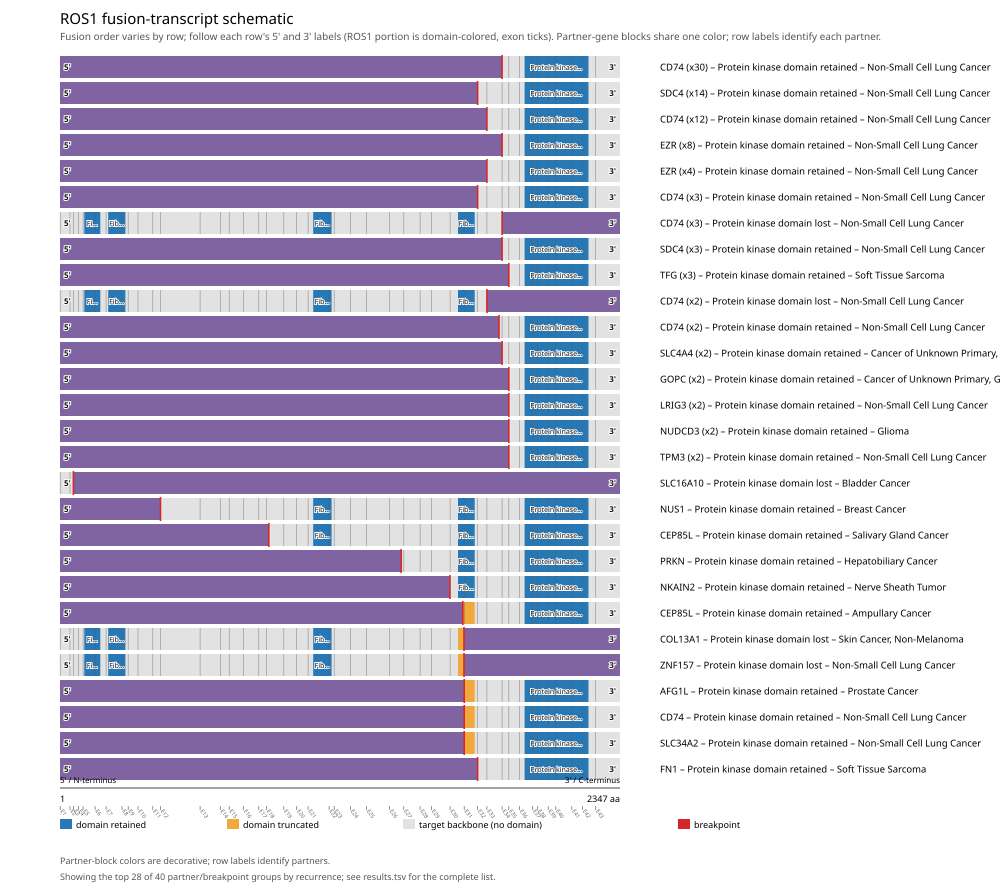

Full per-gene detail: [gene_reports/ros1/report.md](gene_reports/ros1/report.md)

#### NAB2 (FDR-significant)

NAB2 was analyzed across 72 fusion events, 71.4% in-frame and 69.0% domain-retained. Domain-retention Fisher's exact test on NAB2's own fusion events alone gives p=0.179862 (not statistically significant at alpha=0.05). Among 285 genes scanned genome-wide in this cohort run, NAB2's Benjamini-Hochberg-adjusted q=0.00919908 (reaches genome-wide FDR significance).

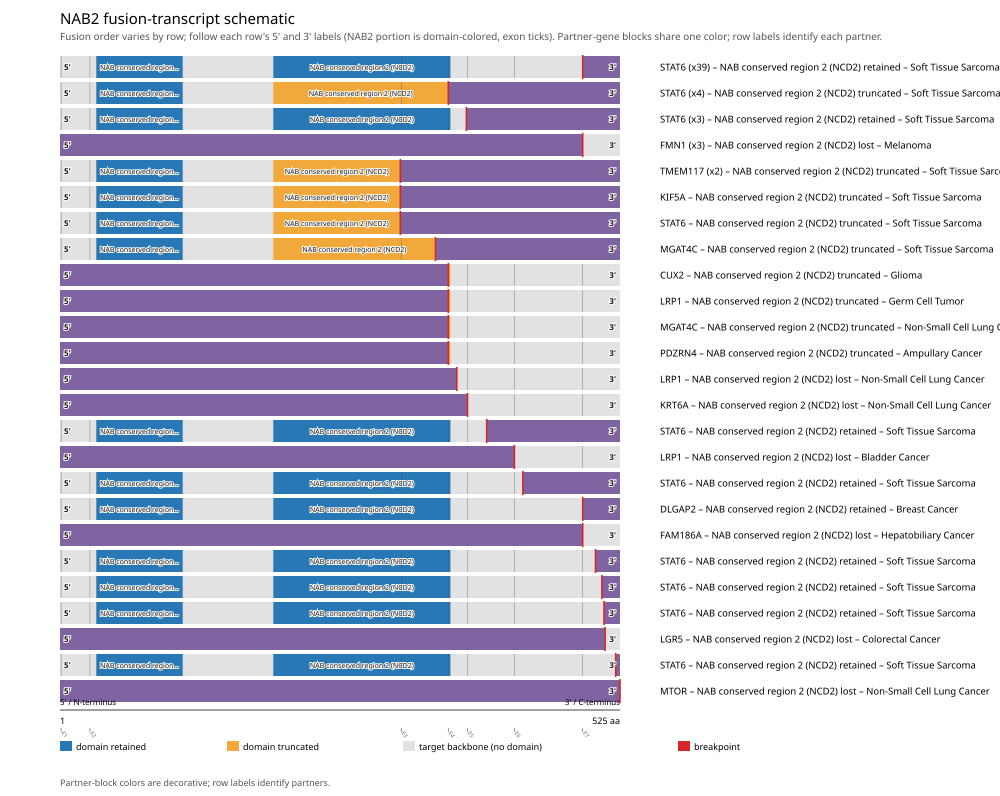

Full per-gene detail: [gene_reports/nab2/report.md](gene_reports/nab2/report.md)

#### ALK (FDR-significant, Curated gene config)

ALK was analyzed across 272 fusion events, 97.4% in-frame and 96.3% domain-retained. Domain-retention Fisher's exact test on ALK's own fusion events alone gives p=0.00057792 (statistically significant at alpha=0.05). The Protein kinase domain appears to be required for retention. Among 285 genes scanned genome-wide in this cohort run, ALK's Benjamini-Hochberg-adjusted q=0.016646 (reaches genome-wide FDR significance).

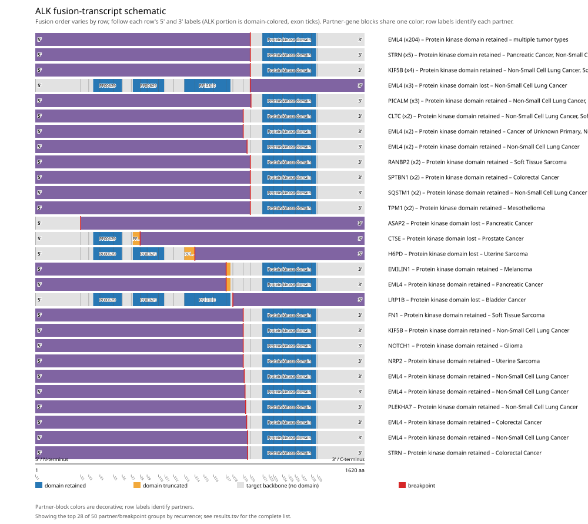

Full per-gene detail: [gene_reports/alk/report.md](gene_reports/alk/report.md)

#### CDKN2B (Honorable mention)

CDKN2B was analyzed across 12 fusion events, 66.7% in-frame and 20.0% domain-retained. Domain-retention Fisher's exact test on CDKN2B's own fusion events alone gives p=0.0222222 (statistically significant at alpha=0.05). Among 285 genes scanned genome-wide in this cohort run, CDKN2B's Benjamini-Hochberg-adjusted q=0.524925 (does not reach genome-wide FDR significance). Did not survive genome-wide multiple-testing correction (FDR-adjusted q-value at or above the significance threshold), but ranks highly by raw p-value among the non-FDR-significant genes and may warrant targeted follow-up. This is NOT a claim of statistical significance.

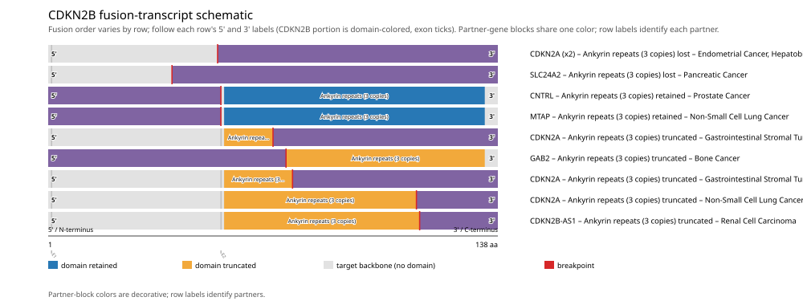

Full per-gene detail: [gene_reports/cdkn2b/report.md](gene_reports/cdkn2b/report.md)

#### NTRK1 (Honorable mention, Curated gene config)

NTRK1 was analyzed across 78 fusion events, 72.7% in-frame and 84.2% domain-retained. Domain-retention Fisher's exact test on NTRK1's own fusion events alone gives p=0.0514497 (not statistically significant at alpha=0.05). Among 285 genes scanned genome-wide in this cohort run, NTRK1's Benjamini-Hochberg-adjusted q=0.320147 (does not reach genome-wide FDR significance). Did not survive genome-wide multiple-testing correction (FDR-adjusted q-value at or above the significance threshold), but ranks highly by raw p-value among the non-FDR-significant genes and may warrant targeted follow-up. This is NOT a claim of statistical significance.

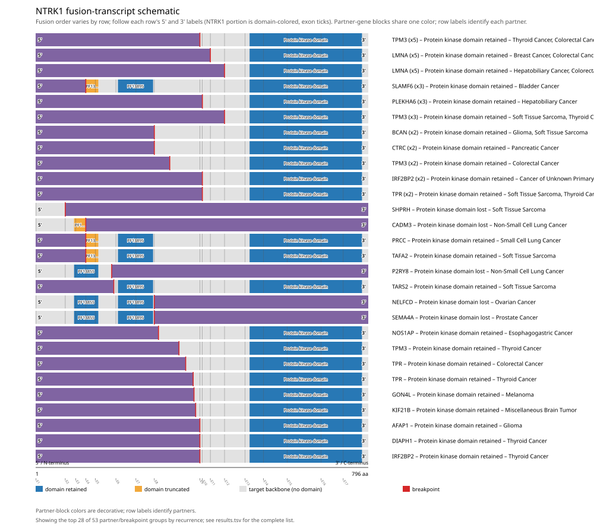

Full per-gene detail: [gene_reports/ntrk1/report.md](gene_reports/ntrk1/report.md)

#### NTRK3 (Honorable mention, Curated gene config)

NTRK3 was analyzed across 58 fusion events, 98.2% in-frame and 96.5% domain-retained. Domain-retention Fisher's exact test on NTRK3's own fusion events alone gives p=0.0555556 (not statistically significant at alpha=0.05). Among 285 genes scanned genome-wide in this cohort run, NTRK3's Benjamini-Hochberg-adjusted q=0.0759241 (does not reach genome-wide FDR significance). Did not survive genome-wide multiple-testing correction (FDR-adjusted q-value at or above the significance threshold), but ranks highly by raw p-value among the non-FDR-significant genes and may warrant targeted follow-up. This is NOT a claim of statistical significance.

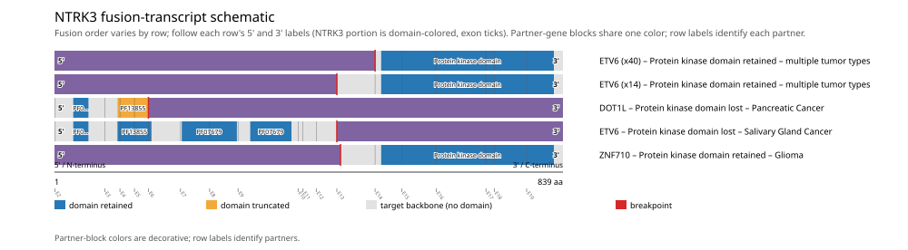

Full per-gene detail: [gene_reports/ntrk3/report.md](gene_reports/ntrk3/report.md)

#### IKBKE (Honorable mention)

IKBKE was analyzed across 12 fusion events, 50.0% in-frame and 36.4% domain-retained. Domain-retention Fisher's exact test on IKBKE's own fusion events alone gives p=0.0666667 (not statistically significant at alpha=0.05). Among 285 genes scanned genome-wide in this cohort run, IKBKE's Benjamini-Hochberg-adjusted q=1 (does not reach genome-wide FDR significance). Did not survive genome-wide multiple-testing correction (FDR-adjusted q-value at or above the significance threshold), but ranks highly by raw p-value among the non-FDR-significant genes and may warrant targeted follow-up. This is NOT a claim of statistical significance.

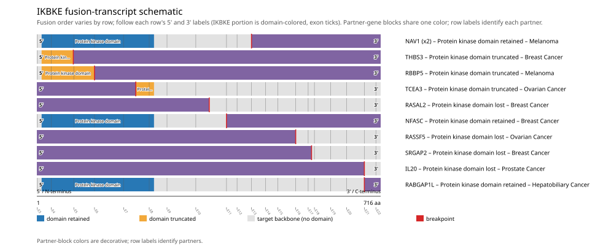

Full per-gene detail: [gene_reports/ikbke/report.md](gene_reports/ikbke/report.md)

#### FLI1 (Honorable mention, Curated gene config)

FLI1 was analyzed across 118 fusion events, 68.2% in-frame and 94.0% domain-retained. Domain-retention Fisher's exact test on FLI1's own fusion events alone gives p=0.0768769 (not statistically significant at alpha=0.05). Among 285 genes scanned genome-wide in this cohort run, FLI1's Benjamini-Hochberg-adjusted q=1 (does not reach genome-wide FDR significance). Did not survive genome-wide multiple-testing correction (FDR-adjusted q-value at or above the significance threshold), but ranks highly by raw p-value among the non-FDR-significant genes and may warrant targeted follow-up. This is NOT a claim of statistical significance.

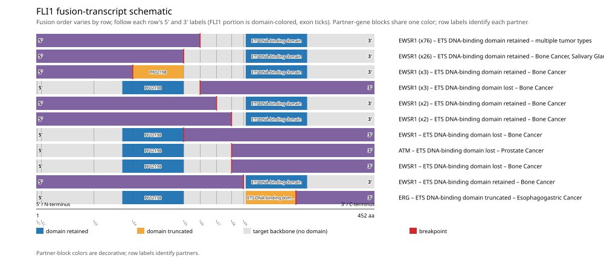

Full per-gene detail: [gene_reports/fli1/report.md](gene_reports/fli1/report.md)

#### RTEL1 (Honorable mention)

RTEL1 was analyzed across 24 fusion events, 50.0% in-frame and 37.5% domain-retained. Domain-retention Fisher's exact test on RTEL1's own fusion events alone gives p=0.116746 (not statistically significant at alpha=0.05). Among 285 genes scanned genome-wide in this cohort run, RTEL1's Benjamini-Hochberg-adjusted q=1 (does not reach genome-wide FDR significance). Did not survive genome-wide multiple-testing correction (FDR-adjusted q-value at or above the significance threshold), but ranks highly by raw p-value among the non-FDR-significant genes and may warrant targeted follow-up. This is NOT a claim of statistical significance.

Full per-gene detail: [gene_reports/rtel1/report.md](gene_reports/rtel1/report.md)

#### KDM5A (Honorable mention)

KDM5A was analyzed across 10 fusion events, 50.0% in-frame and 55.6% domain-retained. Domain-retention Fisher's exact test on KDM5A's own fusion events alone gives p=0.119048 (not statistically significant at alpha=0.05). Among 285 genes scanned genome-wide in this cohort run, KDM5A's Benjamini-Hochberg-adjusted q=1 (does not reach genome-wide FDR significance). Did not survive genome-wide multiple-testing correction (FDR-adjusted q-value at or above the significance threshold), but ranks highly by raw p-value among the non-FDR-significant genes and may warrant targeted follow-up. This is NOT a claim of statistical significance.

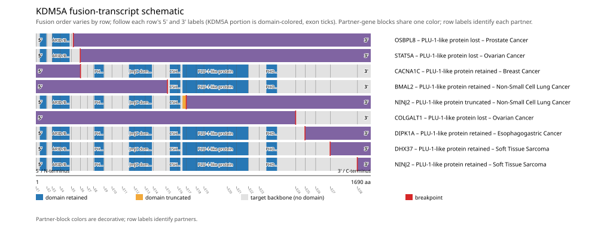

Full per-gene detail: [gene_reports/kdm5a/report.md](gene_reports/kdm5a/report.md)

#### FH (Honorable mention)

FH was analyzed across 16 fusion events, 16.7% in-frame and 13.3% domain-retained. Domain-retention Fisher's exact test on FH's own fusion events alone gives p=0.142857 (not statistically significant at alpha=0.05). Among 285 genes scanned genome-wide in this cohort run, FH's Benjamini-Hochberg-adjusted q=1 (does not reach genome-wide FDR significance). Did not survive genome-wide multiple-testing correction (FDR-adjusted q-value at or above the significance threshold), but ranks highly by raw p-value among the non-FDR-significant genes and may warrant targeted follow-up. This is NOT a claim of statistical significance.

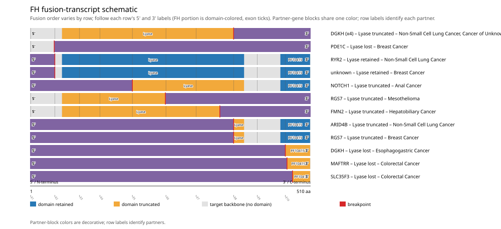

Full per-gene detail: [gene_reports/fh/report.md](gene_reports/fh/report.md)

#### CDK12 (Honorable mention)

CDK12 was analyzed across 43 fusion events, 50.0% in-frame and 39.0% domain-retained. Domain-retention Fisher's exact test on CDK12's own fusion events alone gives p=0.17342 (not statistically significant at alpha=0.05). Among 285 genes scanned genome-wide in this cohort run, CDK12's Benjamini-Hochberg-adjusted q=1 (does not reach genome-wide FDR significance). Did not survive genome-wide multiple-testing correction (FDR-adjusted q-value at or above the significance threshold), but ranks highly by raw p-value among the non-FDR-significant genes and may warrant targeted follow-up. This is NOT a claim of statistical significance.

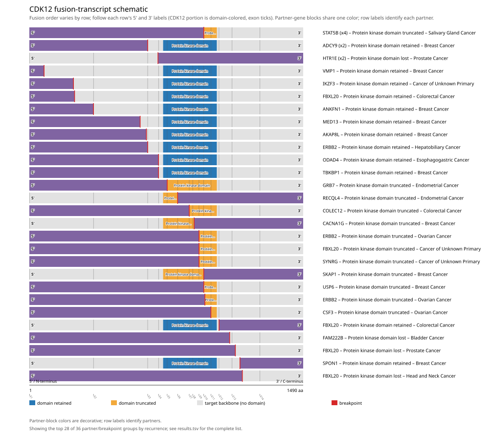

Full per-gene detail: [gene_reports/cdk12/report.md](gene_reports/cdk12/report.md)

#### POLD1 (Honorable mention)

POLD1 was analyzed across 16 fusion events, 33.3% in-frame and 46.2% domain-retained. Domain-retention Fisher's exact test on POLD1's own fusion events alone gives p=0.192308 (not statistically significant at alpha=0.05). Among 285 genes scanned genome-wide in this cohort run, POLD1's Benjamini-Hochberg-adjusted q=0.735265 (does not reach genome-wide FDR significance). Did not survive genome-wide multiple-testing correction (FDR-adjusted q-value at or above the significance threshold), but ranks highly by raw p-value among the non-FDR-significant genes and may warrant targeted follow-up. This is NOT a claim of statistical significance.

Full per-gene detail: [gene_reports/pold1/report.md](gene_reports/pold1/report.md)

#### AGO2 (Honorable mention)

AGO2 was analyzed across 23 fusion events, 46.2% in-frame and 31.8% domain-retained. Domain-retention Fisher's exact test on AGO2's own fusion events alone gives p=0.225232 (not statistically significant at alpha=0.05). Among 285 genes scanned genome-wide in this cohort run, AGO2's Benjamini-Hochberg-adjusted q=1 (does not reach genome-wide FDR significance). Did not survive genome-wide multiple-testing correction (FDR-adjusted q-value at or above the significance threshold), but ranks highly by raw p-value among the non-FDR-significant genes and may warrant targeted follow-up. This is NOT a claim of statistical significance.

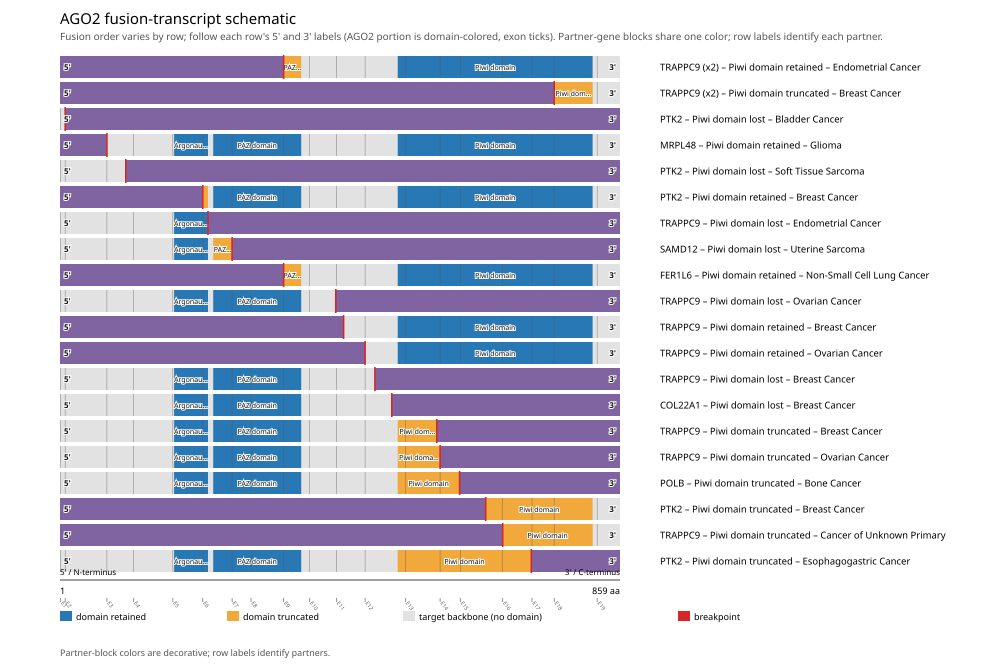

Full per-gene detail: [gene_reports/ago2/report.md](gene_reports/ago2/report.md)

#### NRG1 (Honorable mention)

NRG1 was analyzed across 15 fusion events, 100.0% in-frame and 86.7% domain-retained. Domain-retention Fisher's exact test on NRG1's own fusion events alone gives p=0.227273 (not statistically significant at alpha=0.05). Among 285 genes scanned genome-wide in this cohort run, NRG1's Benjamini-Hochberg-adjusted q=1 (does not reach genome-wide FDR significance). Did not survive genome-wide multiple-testing correction (FDR-adjusted q-value at or above the significance threshold), but ranks highly by raw p-value among the non-FDR-significant genes and may warrant targeted follow-up. This is NOT a claim of statistical significance.

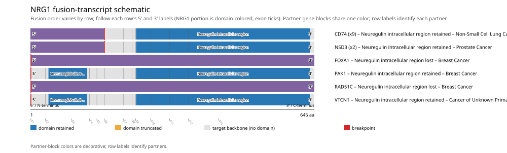

Full per-gene detail: [gene_reports/nrg1/report.md](gene_reports/nrg1/report.md)

#### MTAP (Honorable mention)

MTAP was analyzed across 4 fusion events, 33.3% in-frame and 25.0% domain-retained. Domain-retention Fisher's exact test on MTAP's own fusion events alone gives p=0.25 (not statistically significant at alpha=0.05). Among 285 genes scanned genome-wide in this cohort run, MTAP's Benjamini-Hochberg-adjusted q=1 (does not reach genome-wide FDR significance). Did not survive genome-wide multiple-testing correction (FDR-adjusted q-value at or above the significance threshold), but ranks highly by raw p-value among the non-FDR-significant genes and may warrant targeted follow-up. This is NOT a claim of statistical significance.

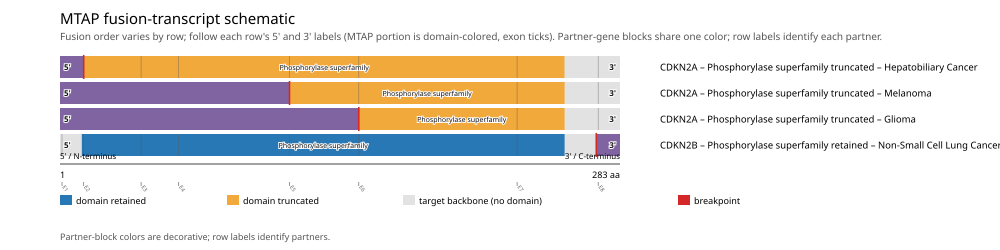

Full per-gene detail: [gene_reports/mtap/report.md](gene_reports/mtap/report.md)

#### RPS6KA4 (Honorable mention)

RPS6KA4 was analyzed across 13 fusion events, 62.5% in-frame and 58.3% domain-retained. Domain-retention Fisher's exact test on RPS6KA4's own fusion events alone gives p=0.261905 (not statistically significant at alpha=0.05). Among 285 genes scanned genome-wide in this cohort run, RPS6KA4's Benjamini-Hochberg-adjusted q=1 (does not reach genome-wide FDR significance). Did not survive genome-wide multiple-testing correction (FDR-adjusted q-value at or above the significance threshold), but ranks highly by raw p-value among the non-FDR-significant genes and may warrant targeted follow-up. This is NOT a claim of statistical significance.

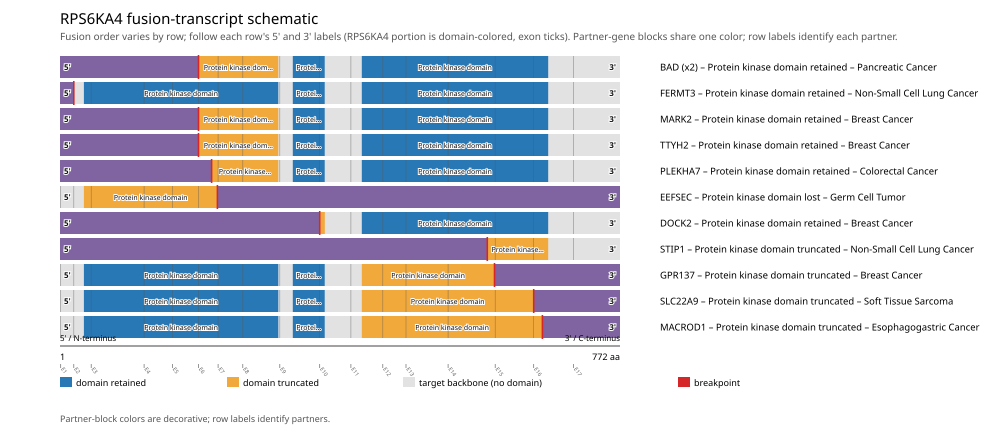

Full per-gene detail: [gene_reports/rps6ka4/report.md](gene_reports/rps6ka4/report.md)

#### PLK2 (Honorable mention)

PLK2 was analyzed across 7 fusion events, 50.0% in-frame and 57.1% domain-retained. Domain-retention Fisher's exact test on PLK2's own fusion events alone gives p=0.285714 (not statistically significant at alpha=0.05). Among 285 genes scanned genome-wide in this cohort run, PLK2's Benjamini-Hochberg-adjusted q=1 (does not reach genome-wide FDR significance). Did not survive genome-wide multiple-testing correction (FDR-adjusted q-value at or above the significance threshold), but ranks highly by raw p-value among the non-FDR-significant genes and may warrant targeted follow-up. This is NOT a claim of statistical significance.

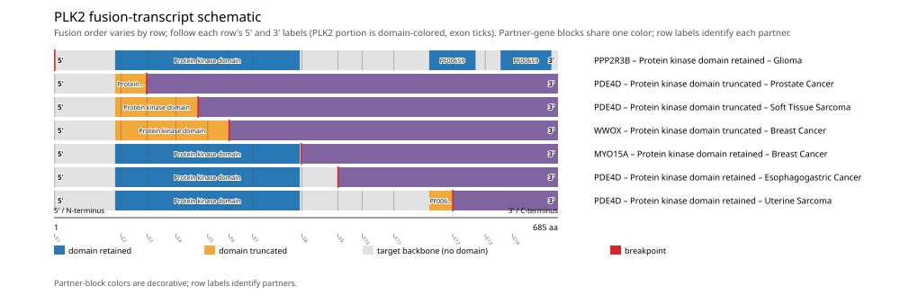

Full per-gene detail: [gene_reports/plk2/report.md](gene_reports/plk2/report.md)

#### ERG (Curated gene config)

ERG was analyzed across 788 fusion events, 33.0% in-frame and 97.7% domain-retained. Domain-retention Fisher's exact test on ERG's own fusion events alone gives p=0.778543 (not statistically significant at alpha=0.05). Among 285 genes scanned genome-wide in this cohort run, ERG's Benjamini-Hochberg-adjusted q=0.100745 (does not reach genome-wide FDR significance).

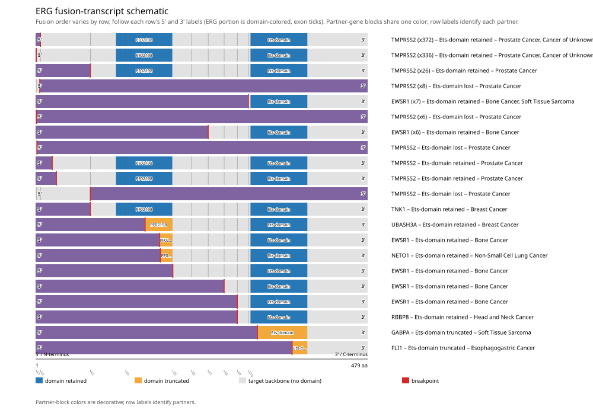

Full per-gene detail: [gene_reports/erg/report.md](gene_reports/erg/report.md)

## Discussion

- Cross-gene Benjamini-Hochberg FDR correction was applied jointly across the 285 genes that produced at least one computable p-value in this scan. This reduces false-positive findings relative to testing each gene in isolation, but is a conservative correction: a real per-gene effect can fail to reach the q < 0.05 threshold once corrected across that full p-value-bearing gene set.
- 10 gene(s) used hand-curated gene configurations, while 528 gene(s) were auto-configured from Genome Nexus canonical-transcript/Pfam-domain data using a kinase/catalytic-keyword heuristic to select the tracked domain; auto-configured domains have not been manually verified the way hand-curated ones have.
- Data were retrieved live from the public msk_impact_50k_2026 cBioPortal study as of 2026-10-29T15:52:29.772745+00:00. Some cBioPortal cohorts (e.g. actively accruing clinical-sequencing panels such as MSK-IMPACT) are updated periodically, so exact counts could shift if this scan is re-run later against such a cohort.
- All findings in this manuscript are computational, hypothesis-generating candidate evidence from bioinformatic analysis of public cohort data, not validated clinical calls; a gene's presence here is not a therapeutic or diagnostic recommendation.

## Appendix: per-gene report index

| gene_symbol | tier | config_source | n_events_analyzed | min_fdr_adjusted_q_value | report |
|---|---|---|---|---|---|
| BRAF | FDR-significant; Curated gene config | curated | 179 | 0.0006243 | [gene_reports/braf/report.md](gene_reports/braf/report.md) |
| CD74 | FDR-significant | auto | 67 | 0.0006243 | [gene_reports/cd74/report.md](gene_reports/cd74/report.md) |
| EGFR | FDR-significant | auto | 55 | 0.0006243 | [gene_reports/egfr/report.md](gene_reports/egfr/report.md) |
| EML4 | FDR-significant | auto | 223 | 0.0006243 | [gene_reports/eml4/report.md](gene_reports/eml4/report.md) |
| ETV6 | FDR-significant; Curated gene config | curated | 90 | 0.0006243 | [gene_reports/etv6/report.md](gene_reports/etv6/report.md) |
| FGFR2 | FDR-significant; Curated gene config | curated | 136 | 0.0006243 | [gene_reports/fgfr2/report.md](gene_reports/fgfr2/report.md) |
| FGFR3 | FDR-significant | auto | 152 | 0.0006243 | [gene_reports/fgfr3/report.md](gene_reports/fgfr3/report.md) |
| KIAA1549 | FDR-significant | auto | 44 | 0.0006243 | [gene_reports/kiaa1549/report.md](gene_reports/kiaa1549/report.md) |
| KIF5B | FDR-significant | auto | 96 | 0.0006243 | [gene_reports/kif5b/report.md](gene_reports/kif5b/report.md) |
| PRKACA | FDR-significant | auto | 35 | 0.0006243 | [gene_reports/prkaca/report.md](gene_reports/prkaca/report.md) |
| RET | FDR-significant; Curated gene config | curated | 194 | 0.0006243 | [gene_reports/ret/report.md](gene_reports/ret/report.md) |
| TMPRSS2 | FDR-significant | auto | 867 | 0.0006243 | [gene_reports/tmprss2/report.md](gene_reports/tmprss2/report.md) |
| ATF1 | FDR-significant | auto | 30 | 0.001092 | [gene_reports/atf1/report.md](gene_reports/atf1/report.md) |
| TPM3 | FDR-significant | auto | 14 | 0.001092 | [gene_reports/tpm3/report.md](gene_reports/tpm3/report.md) |
| ROS1 | FDR-significant; Curated gene config | curated | 122 | 0.001942 | [gene_reports/ros1/report.md](gene_reports/ros1/report.md) |
| NAB2 | FDR-significant | auto | 72 | 0.009199 | [gene_reports/nab2/report.md](gene_reports/nab2/report.md) |
| ALK | FDR-significant; Curated gene config | curated | 272 | 0.01665 | [gene_reports/alk/report.md](gene_reports/alk/report.md) |
| CDKN2B | Honorable mention | auto | 12 | 0.5249 | [gene_reports/cdkn2b/report.md](gene_reports/cdkn2b/report.md) |
| NTRK1 | Honorable mention; Curated gene config | curated | 78 | 0.3201 | [gene_reports/ntrk1/report.md](gene_reports/ntrk1/report.md) |
| NTRK3 | Honorable mention; Curated gene config | curated | 58 | 0.07592 | [gene_reports/ntrk3/report.md](gene_reports/ntrk3/report.md) |
| IKBKE | Honorable mention | auto | 12 | 1 | [gene_reports/ikbke/report.md](gene_reports/ikbke/report.md) |
| FLI1 | Honorable mention; Curated gene config | curated | 118 | 1 | [gene_reports/fli1/report.md](gene_reports/fli1/report.md) |
| RTEL1 | Honorable mention | auto | 24 | 1 | [gene_reports/rtel1/report.md](gene_reports/rtel1/report.md) |
| KDM5A | Honorable mention | auto | 10 | 1 | [gene_reports/kdm5a/report.md](gene_reports/kdm5a/report.md) |
| FH | Honorable mention | auto | 16 | 1 | [gene_reports/fh/report.md](gene_reports/fh/report.md) |
| CDK12 | Honorable mention | auto | 43 | 1 | [gene_reports/cdk12/report.md](gene_reports/cdk12/report.md) |
| POLD1 | Honorable mention | auto | 16 | 0.7353 | [gene_reports/pold1/report.md](gene_reports/pold1/report.md) |
| AGO2 | Honorable mention | auto | 23 | 1 | [gene_reports/ago2/report.md](gene_reports/ago2/report.md) |
| NRG1 | Honorable mention | auto | 15 | 1 | [gene_reports/nrg1/report.md](gene_reports/nrg1/report.md) |
| MTAP | Honorable mention | auto | 4 | 1 | [gene_reports/mtap/report.md](gene_reports/mtap/report.md) |
| RPS6KA4 | Honorable mention | auto | 13 | 1 | [gene_reports/rps6ka4/report.md](gene_reports/rps6ka4/report.md) |
| PLK2 | Honorable mention | auto | 7 | 1 | [gene_reports/plk2/report.md](gene_reports/plk2/report.md) |
| ERG | Curated gene config | curated | 788 | 0.1007 | [gene_reports/erg/report.md](gene_reports/erg/report.md) |
