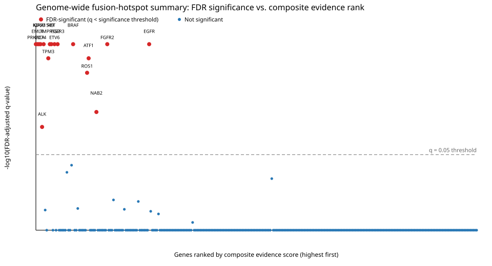

# Genome-wide fusion-hotspot cohort scan: msk_impact_50k_2026

- Total genes with any structural-variant record in the cohort: 3919
- Genes passing the >= 5-distinct-patient recurrence gate: 544
- Curated gene configs used: 10
- Auto-generated gene configs used: 528
- Auto-generated configs resolved by the HGNC-verified single-gene fallback: 14
- Genes gated in but non-coding per HGNC (domain analysis not applicable): 2
- Genes gated in but unresolvable (no verified protein-coding transcript): 4
- Genes in the FDR family (analyzed successfully): 538 of 544 gated genes
- Genes missing from the FDR family because of network errors: 0
- FDR-significant genes (q < 0.05) after Benjamini-Hochberg correction across those 538 genes: 17

- Junction-hotspot candidates (separate FDR family, q < 0.05): 87 of 270 tested

## Warnings

- 4 gated gene(s) had no resolvable canonical transcript in Genome Nexus and were skipped: H3C2, H3C6, MAP3K14, ZFTA
- 2 gated gene(s) are non-coding per HGNC; domain analysis does not apply: CDKN2B-AS1, LINC00114
- 14 gated gene(s) were resolved by the HGNC-verified single-gene fallback: AGAP3, CDH3, CREB3L1, ERF, KMT2B, MEF2B, NBPF20, PLCD3, RAB11FIP4, RECQL4, SEPTIN14, TCF3, TRAF2, TRAP1

## Honorable mentions: highly ranked non-FDR-significant genes worth human review

The following 15 gene(s) **did not survive genome-wide multiple-testing correction** (FDR-adjusted q-value at or above the q=0.05 significance threshold), but rank highest by raw Fisher p-value among the non-FDR-significant genes and may warrant targeted follow-up. This section is **not** a claim of statistical significance -- see the FDR-significant genes above for that.

| rank | gene_symbol | fisher_p_value | min_fdr_adjusted_q_value | n_events_analyzed | in_frame_percent | domain_retention_percent |
|---|---|---|---|---|---|---|
| 1 | CDKN2B | 0.02222 | 0.5249 | 12 | 66.67 | 20 |
| 2 | NTRK1 | 0.05145 | 0.3201 | 78 | 72.73 | 84.21 |
| 3 | NTRK3 | 0.05556 | 0.07592 | 58 | 98.21 | 96.49 |
| 4 | IKBKE | 0.06667 | 1 | 12 | 50 | 36.36 |
| 5 | FLI1 | 0.07688 | 1 | 118 | 68.22 | 94.02 |
| 6 | RTEL1 | 0.1167 | 1 | 24 | 50 | 37.5 |
| 7 | KDM5A | 0.119 | 1 | 10 | 50 | 55.56 |
| 8 | FH | 0.1429 | 1 | 16 | 16.67 | 13.33 |
| 9 | CDK12 | 0.1734 | 1 | 43 | 50 | 39.02 |
| 10 | POLD1 | 0.1923 | 0.7353 | 16 | 33.33 | 46.15 |
| 11 | AGO2 | 0.2252 | 1 | 23 | 46.15 | 31.82 |
| 12 | NRG1 | 0.2273 | 1 | 15 | 100 | 86.67 |
| 13 | MTAP | 0.25 | 1 | 4 | 33.33 | 25 |
| 14 | RPS6KA4 | 0.2619 | 1 | 13 | 62.5 | 58.33 |
| 15 | PLK2 | 0.2857 | 1 | 7 | 50 | 57.14 |

## Genome-wide summary plot

One point per scanned gene with an FDR-adjusted q-value: x-axis is genes ranked by composite evidence score (descending), y-axis is -log10(FDR-adjusted q-value), with a dashed line at the q=0.05 significance threshold.

## Junction-hotspot candidates (separate FDR family)

Junction concentration asks whether one exon holds more of a gene's fusion junctions than breakpoints drawn uniformly along the gene would put there. Its p-values are BH-adjusted across the 270 tested genes as their own family and never make a gene FDR-significant. On a capture panel that sequences every exon but only selected introns, breakpoints near exons are detected far more often than ones deep in introns, so junctions concentrate partly by assay design and these p-values overstate the evidence. Treat the genes below as candidates to confirm in a cohort sequenced without intron selection (see the README's panel caveat).

| gene | top junction | observed share | random-breakage share | q |
|---|---|---|---|---|
| ALK | exon 20 (3') | 0.8977 | 0.002908 | 7.941e-05 |
| APC | exon 16 (5') | 0.9 | 0.08017 | 7.941e-05 |
| ARID1A | exon 15 (5') | 0.2222 | 0.002719 | 7.941e-05 |
| BRAF | exon 9 (3') | 0.5705 | 0.03553 | 7.941e-05 |
| CCDC6 | exon 1 (5') | 0.925 | 0.4576 | 7.941e-05 |
| CD74 | exon 6 (5') | 0.7174 | 0.1373 | 7.941e-05 |
| CREB3L1 | exon 6 (3') | 0.6923 | 0.02936 | 7.941e-05 |
| EGFR | exon 24 (5') | 0.4839 | 0.004529 | 7.941e-05 |
| EML4 | exon 13 (5') | 0.3407 | 0.03591 | 7.941e-05 |
| ERG | exon 2 (3') | 0.8824 | 0.4471 | 7.941e-05 |
| ETV6 | exon 5 (5') | 0.6522 | 0.06117 | 7.941e-05 |
| EWSR1 | exon 7 (5') | 0.5038 | 0.05177 | 7.941e-05 |
| EZR | exon 10 (5') | 1 | 0.0177 | 7.941e-05 |
| FGFR2 | exon 17 (5') | 0.9259 | 0.03158 | 7.941e-05 |
| FGFR3 | exon 16 (5') | 0.5625 | 0.01908 | 7.941e-05 |
| FLI1 | exon 6 (3') | 0.6869 | 0.1959 | 7.941e-05 |
| KIAA1549 | exon 16 (5') | 0.5385 | 0.06389 | 7.941e-05 |
| KIF5B | exon 15 (5') | 0.7368 | 0.1167 | 7.941e-05 |
| MET | exon 15 (3') | 0.5833 | 0.02478 | 7.941e-05 |
| NAB2 | exon 6 (5') | 0.6981 | 0.183 | 7.941e-05 |
| NCOA3 | exon 12 (5') | 0.625 | 0.01158 | 7.941e-05 |
| NOTCH1 | exon 28 (3') | 0.4375 | 0.0177 | 7.941e-05 |
| NOTCH2 | exon 27 (3') | 0.5 | 0.006333 | 7.941e-05 |
| NTRK1 | exon 10 (3') | 0.2075 | 0.01089 | 7.941e-05 |
| PRKACA | exon 2 (3') | 1 | 0.3897 | 7.941e-05 |
| RET | exon 12 (3') | 0.9021 | 0.03741 | 7.941e-05 |
| ROS1 | exon 34 (3') | 0.4186 | 0.01375 | 7.941e-05 |
| SPEN | exon 11 (5') | 0.8333 | 0.09797 | 7.941e-05 |
| STAT6 | exon 16 (3') | 0.5435 | 0.02951 | 7.941e-05 |
| TACC3 | exon 11 (3') | 0.4444 | 0.08784 | 7.941e-05 |
| TERT | exon 1 (3') | 0.8 | 0.006614 | 7.941e-05 |
| TFE3 | exon 5 (3') | 0.3333 | 0.01266 | 7.941e-05 |
| TMPRSS2 | exon 1 (5') | 0.673 | 0.227 | 7.941e-05 |
| WT1 | exon 8 (3') | 0.9583 | 0.07504 | 7.941e-05 |
| RAF1 | exon 7 (5') | 0.8333 | 0.04805 | 0.00015 |
| SDC4 | exon 2 (5') | 0.7692 | 0.1232 | 0.00015 |
| ASPSCR1 | exon 7 (5') | 0.9286 | 0.3166 | 0.0002842 |
| BICC1 | exon 16 (3') | 0.2083 | 0.01062 | 0.0002842 |
| DNAJB1 | exon 1 (5') | 0.7353 | 0.3763 | 0.001286 |
| EP300 | exon 31 (3') | 0.4286 | 0.0402 | 0.001286 |
| NTRK3 | exon 14 (3') | 0.6 | 0.243 | 0.001286 |
| STAT5B | exon 18 (5') | 0.375 | 0.007548 | 0.001286 |
| ATF1 | exon 4 (3') | 0.64 | 0.239 | 0.0018 |
| CREB1 | exon 7 (3') | 0.8 | 0.0698 | 0.0018 |
| RELA | exon 2 (3') | 0.8 | 0.06811 | 0.0018 |
| BCOR | exon 4 (3') | 1 | 0.08894 | 0.002348 |
| AGK | exon 2 (5') | 1 | 0.4032 | 0.004021 |
| RARA | exon 9 (5') | 0.3 | 0.01655 | 0.009562 |
| CUL1 | exon 7 (5') | 0.8 | 0.06098 | 0.009808 |
| KMT2C | exon 52 (3') | 0.2857 | 0.009522 | 0.009808 |
| PAX8 | exon 10 (5') | 0.75 | 0.1124 | 0.009808 |
| PPP2R1A | exon 6 (3') | 0.5 | 0.007407 | 0.009808 |
| RBM10 | exon 17 (5') | 0.6667 | 0.06897 | 0.009808 |
| SMAD3 | exon 9 (5') | 0.6 | 0.03698 | 0.009808 |
| ZFHX3 | exon 9 (3') | 1 | 0.02551 | 0.009808 |
| KDM6A | exon 20 (3') | 0.4 | 0.003538 | 0.01395 |
| MKRN1 | exon 4 (5') | 0.5556 | 0.08922 | 0.01395 |
| PTPRS | exon 27 (5') | 0.2222 | 0.001353 | 0.01395 |
| ELF3 | exon 7 (3') | 0.6667 | 0.09002 | 0.01686 |
| EZH1 | exon 19 (5') | 0.4286 | 0.01919 | 0.01686 |
| EZH2 | exon 12 (5') | 0.2727 | 0.01602 | 0.01686 |
| PDGFRA | exon 4 (5') | 1 | 0.01811 | 0.01686 |
| RPS6KA4 | exon 6 (3') | 0.5 | 0.02361 | 0.01686 |
| VTCN1 | exon 3 (5') | 1 | 0.05274 | 0.01686 |
| ARID2 | exon 15 (3') | 0.4286 | 0.01749 | 0.02013 |
| KEAP1 | exon 5 (3') | 0.6667 | 0.02588 | 0.02013 |
| MALT1 | exon 1 (3') | 0.5 | 0.00593 | 0.02013 |
| TACC2 | exon 15 (3') | 0.2857 | 0.00557 | 0.0238 |
| ASXL1 | exon 12 (5') | 0.4 | 0.01418 | 0.02659 |
| RNF43 | exon 9 (3') | 0.3333 | 0.04134 | 0.02659 |
| SND1 | exon 10 (5') | 0.6 | 0.1957 | 0.02659 |
| ERBB2 | exon 25 (5') | 0.2 | 0.01679 | 0.02916 |
| FH | exon 7 (5') | 0.6667 | 0.07559 | 0.02916 |
| MCL1 | exon 1 (3') | 1 | 0.1486 | 0.02916 |
| ATRX | exon 9 (3') | 0.4 | 0.01215 | 0.03153 |
| CARM1 | exon 14 (5') | 0.2857 | 0.00634 | 0.03153 |
| NTRK2 | exon 14 (3') | 0.6667 | 0.01799 | 0.03153 |
| ANKRD11 | exon 9 (3') | 0.6667 | 0.03125 | 0.03709 |
| CDH1 | exon 9 (3') | 0.2857 | 0.01253 | 0.03709 |
| NOTCH3 | exon 20 (5') | 0.3 | 0.01838 | 0.03709 |
| TP53 | exon 6 (5') | 0.2273 | 0.03559 | 0.04329 |
| LMNA | exon 8 (5') | 0.2222 | 0.007564 | 0.0455 |
| PPM1D | exon 1 (3') | 0.2857 | 0.01095 | 0.0455 |
| JAK1 | exon 10 (5') | 0.3333 | 0.01561 | 0.04705 |
| PAK1 | exon 14 (5') | 0.5 | 0.0624 | 0.04705 |
| SETD2 | exon 3 (3') | 0.5 | 0.0439 | 0.04705 |
| TPR | exon 21 (5') | 0.6 | 0.04602 | 0.04961 |

## Scanned genes (sorted by significance)

The minimum q-value and gene-level FDR flag may come from any tested algorithm in the main family. The retention/disruption Fisher q-value columns refer only to those effects; blank means that specific test had no corrected q-value. The retention CMH columns stratify that test by OncoTree code; their q-values are BH-adjusted across genes as a separate family and do not affect the gene-level FDR flag. The junction-concentration columns are likewise their own family.

| gene_symbol | config_source | transcript_source | status | distinct_patient_count | total_sv_count | n_events_analyzed | in_frame_percent | domain_retention_percent | fisher_p_value | permutation_p_value | min_fdr_adjusted_q_value | fdr_significant | retention_fisher_q_value | retention_fisher_fdr_significant | retention_fisher_fragility_index | disruption_fisher_q_value | disruption_fisher_fdr_significant | disruption_fisher_fragility_index | retention_cmh_p_value | retention_cmh_q_value | retention_mh_common_odds_ratio | retention_informative_tumor_types | retention_cmh_fragility_index | junction_concentration_p_value | junction_concentration_q_value | truncating_fusions | domain_completing_fusions | top_composite_score | top_composite_partner_gene | error |
|---|---|---|---|---|---|---|---|---|---|---|---|---|---|---|---|---|---|---|---|---|---|---|---|---|---|---|---|---|---|---|
| TMPRSS2 | auto | genome_nexus_batch | ok | 1088 | 1132 | 867 | 33.33 | 6.243 | 0.08495 | 1 | 0.0006243 | yes | 1 | no |  | 1 | no |  | 0.08951 | 0.5458 | 1.815 | 4 |  | 1e-05 | 7.941e-05 | 7 | 0 | 0.587 | ERG |  |
| EGFR | auto | genome_nexus_batch | ok | 466 | 559 | 55 | 70 | 74.55 | 0.01844 | 1e-05 | 0.0006243 | yes | 0.4726 | no | 2 | 1 | no |  | 0.2191 | 0.5458 | 2.939 | 2 |  | 1e-05 | 7.941e-05 | 3 | 0 | 0.3311 | SEPTIN14 |  |
| BRAF | curated |  | ok | 247 | 251 | 179 | 92.64 | 91.57 | 0.03713 | 1e-05 | 0.0006243 | yes | 0.8321 | no | 1 | 1 | no |  | 0.5297 | 0.6799 | 1.826 | 4 |  | 1e-05 | 7.941e-05 | 0 | 0 | 0.5048 | KIAA1549 |  |
| EML4 | auto | genome_nexus_batch | ok | 224 | 225 | 223 | 97.51 | 53.36 | 0.9999 | 1e-05 | 0.0006243 | yes | 1 | no |  |  |  |  | 0.001882 | 0.08094 | 0.1261 | 1 | 8 | 1e-05 | 7.941e-05 | 85 | 0 | 0.7578 | ALK |  |
| RET | curated |  | ok | 219 | 230 | 194 | 85.38 | 92.27 | 0.002566 | 1e-05 | 0.0006243 | yes | 0.08971 | no | 4 | 0.1668 | no | 3 | 0.07472 | 0.5458 | 3.513 | 4 |  | 1e-05 | 7.941e-05 | 1 | 0 | 0.5767 | KIF5B |  |
| ETV6 | curated |  | ok | 213 | 214 | 90 | 81.01 | 77.27 | 0.0002902 | 1e-05 | 0.0006243 | yes | 0.01268 | yes | 7 |  |  |  | 0.6473 | 0.7325 | 1.556 | 3 |  | 1e-05 | 7.941e-05 | 0 | 0 | 0.5736 | NTRK3 |  |
| FGFR3 | auto | genome_nexus_batch | ok | 194 | 195 | 152 | 97.37 | 94.04 | 0.01947 | 1e-05 | 0.0006243 | yes | 0.4726 | no | 2 | 1 | no |  | 0.3061 | 0.5458 | 3.52 | 3 |  | 1e-05 | 7.941e-05 | 3 | 0 | 0.5665 | TACC3 |  |
| FGFR2 | curated |  | ok | 188 | 195 | 136 | 93.1 | 85.82 | 0.002267 | 1e-05 | 0.0006243 | yes | 0.08257 | no | 4 | 1 | no |  | 0.3002 | 0.5458 | 2.566 | 4 |  | 1e-05 | 7.941e-05 | 3 | 0 | 0.4161 | BICC1 |  |
| KIF5B | auto | genome_nexus_batch | ok | 95 | 96 | 96 | 97.7 | 96.88 | 0.3078 | 1e-05 | 0.0006243 | yes | 1 | no |  |  |  |  | 0.1716 | 0.5458 | 5.083 | 1 |  | 1e-05 | 7.941e-05 | 0 | 0 | 0.7389 | RET |  |
| CD74 | auto | genome_nexus_batch | ok | 74 | 74 | 67 | 68.42 | 89.39 | 0.2701 | 1e-05 | 0.0006243 | yes | 1 | no |  |  |  |  | 0.852 | 0.8723 | 1.2 | 1 |  | 1e-05 | 7.941e-05 | 0 | 0 | 0.6589 | ROS1 |  |
| KIAA1549 | auto | genome_nexus_batch | ok | 44 | 44 | 44 | 97.56 | 50 | 0.9272 | 1e-05 | 0.0006243 | yes | 1 | no |  |  |  |  | 0.608 | 0.7162 | 2.167 | 1 |  | 1e-05 | 7.941e-05 | 22 | 0 | 0.6214 | BRAF |  |
| PRKACA | auto | genome_nexus_batch | ok | 35 | 35 | 35 | 96 | 96.67 | 0.2143 | 1e-05 | 0.0006243 | yes | 1 | no |  |  |  |  |  |  |  | 0 |  | 1e-05 | 7.941e-05 | 1 | 0 | 0.7742 | DNAJB1 |  |
| ATF1 | auto | genome_nexus_batch | ok | 30 | 30 | 30 | 84 | 90 | 0.7042 | 0.1584 | 0.001092 | yes | 1 | no |  | 1 | no |  | 0.2334 | 0.5458 | 0 | 2 |  | 0.0003 | 0.0018 | 0 | 0 | 0.4549 | EWSR1 |  |
| TPM3 | auto | genome_nexus_batch | ok | 14 | 14 | 14 | 100 | 64.29 | 1 | 2e-05 | 0.001092 | yes | 1 | no |  |  |  |  | 0.3173 | 0.5458 | 0 | 1 |  |  |  | 5 | 0 | 0.5971 | NTRK1 |  |
| ROS1 | curated |  | ok | 204 | 207 | 122 | 72.73 | 90.68 | 0.186 | 4e-05 | 0.001942 | yes | 1 | no |  | 1 | no |  | 0.08817 | 0.5458 | 3.571 | 1 |  | 1e-05 | 7.941e-05 | 0 | 0 | 0.4662 | CD74 |  |
| NAB2 | auto | genome_nexus_batch | ok | 111 | 111 | 72 | 71.43 | 69.01 | 0.1799 | 0.0002 | 0.009199 | yes | 1 | no |  | 1 | no |  | 0.6375 | 0.731 | 0.6124 | 2 |  | 1e-05 | 7.941e-05 | 13 | 0 | 0.4295 | STAT6 |  |
| ALK | curated |  | ok | 321 | 322 | 272 | 97.41 | 96.31 | 0.0005779 | 0.0004 | 0.01665 | yes | 0.02296 | yes | 4 |  |  |  | 0.000733 | 0.06303 | 24.52 | 2 | 2 | 1e-05 | 7.941e-05 | 0 | 0 | 0.6585 | EML4 |  |
| NTRK3 | curated |  | ok | 71 | 71 | 58 | 98.21 | 96.49 | 0.05556 | 0.001998 | 0.07592 | no | 1 | no |  |  |  |  | 0.08326 | 0.5458 | infinity | 1 |  | 0.0002 | 0.001286 | 0 | 0 | 0.509 | ETV6 |  |
| ERG | curated |  | ok | 863 | 863 | 788 | 32.96 | 97.68 | 0.7785 | 0.002997 | 0.1007 | no | 1 | no |  |  |  |  | 0.3539 | 0.5743 | 0.6104 | 2 |  | 1e-05 | 7.941e-05 | 2 | 1 | 0.5331 | TMPRSS2 |  |
| NCOA3 | auto | genome_nexus_batch | ok | 33 | 34 | 13 | 50 | 75 | 0.3394 | 0.003996 | 0.1294 | no | 1 | no |  | 1 | no |  |  |  |  | 0 |  | 1e-05 | 7.941e-05 | 0 | 0 | 0.1846 | EYA2 |  |
| STAT6 | auto | genome_nexus_batch | ok | 60 | 60 | 53 | 100 | 6 | 0.4667 | 1 | 0.3011 | no | 1 | no |  | 1 | no |  | 0.4913 | 0.6401 | 2.375 | 1 |  | 1e-05 | 7.941e-05 | 0 | 0 | 0.3991 | NAB2 |  |
| NTRK1 | curated |  | ok | 113 | 118 | 78 | 72.73 | 84.21 | 0.05145 | 0.01099 | 0.3201 | no | 1 | no |  |  |  |  | 0.095 | 0.5458 | 8 | 4 |  | 1e-05 | 7.941e-05 | 3 | 0 | 0.3559 | LMNA |  |
| RELA | auto | genome_nexus_batch | ok | 11 | 11 | 6 | 66.67 | 100 | 1 | 0.01499 | 0.4225 | no | 1 | no |  |  |  |  |  |  |  | 0 |  | 0.0003 | 0.0018 | 0 | 0 | 0.4962 | ZFTA |  |
| RBM10 | auto | genome_nexus_batch | ok | 36 | 36 | 7 | 75 | 71.43 | 0.2857 | 0.01598 | 0.4366 | no | 1 | no |  |  |  |  |  |  |  | 0 |  | 0.001998 | 0.009808 | 0 | 0 | 0.3861 | TFE3 |  |
| AGAP3 | auto | genome_nexus_single_gene_hgnc_verified | ok | 6 | 6 | 6 | 100 | 100 | 1 | 0.01698 | 0.4498 | no | 1 | no |  |  |  |  |  |  |  | 0 |  | 0.04995 | 0.1163 | 0 | 0 | 0.6166 | BRAF |  |
| RAD51B | auto | genome_nexus_batch | ok | 16 | 16 | 2 | 50 | 50 | 0.5 | 0.01898 | 0.4726 | no | 1 | no |  |  |  |  |  |  |  | 0 |  |  |  | 1 | 0 | 0.3288 | CCND2 |  |
| CDKN2B | auto | genome_nexus_batch | ok | 40 | 40 | 12 | 66.67 | 20 | 0.02222 | 0.2079 | 0.5249 | no | 0.5249 | no | 1 |  |  |  | 0.3173 | 0.5458 | infinity | 1 |  | 1 | 1 | 5 | 0 | 0.2992 | CDKN2A |  |
| POLD1 | auto | genome_nexus_batch | ok | 36 | 37 | 16 | 33.33 | 46.15 | 0.1923 | 0.03197 | 0.7353 | no | 1 | no |  | 1 | no |  |  |  |  | 0 |  | 0.01998 | 0.05801 | 6 | 0 | 0.2623 | MYH14 |  |
| EWSR1 | auto | genome_nexus_batch | ok | 415 | 418 | 349 | 78.35 | 11.3 | 1 | 1 | 1 | no | 1 | no |  |  |  |  | 0.05973 | 0.5458 | 0.3496 | 4 |  | 1e-05 | 7.941e-05 | 35 | 0 | 0.3727 | FLI1 |  |
| TP53 | auto | genome_nexus_batch | ok | 258 | 260 | 47 | 30.77 | 27.91 | 1 | 1 | 1 | no | 1 | no |  | 1 | no |  |  |  |  | 0 |  | 0.01299 | 0.04329 | 20 | 0 | 0.2279 | EIF5 |  |
| NF1 | auto | genome_nexus_batch | ok | 247 | 253 | 47 | 27.78 | 47.73 | 0.3964 | 0.505 | 1 | no | 1 | no |  |  |  |  | 0.763 | 0.8306 | 1.5 | 3 |  | 0.04595 | 0.1098 | 2 | 0 | 0.1374 | RAB11FIP4 |  |
| ARID1A | auto | genome_nexus_batch | ok | 148 | 149 | 31 | 44.44 | 37.93 | 0.452 | 0.9703 | 1 | no | 1 | no |  | 1 | no |  | 0.8084 | 0.8528 | 0.75 | 2 |  | 1e-05 | 7.941e-05 | 2 | 0 | 0.08826 | NUDC |  |
| SMARCA4 | auto | genome_nexus_batch | ok | 143 | 146 | 36 | 36.84 | 41.67 | 0.9761 | 0.9802 | 1 | no | 1 | no |  | 1 | no |  |  |  |  | 0 |  | 0.1386 | 0.243 | 8 | 0 | 0.1849 | LDLR |  |
| TACC3 | auto | genome_nexus_batch | ok | 138 | 139 | 132 | 97.06 | 48.48 | 0.6101 | 1 | 1 | no | 1 | no |  |  |  |  | 0.3242 | 0.5466 | 0.6716 | 4 |  | 1e-05 | 7.941e-05 | 68 | 0 | 0.5671 | FGFR3 |  |
| KMT2C | auto | genome_nexus_batch | ok | 134 | 136 | 32 | 14.29 | 53.57 | 0.48 | 1 | 1 | no | 1 | no |  | 1 | no |  | 0.4795 | 0.6344 | infinity | 1 |  | 0.001998 | 0.009808 | 2 | 0 | 0.112 | GALNT11 |  |
| KMT2D | auto | genome_nexus_batch | ok | 128 | 130 | 47 | 25 | 48.57 | 1 | 1 | 1 | no | 1 | no |  | 1 | no |  |  |  |  | 0 |  | 0.3366 | 0.4328 | 1 | 0 | 0.04628 | ARF3 |  |
| CREBBP | auto | genome_nexus_batch | ok | 121 | 122 | 46 | 50 | 32.61 | 0.582 | 0.8416 | 1 | no | 1 | no |  | 1 | no |  | 0.3124 | 0.5458 | 6 | 1 |  | 0.02398 | 0.06539 | 8 | 0 | 0.1314 | SLX4 |  |
| FLI1 | curated |  | ok | 121 | 121 | 118 | 68.22 | 94.02 | 0.07688 | 0.198 | 1 | no | 1 | no |  |  |  |  | 0.3459 | 0.572 | 2.375 | 1 |  | 1e-05 | 7.941e-05 | 1 | 1 | 0.5989 | EWSR1 |  |
| WT1 | auto | genome_nexus_batch | ok | 119 | 119 | 104 | 93.94 | 4.808 | 0.9961 | 0.4356 | 1 | no | 1 | no |  |  |  |  | 0.06049 | 0.5458 | 0.1176 | 1 |  | 1e-05 | 7.941e-05 | 6 | 0 | 0.5423 | EWSR1 |  |
| NOTCH1 | auto | genome_nexus_batch | ok | 115 | 117 | 47 | 57.89 | 60.87 | 0.8464 | 0.703 | 1 | no | 1 | no |  | 1 | no |  | 0.2689 | 0.5458 | infinity | 1 |  | 1e-05 | 7.941e-05 | 0 | 0 | 0.2025 | SEC16A |  |
| NOTCH3 | auto | genome_nexus_batch | ok | 101 | 102 | 26 | 25 | 59.09 | 1 | 1 | 1 | no | 1 | no |  | 1 | no |  |  |  |  | 0 |  | 0.01099 | 0.03709 | 0 | 0 | 0.09913 | BRD4 |  |
| CDK12 | auto | genome_nexus_batch | ok | 99 | 101 | 43 | 50 | 39.02 | 0.1734 | 0.1089 | 1 | no | 1 | no |  |  |  |  | 0.7595 | 0.8306 | 0.6 | 1 |  | 0.06394 | 0.1381 | 15 | 0 | 0.2874 | ADCY9 |  |
| EP300 | auto | genome_nexus_batch | ok | 98 | 98 | 22 | 14.29 | 31.82 | 1 | 1 | 1 | no | 1 | no |  | 1 | no |  |  |  |  | 0 |  | 0.00019 | 0.001286 | 3 | 0 | 0.07645 | ACO2 |  |
| STK11 | auto | genome_nexus_batch | ok | 97 | 98 | 23 | 14.29 | 30.43 | 0.3043 | 0.2673 | 1 | no | 1 | no |  |  |  |  | 0.3173 | 0.5458 | infinity | 1 |  | 0.2178 | 0.3196 | 13 | 0 | 0.1403 | MIDN |  |
| NOTCH2 | auto | genome_nexus_batch | ok | 92 | 92 | 28 | 25 | 53.85 | 0.56 | 0.9901 | 1 | no | 1 | no |  | 1 | no |  |  |  |  | 0 |  | 1e-05 | 7.941e-05 | 0 | 0 | 0.2176 | CEP85 |  |
| ERBB2 | auto | genome_nexus_batch | ok | 88 | 92 | 44 | 35 | 43.18 | 1 | 1 | 1 | no | 1 | no |  | 1 | no |  | 0.1768 | 0.5458 | 0 | 3 |  | 0.007992 | 0.02916 | 10 | 0 | 0.1084 | IKZF3 |  |
| TSC2 | auto | genome_nexus_batch | ok | 88 | 90 | 34 | 42.86 | 25 | 0.5195 | 0.8812 | 1 | no | 1 | no |  |  |  |  | 0.8084 | 0.8528 | 1.333 | 2 |  | 0.2574 | 0.3658 | 13 | 0 | 0.2475 | LMLN |  |
| BRD4 | auto | genome_nexus_batch | ok | 86 | 87 | 32 | 11.11 | 39.29 | 1 | 1 | 1 | no | 1 | no |  | 1 | no |  | 0.3173 | 0.5458 | 0 | 1 |  | 0.01798 | 0.05395 | 1 | 0 | 0.1141 | NOTCH3 |  |
| PTEN | auto | genome_nexus_batch | ok | 86 | 86 | 9 | 50 | 25 | 1 | 1 | 1 | no | 1 | no |  |  |  |  |  |  |  | 0 |  | 0.02098 | 0.059 | 3 | 0 | 0.1487 | PAPSS2 |  |
| DOT1L | auto | genome_nexus_batch | ok | 85 | 85 | 22 | 55.56 | 36.36 | 0.9368 | 0.802 | 1 | no | 1 | no |  |  |  |  |  |  |  | 0 |  | 0.04895 | 0.1149 | 4 | 0 | 0.09687 | CELF5 |  |
| PBRM1 | auto | genome_nexus_batch | ok | 85 | 85 | 18 | 16.67 | 50 | 0.5 | 0.2376 | 1 | no | 1 | no |  | 1 | no |  | 0.3173 | 0.5458 | infinity | 1 |  | 0.3069 | 0.4144 | 1 | 0 | 0.158 | BAP1 |  |
| DNMT1 | auto | genome_nexus_batch | ok | 80 | 82 | 28 | 45.45 | 20 | 1 | 1 | 1 | no | 1 | no |  | 1 | no |  | 0.4795 | 0.6344 | 0 | 1 |  | 0.1188 | 0.2168 | 6 | 0 | 0.1047 | RAVER1 |  |
| BRCA2 | auto | genome_nexus_batch | ok | 79 | 82 | 12 | 14.29 | 63.64 | 1 | 1 | 1 | no | 1 | no |  | 1 | no |  | 0.4142 | 0.625 | 0 | 1 |  | 0.396 | 0.4883 | 0 | 0 | 0.07525 | ATP5MC2 |  |
| MET | auto | genome_nexus_batch | ok | 73 | 75 | 33 | 89.47 | 75 | 0.4278 | 0.08392 | 1 | no | 1 | no |  | 1 | no |  | 0.593 | 0.7083 | 2.5 | 1 |  | 1e-05 | 7.941e-05 | 2 | 0 | 0.1674 | ST7 |  |
| POLE | auto | genome_nexus_batch | ok | 73 | 74 | 22 | 36.36 | 31.82 | 1 | 1 | 1 | no | 1 | no |  | 1 | no |  |  |  |  | 0 |  | 0.04695 | 0.1112 | 2 | 0 | 0.1119 | GOLGA3 |  |
| ATM | auto | genome_nexus_batch | ok | 72 | 72 | 27 | 12.5 | 32 | 0.3333 | 0.7525 | 1 | no | 1 | no |  | 1 | no |  | 0.3173 | 0.5458 | infinity | 1 |  | 0.2871 | 0.3955 | 6 | 0 | 0.08901 | C11ORF65 |  |
| CTNNB1 | auto | genome_nexus_batch | ok | 72 | 72 | 10 | 60 | 44.44 | 0.4048 | 0.8713 | 1 | no | 1 | no |  | 1 | no |  | 0.08326 | 0.5458 | infinity | 1 |  | 0.2079 | 0.3154 | 0 | 0 | 0.0742 | ANKRD28 |  |
| KDM6A | auto | genome_nexus_batch | ok | 71 | 71 | 8 | 50 | 100 | 1 | 0.08891 | 1 | no | 1 | no |  | 1 | no |  |  |  |  | 0 |  | 0.002997 | 0.01395 | 0 | 0 | 0.1127 | BMS1P20 |  |
| KMT2B | auto | genome_nexus_single_gene_hgnc_verified | ok | 68 | 69 | 18 | 66.67 | 46.67 | 0.9487 | 0.9901 | 1 | no | 1 | no |  | 1 | no |  |  |  |  | 0 |  | 0.03996 | 0.1008 | 0 | 0 | 0.07198 | LIN37 |  |
| BAP1 | auto | genome_nexus_batch | ok | 67 | 70 | 18 | 42.86 | 33.33 | 1 | 1 | 1 | no | 1 | no |  |  |  |  |  |  |  | 0 |  | 0.4851 | 0.572 | 2 | 0 | 0.1776 | PBRM1 |  |
| BRCA1 | auto | genome_nexus_batch | ok | 66 | 69 | 27 | 25 | 52 | 0.7609 | 0.8515 | 1 | no | 1 | no |  | 1 | no |  |  |  |  | 0 |  | 0.01698 | 0.05152 | 2 | 0 | 0.06825 | METTL25 |  |
| KMT2A | auto | genome_nexus_batch | ok | 65 | 65 | 21 | 40 | 62.5 | 0.8571 | 0.9505 | 1 | no | 1 | no |  | 1 | no |  |  |  |  | 0 |  | 0.1188 | 0.2168 | 0 | 0 | 0.06373 | CBL |  |
| MGA | auto | genome_nexus_batch | ok | 65 | 66 | 15 | 33.33 | 46.67 | 1 | 1 | 1 | no | 1 | no |  |  |  |  | 0.3173 | 0.5458 | 0 | 1 |  | 0.3168 | 0.4235 | 0 | 0 | 0.09197 | MAPKBP1 |  |
| ATRX | auto | genome_nexus_batch | ok | 64 | 65 | 7 | 50 | 42.86 | 0.7143 | 0.8218 | 1 | no | 1 | no |  |  |  |  |  |  |  | 0 |  | 0.008991 | 0.03153 | 1 | 0 | 0.1717 | MAGT1 |  |
| FGFR1 | auto | genome_nexus_batch | ok | 64 | 64 | 23 | 58.33 | 50 | 0.3142 | 0.6337 | 1 | no | 1 | no |  | 1 | no |  | 0.08956 | 0.5458 | infinity | 2 |  | 0.1881 | 0.297 | 8 | 0 | 0.127 | NSD3 |  |
| CDH1 | auto | genome_nexus_batch | ok | 58 | 58 | 9 | 50 | 85.71 | 0.8571 | 0.9505 | 1 | no | 1 | no |  | 1 | no |  |  |  |  | 0 |  | 0.01099 | 0.03709 | 1 | 0 | 0.1426 | CDH3 |  |
| PTPRD | auto | genome_nexus_batch | ok | 57 | 58 | 8 | 25 | 42.86 | 0.4286 | 0.9802 | 1 | no | 1 | no |  | 1 | no |  |  |  |  | 0 |  | 0.1386 | 0.243 | 3 | 0 | 0.07841 | ADAMTSL1 |  |
| RTEL1 | auto | genome_nexus_batch | ok | 57 | 57 | 24 | 50 | 37.5 | 0.1167 | 0.06094 | 1 | no | 1 | no |  | 1 | no |  | 0.5637 | 0.6828 | 0 | 1 |  | 0.05994 | 0.1316 | 2 | 0 | 0.1395 | ZGPAT |  |
| PIK3R1 | auto | genome_nexus_batch | ok | 55 | 56 | 3 | 50 | 33.33 | 1 | 1 | 1 | no | 1 | no |  | 1 | no |  | 0.4795 | 0.6344 | 0 | 1 |  |  |  | 0 | 0 | 0.1399 | LRRFIP1 |  |
| DNAJB1 | auto | genome_nexus_batch | ok | 54 | 54 | 39 | 100 | 2.564 | 0.6571 | 1 | 1 | no | 1 | no |  | 1 | no |  |  |  |  | 0 |  | 0.0002 | 0.001286 | 2 | 0 | 0.3699 | PRKACA |  |
| RECQL4 | auto | genome_nexus_single_gene_hgnc_verified | ok | 54 | 54 | 32 | 50 | 41.94 | 0.8291 | 0.7921 | 1 | no | 1 | no |  | 1 | no |  |  |  |  | 0 |  | 0.8218 | 0.8567 | 9 | 0 | 0.07871 | ARHGAP39 |  |
| CCDC6 | auto | genome_nexus_batch | ok | 53 | 53 | 53 | 94.23 | 1.887 | 0.9091 | 0.9901 | 1 | no | 1 | no |  |  |  |  | 0.4795 | 0.6344 | infinity | 1 |  | 1e-05 | 7.941e-05 | 52 | 0 | 0.426 | RET |  |
| MDC1 | auto | genome_nexus_batch | ok | 52 | 56 | 14 | 50 | 57.14 | 0.5714 | 0.7921 | 1 | no | 1 | no |  |  |  |  |  |  |  | 0 |  | 0.6436 | 0.7007 | 0 | 0 | 0.1016 | FLOT1 |  |
| GLI1 | auto | genome_nexus_batch | ok | 51 | 53 | 21 | 57.14 | 60 | 0.4654 | 0.2277 | 1 | no | 1 | no |  |  |  |  |  |  |  | 0 |  | 0.2079 | 0.3154 | 1 | 0 | 0.11 | KIF5A |  |
| STAT3 | auto | genome_nexus_batch | ok | 51 | 51 | 12 | 100 | 11.11 | 1 | 1 | 1 | no | 1 | no |  | 1 | no |  |  |  |  | 0 |  | 0.1584 | 0.264 | 6 | 0 | 0.08312 | ABR |  |
| AGO2 | auto | genome_nexus_batch | ok | 49 | 49 | 23 | 46.15 | 31.82 | 0.2252 | 0.8416 | 1 | no | 1 | no |  | 1 | no |  | 0.1573 | 0.5458 | infinity | 1 |  | 0.03497 | 0.08991 | 8 | 0 | 0.2518 | TRAPPC9 |  |
| FANCA | auto | genome_nexus_batch | ok | 49 | 49 | 20 | 30 | 35 | 0.7049 | 0.9307 | 1 | no | 1 | no |  |  |  |  | 1 | 1 | 1 | 2 |  | 0.3861 | 0.4782 | 2 | 0 | 0.1045 | MTUS2 |  |
| MTOR | auto | genome_nexus_batch | ok | 49 | 51 | 20 | 33.33 | 30 | 1 | 1 | 1 | no | 1 | no |  | 1 | no |  |  |  |  | 0 |  | 0.1188 | 0.2168 | 2 | 0 | 0.08587 | EXOSC10 |  |
| RNF43 | auto | genome_nexus_batch | ok | 48 | 48 | 21 | 60 | 38.89 | 0.983 | 1 | 1 | no | 1 | no |  |  |  |  | 0.1138 | 0.5458 | 0 | 1 |  | 0.006993 | 0.02659 | 2 | 0 | 0.2447 | EFCAB5 |  |
| ELF3 | auto | genome_nexus_batch | ok | 47 | 47 | 11 | 50 | 55.56 | 0.5952 | 0.5842 | 1 | no | 1 | no |  | 1 | no |  | 0.6949 | 0.7761 | 1.667 | 3 |  | 0.003996 | 0.01686 | 2 | 0 | 0.1141 | LGR6 |  |
| NF2 | auto | genome_nexus_batch | ok | 46 | 48 | 12 | 20 | 11.11 | 1 | 1 | 1 | no | 1 | no |  | 1 | no |  |  |  |  | 0 |  | 0.4059 | 0.4959 | 6 | 0 | 0.1661 | EWSR1 |  |
| ERBB3 | auto | genome_nexus_batch | ok | 45 | 45 | 18 | 50 | 58.82 | 0.3309 | 0.1129 | 1 | no | 1 | no |  | 1 | no |  | 0.1573 | 0.5458 | infinity | 1 |  | 0.3762 | 0.4725 | 1 | 0 | 0.2257 | ATF1 |  |
| NSD1 | auto | genome_nexus_batch | ok | 45 | 45 | 12 | 50 | 36.36 | 0.4 | 0.901 | 1 | no | 1 | no |  | 1 | no |  |  |  |  | 0 |  | 0.2178 | 0.3196 | 0 | 0 | 0.1118 | FGFR4 |  |
| TFE3 | auto | genome_nexus_batch | ok | 45 | 46 | 37 | 87.5 | 80.56 | 0.3602 | 0.2277 | 1 | no | 1 | no |  | 1 | no |  | 0.8189 | 0.8528 | 1.26 | 3 |  | 1e-05 | 7.941e-05 | 0 | 0 | 0.2642 | ASPSCR1 |  |
| KDM5A | auto | genome_nexus_batch | ok | 44 | 45 | 10 | 50 | 55.56 | 0.119 | 0.04995 | 1 | no | 1 | no |  | 1 | no |  |  |  |  | 0 |  | 0.2178 | 0.3196 | 1 | 0 | 0.1494 | NINJ2 |  |
| PTPRS | auto | genome_nexus_batch | ok | 44 | 45 | 14 | 25 | 38.46 | 1 | 1 | 1 | no | 1 | no |  | 1 | no |  |  |  |  | 0 |  | 0.002997 | 0.01395 | 0 | 0 | 0.0784 | PPAN |  |
| PAX8 | auto | genome_nexus_batch | ok | 43 | 45 | 10 | 42.86 | 80 | 0.9333 | 0.3762 | 1 | no | 1 | no |  |  |  |  |  |  |  | 0 |  | 0.001998 | 0.009808 | 0 | 0 | 0.276 | DPP10 |  |
| PIK3C2G | auto | genome_nexus_batch | ok | 43 | 43 | 10 | 50 | 33.33 | 0.7619 | 0.8911 | 1 | no | 1 | no |  | 1 | no |  | 0.4795 | 0.6344 | 0 | 1 |  | 0.1485 | 0.257 | 2 | 0 | 0.1048 | GRIN2B |  |
| RPTOR | auto | genome_nexus_batch | ok | 43 | 43 | 13 | 37.5 | 18.18 | 0.4909 | 0.6832 | 1 | no | 1 | no |  |  |  |  |  |  |  | 0 |  | 0.1287 | 0.2317 | 2 | 0 | 0.1579 | BAIAP2 |  |
| ERBB4 | auto | genome_nexus_batch | ok | 42 | 42 | 5 | 100 | 40 | 0.7 | 0.7921 | 1 | no | 1 | no |  | 1 | no |  |  |  |  | 0 |  | 0.08092 | 0.1643 | 2 | 0 | 0.09893 | CNTNAP5 |  |
| MAP3K1 | auto | genome_nexus_batch | ok | 42 | 42 | 10 | 33.33 | 30 | 1 | 1 | 1 | no | 1 | no |  |  |  |  | 0.3865 | 0.6155 | 0 | 1 |  | 0.02897 | 0.07745 | 3 | 0 | 0.1227 | LINC03122 |  |
| CARM1 | auto | genome_nexus_batch | ok | 39 | 39 | 18 | 40 | 27.78 | 0.7663 | 0.9604 | 1 | no | 1 | no |  | 1 | no |  |  |  |  | 0 |  | 0.008991 | 0.03153 | 7 | 0 | 0.2132 | SMARCA4 |  |
| EZH2 | auto | genome_nexus_batch | ok | 39 | 39 | 14 | 40 | 7.143 | 1 | 1 | 1 | no | 1 | no |  | 1 | no |  |  |  |  | 0 |  | 0.003996 | 0.01686 | 5 | 0 | 0.2622 | CUL1 |  |
| FOXP1 | auto | genome_nexus_batch | ok | 39 | 39 | 5 | 50 | 80 | 0.8 | 1 | 1 | no | 1 | no |  |  |  |  |  |  |  | 0 |  | 0.03097 | 0.08198 | 1 | 0 | 0.2137 | FGFR2 |  |
| INPPL1 | auto | genome_nexus_batch | ok | 39 | 39 | 14 | 57.14 | 53.85 | 0.4 | 0.4554 | 1 | no | 1 | no |  | 1 | no |  |  |  |  | 0 |  | 0.2475 | 0.3574 | 2 | 0 | 0.1421 | FCHSD2 |  |
| RAD21 | auto | genome_nexus_batch | ok | 38 | 39 | 9 | 100 | 55.56 | 0.8333 | 0.5347 | 1 | no | 1 | no |  |  |  |  |  |  |  | 0 |  | 0.07692 | 0.1606 | 3 | 0 | 0.3195 | EIF3H |  |
| AXL | auto | genome_nexus_batch | ok | 37 | 37 | 10 | 75 | 25 | 0.6429 | 0.901 | 1 | no | 1 | no |  | 1 | no |  | 0.3173 | 0.5458 | 0 | 1 |  | 0.5644 | 0.6402 | 2 | 0 | 0.1001 | ACP3 |  |
| DROSHA | auto | genome_nexus_batch | ok | 36 | 36 | 7 | 50 | 14.29 | 0.5 | 0.9208 | 1 | no | 1 | no |  |  |  |  |  |  |  | 0 |  | 0.6238 | 0.6902 | 0 | 0 | 0.1722 | ADAMTS12 |  |
| IGF1R | auto | genome_nexus_batch | ok | 36 | 37 | 12 | 33.33 | 25 | 1 | 1 | 1 | no | 1 | no |  | 1 | no |  | 0.4142 | 0.625 | 0 | 1 |  | 0.02797 | 0.07552 | 3 | 0 | 0.09049 | TTC23 |  |
| FLT4 | auto | genome_nexus_batch | ok | 35 | 35 | 7 | 33.33 | 42.86 | 0.4286 | 0.6733 | 1 | no | 1 | no |  | 1 | no |  |  |  |  | 0 |  | 0.03297 | 0.08559 | 3 | 0 | 0.07874 | CNOT6 |  |
| TCF3 | auto | genome_nexus_single_gene_hgnc_verified | ok | 35 | 36 | 13 | 33.33 | 60 | 0.8667 | 0.9703 | 1 | no | 1 | no |  |  |  |  |  |  |  | 0 |  | 0.2475 | 0.3574 | 0 | 0 | 0.1127 | ABHD17A |  |
| RICTOR | auto | genome_nexus_batch | ok | 34 | 34 | 10 | 60 | 55.56 | 0.9524 | 0.5743 | 1 | no | 1 | no |  |  |  |  |  |  |  | 0 |  | 0.1584 | 0.264 | 2 | 0 | 0.1368 | FYB1 |  |
| KDM5C | auto | genome_nexus_batch | ok | 33 | 34 | 10 | 100 | 66.67 | 0.9881 | 0.2574 | 1 | no | 1 | no |  | 1 | no |  |  |  |  | 0 |  | 0.5347 | 0.6169 | 1 | 0 | 0.08492 | AMER1 |  |
| PTPRT | auto | genome_nexus_batch | ok | 33 | 33 | 6 | 100 | 60 | 0.9 | 0.9802 | 1 | no | 1 | no |  | 1 | no |  |  |  |  | 0 |  | 0.2772 | 0.3839 | 0 | 0 | 0.08338 | EPB41L1 |  |
| RUNX1 | auto | genome_nexus_batch | ok | 33 | 34 | 6 | 50 | 33.33 | 0.3333 | 0.6832 | 1 | no | 1 | no |  |  |  |  |  |  |  | 0 |  | 0.07193 | 0.1541 | 0 | 0 | 0.192 | RCAN1 |  |
| BCL2L11 | auto | genome_nexus_batch | ok | 32 | 32 | 14 | 23.08 | 21.43 | 1 | 1 | 1 | no | 1 | no |  |  |  |  | 0.5637 | 0.6828 | 0 | 1 |  | 0.5842 | 0.6545 | 0 | 0 | 0.2968 | ACOXL |  |
| DNMT3A | auto | genome_nexus_batch | ok | 32 | 32 | 11 | 100 | 36.36 | 1 | 1 | 1 | no | 1 | no |  | 1 | no | 1 | 0.4795 | 0.6344 | 0 | 1 |  | 0.1782 | 0.2847 | 0 | 0 | 0.2238 | DTNB |  |
| PIK3R2 | auto | genome_nexus_batch | ok | 32 | 32 | 10 | 20 | 40 | 1 | 1 | 1 | no | 1 | no |  |  |  |  | 0.1573 | 0.5458 | 0 | 1 |  | 0.3366 | 0.4328 | 1 | 0 | 0.1289 | MRI1 |  |
| RPS6KB2 | auto | genome_nexus_batch | ok | 32 | 32 | 9 | 50 | 0 | 1 | 1 | 1 | no | 1 | no |  |  |  |  |  |  |  | 0 |  | 0.04096 | 0.1024 | 7 | 0 | 0.109 | ANO5 |  |
| ERCC2 | auto | genome_nexus_batch | ok | 31 | 32 | 8 | 50 | 75 | 0.9643 | 0.6634 | 1 | no | 1 | no |  |  |  |  | 0.3173 | 0.5458 | 0 | 1 |  | 0.3861 | 0.4782 | 2 | 0 | 0.1011 | CNTLN |  |
| INSR | auto | genome_nexus_batch | ok | 31 | 31 | 6 | 50 | 50 | 0.5 | 0.9901 | 1 | no | 1 | no |  | 1 | no |  | 0.3173 | 0.5458 | infinity | 1 |  | 0.2079 | 0.3154 | 1 | 0 | 0.08249 | CLASP1 |  |
| PDGFRA | auto | genome_nexus_batch | ok | 31 | 33 | 9 | 83.33 | 55.56 | 0.8857 | 0.8119 | 1 | no | 1 | no |  | 1 | no |  | 0.3173 | 0.5458 | 0 | 1 |  | 0.003996 | 0.01686 | 2 | 0 | 0.1285 | EXOC1 |  |
| TP53BP1 | auto | genome_nexus_batch | ok | 31 | 31 | 11 | 66.67 | 66.67 | 0.9167 | 0.8416 | 1 | no | 1 | no |  |  |  |  |  |  |  | 0 |  | 0.2079 | 0.3154 | 0 | 0 | 0.1592 | PPIP5K1 |  |
| XPO1 | auto | genome_nexus_batch | ok | 31 | 31 | 12 | 12.5 | 41.67 | 1 | 1 | 1 | no | 1 | no |  | 1 | no |  |  |  |  | 0 |  | 0.3069 | 0.4144 | 4 | 0 | 0.2475 | USP34 |  |
| ESR1 | auto | genome_nexus_batch | ok | 30 | 30 | 13 | 37.5 | 38.46 | 0.5333 | 0.7228 | 1 | no | 1 | no |  | 1 | no |  |  |  |  | 0 |  | 0.5842 | 0.6545 | 3 | 0 | 0.1397 | LAMA4 |  |
| ETV1 | auto | genome_nexus_batch | ok | 30 | 30 | 21 | 68.75 | 0 | 1 | 1 | 1 | no | 1 | no |  |  |  |  |  |  |  | 0 |  | 0.05295 | 0.1191 | 21 | 0 | 0.3961 | TMPRSS2 |  |
| GNAS | auto | genome_nexus_batch | ok | 30 | 30 | 8 | 40 | 0 | 1 | 1 | 1 | no | 1 | no |  |  |  |  |  |  |  | 0 |  | 0.2079 | 0.3154 | 6 | 0 | 0.1616 | CREM |  |
| AXIN1 | auto | genome_nexus_batch | ok | 29 | 29 | 6 | 100 | 66.67 | 0.3 | 0.8614 | 1 | no | 1 | no |  |  |  |  |  |  |  | 0 |  | 0.3267 | 0.4262 | 0 | 0 | 0.2859 | NPRL3 |  |
| BICC1 | auto | genome_nexus_batch | ok | 29 | 29 | 28 | 100 | 67.86 | 0.3462 | 0.9802 | 1 | no | 1 | no |  | 1 | no |  | 0.2123 | 0.5458 | infinity | 1 |  | 4e-05 | 0.0002842 | 0 | 0 | 0.3992 | FGFR2 |  |
| CALR | auto | genome_nexus_batch | ok | 29 | 29 | 9 | 80 | 0 | 1 | 1 | 1 | no | 1 | no |  |  |  |  |  |  |  | 0 |  | 0.7723 | 0.8113 | 8 | 0 | 0.1558 | NFIX |  |
| CBL | auto | genome_nexus_batch | ok | 29 | 29 | 4 | 50 | 50 | 1 | 1 | 1 | no | 1 | no |  |  |  |  |  |  |  | 0 |  |  |  | 1 | 0 | 0.2599 | KMT2A |  |
| FH | auto | genome_nexus_batch | ok | 29 | 30 | 16 | 16.67 | 13.33 | 0.1429 | 0.1089 | 1 | no | 1 | no |  |  |  |  |  |  |  | 0 |  | 0.007992 | 0.02916 | 9 | 0 | 0.2407 | DGKH |  |
| FUBP1 | auto | genome_nexus_batch | ok | 29 | 29 | 11 | 50 | 66.67 | 0.625 | 0.5149 | 1 | no | 1 | no |  | 1 | no |  |  |  |  | 0 |  | 0.1584 | 0.264 | 1 | 0 | 0.09592 | SPMIP2 |  |
| JAK1 | auto | genome_nexus_batch | ok | 29 | 30 | 8 | 50 | 0 | 1 | 1 | 1 | no | 1 | no |  | 1 | no |  |  |  |  | 0 |  | 0.01499 | 0.04705 | 2 | 0 | 0.1105 | GLIS1 |  |
| KDR | auto | genome_nexus_batch | ok | 28 | 29 | 9 | 25 | 33.33 | 1 | 1 | 1 | no | 1 | no |  | 1 | no |  |  |  |  | 0 |  | 0.297 | 0.4071 | 3 | 0 | 0.2071 | PAICS |  |
| RARA | auto | genome_nexus_batch | ok | 28 | 28 | 14 | 66.67 | 35.71 | 1 | 1 | 1 | no | 1 | no |  | 1 | no |  | 0.4142 | 0.625 | 0 | 1 |  | 0.0017 | 0.009562 | 2 | 0 | 0.07262 | APPBP2 |  |
| SLX4 | auto | genome_nexus_batch | ok | 28 | 29 | 19 | 71.43 | 61.11 | 0.8182 | 0.8416 | 1 | no | 1 | no |  |  |  |  | 0.3173 | 0.5458 | infinity | 1 |  | 0.8911 | 0.9218 | 1 | 0 | 0.3416 | CREBBP |  |
| TET1 | auto | genome_nexus_batch | ok | 28 | 28 | 7 | 100 | 28.57 | 1 | 1 | 1 | no | 1 | no |  | 1 | no |  |  |  |  | 0 |  | 0.1584 | 0.264 | 2 | 0 | 0.07472 | CAMTA1 |  |
| IKBKE | auto | genome_nexus_batch | ok | 27 | 28 | 12 | 50 | 36.36 | 0.06667 | 0.5644 | 1 | no | 1 | no |  |  |  |  |  |  |  | 0 |  | 0.7426 | 0.7925 | 3 | 0 | 0.1335 | NAV1 |  |
| MAP2K4 | auto | genome_nexus_batch | ok | 27 | 27 | 7 | 50 | 0 | 1 | 1 | 1 | no | 1 | no |  |  |  |  |  |  |  | 0 |  | 0.2178 | 0.3196 | 4 | 0 | 0.2269 | DNAH9 |  |
| PPM1D | auto | genome_nexus_batch | ok | 27 | 29 | 12 | 25 | 25 | 1 | 1 | 1 | no | 1 | no |  |  |  |  |  |  |  | 0 |  | 0.01399 | 0.0455 | 7 | 0 | 0.2456 | BCAS3 |  |
| SMAD3 | auto | genome_nexus_batch | ok | 27 | 27 | 9 | 33.33 | 55.56 | 1 | 1 | 1 | no | 1 | no |  | 1 | no |  | 0.5637 | 0.6828 | 0 | 1 |  | 0.001998 | 0.009808 | 3 | 0 | 0.1027 | EWSR1 |  |
| STAT5B | auto | genome_nexus_batch | ok | 27 | 27 | 13 | 66.67 | 75 | 0.9167 | 0.8416 | 1 | no | 1 | no |  | 1 | no |  |  |  |  | 0 |  | 0.0002 | 0.001286 | 2 | 1 | 0.1365 | CDK12 |  |
| TRAF7 | auto | genome_nexus_batch | ok | 27 | 27 | 10 | 25 | 20 | 1 | 1 | 1 | no | 1 | no |  | 1 | no |  |  |  |  | 0 |  | 0.1287 | 0.2317 | 0 | 0 | 0.1797 | E4F1 |  |
| IRS2 | auto | genome_nexus_batch | ok | 26 | 26 | 9 | 50 | 77.78 | 0.7778 | 0.9901 | 1 | no | 1 | no |  |  |  |  |  |  |  | 0 |  | 0.3267 | 0.4262 | 0 | 0 | 0.08323 | CADM2 |  |
| UPF1 | auto | genome_nexus_batch | ok | 26 | 26 | 6 | 100 | 60 | 0.9 | 0.7525 | 1 | no | 1 | no |  | 1 | no |  |  |  |  | 0 |  | 0.3465 | 0.4434 | 1 | 0 | 0.08901 | ATAT1 |  |
| FLT1 | auto | genome_nexus_batch | ok | 25 | 25 | 3 | 33.33 | 33.33 | 0.3333 | 0.8218 | 1 | no | 1 | no |  | 1 | no |  | 0.3173 | 0.5458 | infinity | 1 |  |  |  | 2 | 0 | 0.1524 | IRS2 |  |
| MALT1 | auto | genome_nexus_batch | ok | 25 | 25 | 7 | 100 | 42.86 | 1 | 1 | 1 | no | 1 | no |  | 1 | no |  |  |  |  | 0 |  | 0.004995 | 0.02013 | 1 | 0 | 0.2043 | ZNF532 |  |
| PAK1 | auto | genome_nexus_batch | ok | 25 | 26 | 10 | 16.67 | 10 | 1 | 1 | 1 | no | 1 | no |  | 1 | no |  |  |  |  | 0 |  | 0.01499 | 0.04705 | 7 | 0 | 0.1255 | GDPD4 |  |
| ASXL2 | auto | genome_nexus_batch | ok | 24 | 24 | 7 | 66.67 | 57.14 | 0.5 | 0.7921 | 1 | no | 1 | no |  | 1 | no |  |  |  |  | 0 |  | 0.4752 | 0.5678 | 0 | 0 | 0.1281 | DNMT3A |  |
| DIS3 | auto | genome_nexus_batch | ok | 24 | 24 | 6 | 50 | 16.67 | 1 | 1 | 1 | no | 1 | no |  | 1 | no |  | 0.3173 | 0.5458 | 0 | 1 |  |  |  | 2 | 0 | 0.1987 | NALF1 |  |
| TP63 | auto | genome_nexus_batch | ok | 24 | 24 | 7 | 66.67 | 14.29 | 1 | 1 | 1 | no | 1 | no |  |  |  |  | 0.3173 | 0.5458 | 0 | 1 |  | 0.1386 | 0.243 | 2 | 0 | 0.1073 | IQSEC1 |  |
| MDM2 | auto | genome_nexus_batch | ok | 23 | 23 | 17 | 66.67 | 47.06 | 0.9308 | 0.7228 | 1 | no | 1 | no |  |  |  |  | 0.4711 | 0.6344 | 0.4286 | 3 |  | 0.05794 | 0.1282 | 2 | 0 | 0.1142 | CADM3 |  |
| RAF1 | auto | genome_nexus_batch | ok | 23 | 23 | 12 | 37.5 | 50 | 1 | 1 | 1 | no | 1 | no |  | 1 | no |  | 0.08326 | 0.5458 | 0 | 1 |  | 2e-05 | 0.00015 | 0 | 0 | 0.0757 | DIP2B |  |
| STAT5A | auto | genome_nexus_batch | ok | 23 | 23 | 13 | 33.33 | 0 | 1 | 1 | 1 | no | 1 | no |  | 1 | no |  |  |  |  | 0 |  | 0.08591 | 0.1706 | 6 | 1 | 0.05923 | ATP6V0A1 |  |
| AKT2 | auto | genome_nexus_batch | ok | 22 | 22 | 10 | 25 | 22.22 | 1 | 1 | 1 | no | 1 | no |  | 1 | no |  |  |  |  | 0 |  | 0.04196 | 0.1039 | 5 | 0 | 0.06328 | ACTN4 |  |
| PARP1 | auto | genome_nexus_batch | ok | 22 | 22 | 10 | 20 | 40 | 1 | 1 | 1 | no | 1 | no |  | 1 | no |  |  |  |  | 0 |  | 0.07393 | 0.1559 | 3 | 0 | 0.1518 | LIN9 |  |
| PIK3CD | auto | genome_nexus_batch | ok | 22 | 23 | 8 | 33.33 | 50 | 0.4286 | 0.9406 | 1 | no | 1 | no |  | 1 | no |  |  |  |  | 0 |  | 0.09091 | 0.1792 | 2 | 0 | 0.09106 | CAMTA1 |  |
| PLK2 | auto | genome_nexus_batch | ok | 22 | 22 | 7 | 50 | 57.14 | 0.2857 | 0.2376 | 1 | no | 1 | no |  |  |  |  |  |  |  | 0 |  | 0.8515 | 0.8842 | 3 | 0 | 0.3243 | PDE4D |  |
| PPP2R1A | auto | genome_nexus_batch | ok | 22 | 23 | 6 | 75 | 33.33 | 0.8 | 0.8416 | 1 | no | 1 | no |  |  |  |  |  |  |  | 0 |  | 0.001998 | 0.009808 | 2 | 0 | 0.1207 | FRMD4A |  |
| PRKCI | auto | genome_nexus_batch | ok | 22 | 22 | 6 | 66.67 | 50 | 0.4 | 0.6535 | 1 | no | 1 | no |  | 1 | no |  |  |  |  | 0 |  | 0.3267 | 0.4262 | 2 | 0 | 0.1474 | SKIL |  |
| MAP2K2 | auto | genome_nexus_batch | ok | 21 | 21 | 7 | 40 | 14.29 | 1 | 1 | 1 | no | 1 | no |  |  |  |  |  |  |  | 0 |  | 0.02098 | 0.059 | 6 | 0 | 0.1855 | CHAF1A |  |
| RPS6KA4 | auto | genome_nexus_batch | ok | 21 | 22 | 13 | 62.5 | 58.33 | 0.2619 | 0.4158 | 1 | no | 1 | no |  | 1 | no |  |  |  |  | 0 |  | 0.003996 | 0.01686 | 4 | 0 | 0.102 | BAD |  |
| SMARCD1 | auto | genome_nexus_batch | ok | 21 | 21 | 8 | 33.33 | 57.14 | 0.6 | 0.7228 | 1 | no | 1 | no |  |  |  |  |  |  |  | 0 |  | 0.3267 | 0.4262 | 0 | 0 | 0.1512 | LIMA1 |  |
| ASPSCR1 | auto | genome_nexus_batch | ok | 20 | 20 | 20 | 93.33 | 20 | 0.9167 | 0.8911 | 1 | no | 1 | no |  | 1 | no |  | 0.8637 | 0.8739 | 0.7778 | 2 |  | 4e-05 | 0.0002842 | 0 | 0 | 0.4824 | TFE3 |  |
| ERF | auto | genome_nexus_single_gene_hgnc_verified | ok | 20 | 20 | 7 | 50 | 28.57 | 1 | 1 | 1 | no | 1 | no |  |  |  |  |  |  |  | 0 |  | 0.05095 | 0.1166 | 0 | 0 | 0.1636 | POU2F2 |  |
| FLCN | auto | genome_nexus_batch | ok | 20 | 21 | 10 | 71.43 | 44.44 | 0.9286 | 0.703 | 1 | no | 1 | no |  |  |  |  |  |  |  | 0 |  | 0.4851 | 0.572 | 3 | 0 | 0.1988 | COPS3 |  |
| PIK3R3 | auto | genome_nexus_batch | ok | 20 | 20 | 3 | 100 | 0 | 1 | 1 | 1 | no | 1 | no |  | 1 | no |  |  |  |  | 0 |  |  |  | 2 | 0 | 0.1712 | ARHGEF10L |  |
| SMYD3 | auto | genome_nexus_batch | ok | 20 | 20 | 4 | 50 | 33.33 | 1 | 1 | 1 | no | 1 | no |  | 1 | no |  |  |  |  | 0 |  |  |  | 1 | 0 | 0.1125 | COQ5 |  |
| SRC | auto | genome_nexus_batch | ok | 20 | 20 | 4 | 100 | 0 | 1 | 1 | 1 | no | 1 | no |  | 1 | no |  |  |  |  | 0 |  |  |  | 2 | 0 | 0.1138 | EPB41L1 |  |
| CASP8 | auto | genome_nexus_batch | ok | 19 | 19 | 9 | 66.67 | 55.56 | 0.5 | 0.5743 | 1 | no | 1 | no |  | 1 | no |  |  |  |  | 0 |  | 0.7525 | 0.7967 | 1 | 0 | 0.1126 | FLACC1 |  |
| CHEK2 | auto | genome_nexus_batch | ok | 19 | 19 | 6 | 25 | 16.67 | 1 | 1 | 1 | no | 1 | no |  | 1 | no |  |  |  |  | 0 |  | 0.6337 | 0.6927 | 4 | 0 | 0.2676 | TTC28 |  |
| LATS1 | auto | genome_nexus_batch | ok | 19 | 19 | 6 | 50 | 33.33 | 1 | 1 | 1 | no | 1 | no |  | 1 | no |  |  |  |  | 0 |  | 0.1683 | 0.2754 | 2 | 0 | 0.1419 | KATNA1 |  |
| YAP1 | auto | genome_nexus_batch | ok | 19 | 19 | 5 | 50 | 20 | 1 | 1 | 1 | no | 1 | no |  |  |  |  |  |  |  | 0 |  | 0.03297 | 0.08559 | 1 | 0 | 0.1214 | ETFA |  |
| BCAS3 | auto | genome_nexus_batch | ok | 18 | 19 | 16 | 16.67 | 46.67 | 1 | 1 | 1 | no | 1 | no |  | 1 | no |  |  |  |  | 0 |  | 0.3366 | 0.4328 | 2 | 0 | 0.1619 | PPM1D |  |
| FGFR4 | auto | genome_nexus_batch | ok | 18 | 18 | 9 | 50 | 44.44 | 1 | 1 | 1 | no | 1 | no |  | 1 | no |  |  |  |  | 0 |  | 0.2772 | 0.3839 | 3 | 0 | 0.1469 | NSD1 |  |
| PGR | auto | genome_nexus_batch | ok | 18 | 18 | 7 | 33.33 | 57.14 | 0.5714 | 0.9703 | 1 | no | 1 | no |  |  |  |  |  |  |  | 0 |  | 0.1683 | 0.2754 | 1 | 0 | 0.09687 | ARHGAP42 |  |
| VTCN1 | auto | genome_nexus_batch | ok | 18 | 18 | 5 | 50 | 60 | 0.6 | 0.1782 | 1 | no | 1 | no |  |  |  |  |  |  |  | 0 |  | 0.003996 | 0.01686 | 1 | 0 | 0.1502 | CD58 |  |
| CSF3R | auto | genome_nexus_batch | ok | 17 | 18 | 6 | 66.67 | 66.67 | 0.4 | 0.3366 | 1 | no | 1 | no |  |  |  |  |  |  |  | 0 |  | 0.1089 | 0.2086 | 0 | 0 | 0.1373 | CSMD2 |  |
| EGFL7 | auto | genome_nexus_batch | ok | 17 | 17 | 4 | 66.67 | 25 | 1 | 1 | 1 | no | 1 | no |  |  |  |  |  |  |  | 0 |  |  |  | 1 | 0 | 0.2599 | PNPLA7 |  |
| LDLR | auto | genome_nexus_batch | ok | 17 | 17 | 15 | 37.5 | 61.54 | 0.6853 | 0.7426 | 1 | no | 1 | no |  | 1 | no |  |  |  |  | 0 |  | 0.1089 | 0.2086 | 0 | 0 | 0.3481 | SMARCA4 |  |
| LMNA | auto | genome_nexus_batch | ok | 17 | 17 | 13 | 100 | 38.46 | 0.881 | 0.4356 | 1 | no | 1 | no |  |  |  |  | 0.1573 | 0.5458 | 0 | 1 |  | 0.01399 | 0.0455 | 8 | 0 | 0.3977 | NTRK1 |  |
| PLCG2 | auto | genome_nexus_batch | ok | 17 | 17 | 6 | 40 | 66.67 | 0.6 | 0.3267 | 1 | no | 1 | no |  | 1 | no |  |  |  |  | 0 |  | 0.1782 | 0.2847 | 1 | 0 | 0.1599 | LIMK2 |  |
| SDC4 | auto | genome_nexus_batch | ok | 17 | 17 | 17 | 100 | 0 | 1 | 1 | 1 | no | 1 | no |  |  |  |  |  |  |  | 0 |  | 2e-05 | 0.00015 | 4 | 0 | 0.5756 | ROS1 |  |
| SEC16A | auto | genome_nexus_batch | ok | 17 | 17 | 17 | 80 | 50 | 1 | 1 | 1 | no | 1 | no |  | 1 | no |  | 0.5637 | 0.6828 | 0 | 1 |  | 0.4851 | 0.572 | 2 | 0 | 0.4034 | NOTCH1 |  |
| SND1 | auto | genome_nexus_batch | ok | 17 | 17 | 17 | 100 | 17.65 | 0.8235 | 0.9901 | 1 | no | 1 | no |  | 1 | no |  | 0.6171 | 0.7171 | infinity | 1 |  | 0.006993 | 0.02659 | 9 | 0 | 0.4507 | BRAF |  |
| SUFU | auto | genome_nexus_batch | ok | 17 | 17 | 8 | 66.67 | 25 | 0.5238 | 0.9208 | 1 | no | 1 | no |  | 1 | no |  |  |  |  | 0 |  | 0.07992 | 0.1635 | 6 | 0 | 0.1131 | PLPP4 |  |
| TGFBR1 | auto | genome_nexus_batch | ok | 17 | 17 | 4 | 100 | 75 | 0.75 | 0.604 | 1 | no | 1 | no |  | 1 | no |  |  |  |  | 0 |  |  |  | 1 | 0 | 0.2072 | COL15A1 |  |
| CUL1 | auto | genome_nexus_batch | ok | 16 | 16 | 14 | 100 | 0 | 1 | 1 | 1 | no | 1 | no |  |  |  |  |  |  |  | 0 |  | 0.001998 | 0.009808 | 14 | 0 | 0.3752 | EZH2 |  |
| NRG1 | auto | genome_nexus_batch | ok | 16 | 16 | 15 | 100 | 86.67 | 0.2273 | 0.7327 | 1 | no | 1 | no |  | 1 | no |  |  |  |  | 0 |  | 0.04396 | 0.1079 | 0 | 0 | 0.2928 | CD74 |  |
| PDGFRB | auto | genome_nexus_batch | ok | 16 | 16 | 5 | 100 | 40 | 1 | 1 | 1 | no | 1 | no |  | 1 | no |  |  |  |  | 0 |  | 0.3168 | 0.4235 | 1 | 0 | 0.1815 | PDE6A |  |
| PRKD1 | auto | genome_nexus_batch | ok | 16 | 16 | 4 | 66.67 | 25 | 0.5 | 0.9802 | 1 | no | 1 | no |  | 1 | no |  |  |  |  | 0 |  |  |  | 1 | 0 | 0.1397 | CRIP2 |  |
| TRAP1 | auto | genome_nexus_single_gene_hgnc_verified | ok | 16 | 16 | 16 | 80 | 37.5 | 1 | 1 | 1 | no | 1 | no |  |  |  |  | 0.3173 | 0.5458 | 0 | 1 |  | 0.6337 | 0.6927 | 3 | 0 | 0.3595 | CREBBP |  |
| CCNE1 | auto | genome_nexus_batch | ok | 15 | 15 | 5 | 50 | 0 | 1 | 1 | 1 | no | 1 | no |  |  |  |  |  |  |  | 0 |  |  |  | 1 | 0 | 0.1214 | ACTN4 |  |
| CREB3L1 | auto | genome_nexus_single_gene_hgnc_verified | ok | 15 | 15 | 15 | 100 | 100 | 1 | 0.5743 | 1 | no | 1 | no |  |  |  |  |  |  |  | 0 |  | 1e-05 | 7.941e-05 | 0 | 0 | 0.5383 | EWSR1 |  |
| TNFRSF14 | auto | genome_nexus_batch | ok | 15 | 15 | 4 | 100 | 0 | 1 | 1 | 1 | no | 1 | no |  |  |  |  |  |  |  | 0 |  |  |  | 1 | 0 | 0.2625 | PLCH2 |  |
| TTC28 | auto | genome_nexus_batch | ok | 15 | 15 | 12 | 28.57 | 63.64 | 0.3818 | 0.9406 | 1 | no | 1 | no |  | 1 | no |  |  |  |  | 0 |  | 0.02198 | 0.06055 | 0 | 0 | 0.1601 | CHEK2 |  |
| AGK | auto | genome_nexus_batch | ok | 14 | 14 | 14 | 100 | 14.29 | 0.8333 | 0.9307 | 1 | no | 1 | no |  |  |  |  |  |  |  | 0 |  | 0.0006999 | 0.004021 | 0 | 0 | 0.543 | BRAF |  |
| CDK4 | auto | genome_nexus_batch | ok | 14 | 14 | 6 | 66.67 | 0 | 1 | 1 | 1 | no | 1 | no |  |  |  |  |  |  |  | 0 |  | 0.5347 | 0.6169 | 6 | 0 | 0.1183 | ATP6V1C2 |  |
| FOXO1 | auto | genome_nexus_batch | ok | 14 | 14 | 4 | 100 | 0 | 1 | 1 | 1 | no | 1 | no |  |  |  |  |  |  |  | 0 |  |  |  | 2 | 0 | 0.2625 | PAX3 |  |
| NUF2 | auto | genome_nexus_batch | ok | 14 | 14 | 10 | 100 | 11.11 | 1 | 1 | 1 | no | 1 | no |  |  |  |  |  |  |  | 0 |  | 0.4257 | 0.5132 | 1 | 0 | 0.2164 | ATF6 |  |
| SESN3 | auto | genome_nexus_batch | ok | 14 | 15 | 5 | 50 | 0 | 1 | 1 | 1 | no | 1 | no |  |  |  |  |  |  |  | 0 |  |  |  | 4 | 0 | 0.1214 | GRIA4 |  |
| SF3B1 | auto | genome_nexus_batch | ok | 14 | 15 | 5 | 33.33 | 40 | 1 | 1 | 1 | no | 1 | no |  |  |  |  |  |  |  | 0 |  |  |  | 0 | 0 | 0.1227 | ARID5A |  |
| TRAF2 | auto | genome_nexus_single_gene_hgnc_verified | ok | 14 | 14 | 5 | 33.33 | 20 | 1 | 1 | 1 | no | 1 | no |  | 1 | no |  |  |  |  | 0 |  |  |  | 3 | 0 | 0.1634 | MICU1 |  |
| EZR | auto | genome_nexus_batch | ok | 13 | 13 | 13 | 66.67 | 0 | 1 | 1 | 1 | no | 1 | no |  | 1 | no |  |  |  |  | 0 |  | 1e-05 | 7.941e-05 | 13 | 0 | 0.4088 | ROS1 |  |
| MST1R | auto | genome_nexus_batch | ok | 13 | 13 | 5 | 33.33 | 40 | 0.4 | 0.5347 | 1 | no | 1 | no |  | 1 | no |  |  |  |  | 0 |  | 0.5149 | 0.6018 | 1 | 0 | 0.1109 | APEH |  |
| NPM1 | auto | genome_nexus_batch | ok | 13 | 13 | 4 | 100 | 50 | 0.8333 | 0.7426 | 1 | no | 1 | no |  |  |  |  |  |  |  | 0 |  |  |  | 2 | 0 | 0.1521 | ARB2A |  |
| TRAPPC9 | auto | genome_nexus_batch | ok | 13 | 13 | 13 | 42.86 | 0 | 1 | 1 | 1 | no | 1 | no |  |  |  |  |  |  |  | 0 |  | 0.3762 | 0.4725 | 13 | 0 | 0.4838 | AGO2 |  |
| YES1 | auto | genome_nexus_batch | ok | 13 | 13 | 6 | 50 | 16.67 | 1 | 1 | 1 | no | 1 | no |  | 1 | no |  |  |  |  | 0 |  | 0.6832 | 0.7349 | 3 | 0 | 0.2015 | GRK3 |  |
| AKT3 | auto | genome_nexus_batch | ok | 12 | 12 | 3 | 100 | 50 | 1 | 1 | 1 | no | 1 | no |  | 1 | no |  |  |  |  | 0 |  |  |  | 0 | 0 | 0.2639 | SDCCAG8 |  |
| FYN | auto | genome_nexus_batch | ok | 12 | 12 | 3 | 100 | 66.67 | 1 | 0.8119 | 1 | no | 1 | no |  | 1 | no |  |  |  |  | 0 |  |  |  | 0 | 0 | 0.1446 | LAMA2 |  |
| IDH1 | auto | genome_nexus_batch | ok | 12 | 12 | 4 | 100 | 0 | 1 | 1 | 1 | no | 1 | no |  |  |  |  |  |  |  | 0 |  |  |  | 4 | 0 | 0.2625 | CMKLR2-AS |  |
| PAX5 | auto | genome_nexus_batch | ok | 12 | 12 | 3 | 100 | 66.67 | 0.6667 | 0.901 | 1 | no | 1 | no |  |  |  |  |  |  |  | 0 |  |  |  | 0 | 0 | 0.1874 | ADAMTSL1 |  |
| PIK3C3 | auto | genome_nexus_batch | ok | 12 | 12 | 1 | 100 | 100 | 1 | 0.495 | 1 | no | 1 | no |  | 1 | no |  |  |  |  | 0 |  |  |  | 0 | 0 | 0.3862 | SLC35D4 |  |
| PRKAR1A | auto | genome_nexus_batch | ok | 12 | 12 | 6 | 66.67 | 20 | 0.4 | 0.8119 | 1 | no | 1 | no |  | 1 | no |  |  |  |  | 0 |  | 0.198 | 0.309 | 1 | 0 | 0.08571 | BRIP1 |  |
| SDHA | auto | genome_nexus_batch | ok | 12 | 12 | 5 | 66.67 | 60 | 0.3 | 0.2574 | 1 | no | 1 | no |  |  |  |  |  |  |  | 0 |  | 0.07792 | 0.1606 | 1 | 0 | 0.1572 | AHRR |  |
| ERCC4 | auto | genome_nexus_batch | ok | 11 | 11 | 5 | 33.33 | 50 | 1 | 1 | 1 | no | 1 | no |  |  |  |  |  |  |  | 0 |  |  |  | 0 | 0 | 0.1227 | CDH7 |  |
| GSK3B | auto | genome_nexus_batch | ok | 11 | 11 | 2 | 100 | 0 | 1 | 1 | 1 | no | 1 | no |  |  |  |  |  |  |  | 0 |  |  |  | 0 | 0 | 0.2625 | FSTL1 |  |
| MKRN1 | auto | genome_nexus_batch | ok | 11 | 11 | 11 | 77.78 | 0 | 1 | 1 | 1 | no | 1 | no |  | 1 | no |  |  |  |  | 0 |  | 0.002997 | 0.01395 | 0 | 0 | 0.3812 | BRAF |  |
| MLH1 | auto | genome_nexus_batch | ok | 11 | 14 | 2 | 100 | 50 | 1 | 1 | 1 | no | 1 | no |  |  |  |  |  |  |  | 0 |  |  |  | 0 | 0 | 0.2625 | SLC4A7 |  |
| PHF7 | auto | genome_nexus_batch | ok | 11 | 11 | 2 | 100 | 0 | 1 | 1 | 1 | no | 1 | no |  |  |  |  |  |  |  | 0 |  |  |  | 1 | 0 | 0.2625 | BAP1 |  |
| RAD51D | auto | genome_nexus_batch | ok | 11 | 11 | 2 | 100 | 0 | 1 | 1 | 1 | no | 1 | no |  |  |  |  |  |  |  | 0 |  |  |  | 1 | 0 | 0.2625 | ASIC2 |  |
| SOS1 | auto | genome_nexus_batch | ok | 11 | 11 | 3 | 50 | 0 | 1 | 1 | 1 | no | 1 | no |  | 1 | no |  |  |  |  | 0 |  |  |  | 0 | 0 | 0.1471 | ALK |  |
| TACC2 | auto | genome_nexus_batch | ok | 11 | 11 | 8 | 100 | 100 | 1 | 0.7921 | 1 | no | 1 | no |  |  |  |  |  |  |  | 0 |  | 0.005994 | 0.0238 | 0 | 0 | 0.5439 | FGFR2 |  |
| BMPR1A | auto | genome_nexus_batch | ok | 10 | 10 | 1 | 100 | 0 | 1 | 1 | 1 | no | 1 | no |  | 1 | no |  |  |  |  | 0 |  |  |  | 0 | 0 | 0.3792 | DACH2 |  |
| CDK8 | auto | genome_nexus_batch | ok | 10 | 10 | 4 | 100 | 0 | 1 | 1 | 1 | no | 1 | no |  |  |  |  |  |  |  | 0 |  |  |  | 4 | 0 | 0.1472 | CACNA1I |  |
| CUL3 | auto | genome_nexus_batch | ok | 10 | 10 | 2 | 50 | 0 | 1 | 1 | 1 | no | 1 | no |  |  |  |  |  |  |  | 0 |  |  |  | 2 | 0 | 0.2599 | CERKL |  |
| IKZF3 | auto | genome_nexus_batch | ok | 10 | 10 | 8 | 50 | 62.5 | 0.3571 | 0.5644 | 1 | no | 1 | no |  |  |  |  |  |  |  | 0 |  | 0.6634 | 0.7164 | 0 | 0 | 0.3442 | ERBB2 |  |
| MDM4 | auto | genome_nexus_batch | ok | 10 | 10 | 4 | 50 | 50 | 0.5 | 0.7327 | 1 | no | 1 | no |  |  |  |  |  |  |  | 0 |  |  |  | 1 | 0 | 0.1524 | CSMD3 |  |
| RXRA | auto | genome_nexus_batch | ok | 10 | 10 | 3 | 50 | 66.67 | 1 | 1 | 1 | no | 1 | no |  | 1 | no |  |  |  |  | 0 |  |  |  | 0 | 0 | 0.1455 | RAPGEF1 |  |
| TRIM24 | auto | genome_nexus_batch | ok | 10 | 10 | 9 | 100 | 0 | 1 | 1 | 1 | no | 1 | no |  | 1 | no |  |  |  |  | 0 |  | 0.07293 | 0.155 | 0 | 0 | 0.3899 | BRAF |  |
| ARAF | auto | genome_nexus_batch | ok | 9 | 10 | 2 | 100 | 50 | 1 | 1 | 1 | no | 1 | no |  | 1 | no |  |  |  |  | 0 |  |  |  | 0 | 0 | 0.2139 | SCML2 |  |
| NTHL1 | auto | genome_nexus_batch | ok | 9 | 9 | 3 | 50 | 66.67 | 0.6667 | 0.4554 | 1 | no | 1 | no |  |  |  |  |  |  |  | 0 |  |  |  | 0 | 0 | 0.1988 | ABCA3 |  |
| PPARG | auto | genome_nexus_batch | ok | 9 | 9 | 2 | 100 | 50 | 0.5 | 0.802 | 1 | no | 1 | no |  | 1 | no |  |  |  |  | 0 |  |  |  | 1 | 0 | 0.2036 | IQSEC1 |  |
| RAD51 | auto | genome_nexus_batch | ok | 9 | 9 | 3 | 100 | 66.67 | 0.5 | 0.2475 | 1 | no | 1 | no |  | 1 | no |  |  |  |  | 0 |  |  |  | 1 | 0 | 0.2788 | EGFR |  |
| STK40 | auto | genome_nexus_batch | ok | 9 | 9 | 3 | 33.33 | 0 | 1 | 1 | 1 | no | 1 | no |  |  |  |  |  |  |  | 0 |  |  |  | 3 | 0 | 0.1953 | ASXL2 |  |
| ACOXL | auto | genome_nexus_batch | ok | 8 | 8 | 8 | 14.29 | 50 | 0.5 | 0.4059 | 1 | no | 1 | no |  | 1 | no |  | 0.3173 | 0.5458 | infinity | 1 |  | 0.9208 | 0.9417 | 3 | 0 | 0.3113 | BCL2L11 |  |
| ETV4 | auto | genome_nexus_batch | ok | 8 | 8 | 6 | 100 | 16.67 | 1 | 1 | 1 | no | 1 | no |  |  |  |  | 0.4795 | 0.6344 | 0 | 1 |  |  |  | 5 | 0 | 0.2834 | TMPRSS2 |  |
| FBXL20 | auto | genome_nexus_batch | ok | 8 | 8 | 7 | 100 | 28.57 | 0.5238 | 0.5743 | 1 | no | 1 | no |  |  |  |  | 0.3173 | 0.5458 | 0 | 1 |  | 0.6634 | 0.7164 | 2 | 0 | 0.4366 | CDK12 |  |
| IKZF1 | auto | genome_nexus_batch | ok | 8 | 8 | 1 | 100 | 0 | 1 | 1 | 1 | no | 1 | no |  | 1 | no |  |  |  |  | 0 |  |  |  | 0 | 0 | 0.3949 | BBS9 |  |
| KRAS | auto | genome_nexus_batch | ok | 8 | 8 | 3 | 100 | 0 | 1 | 1 | 1 | no | 1 | no |  |  |  |  |  |  |  | 0 |  |  |  | 3 | 0 | 0.1856 | MS4A2 |  |
| MAPK1 | auto | genome_nexus_batch | ok | 8 | 8 | 2 | 50 | 0 | 1 | 1 | 1 | no | 1 | no |  |  |  |  |  |  |  | 0 |  |  |  | 2 | 0 | 0.2599 | GNL2 |  |
| MSI1 | auto | genome_nexus_batch | ok | 8 | 8 | 5 | 25 | 40 | 1 | 1 | 1 | no | 1 | no |  | 1 | no |  |  |  |  | 0 |  | 0.4653 | 0.5584 | 0 | 0 | 0.1748 | GCN1 |  |
| MTAP | auto | genome_nexus_batch | ok | 8 | 8 | 4 | 33.33 | 25 | 0.25 | 0.1089 | 1 | no | 1 | no |  |  |  |  |  |  |  | 0 |  |  |  | 3 | 0 | 0.4254 | CDKN2A |  |
| MYD88 | auto | genome_nexus_batch | ok | 8 | 8 | 6 | 66.67 | 33.33 | 0.6 | 0.6139 | 1 | no | 1 | no |  | 1 | no |  |  |  |  | 0 |  | 0.2574 | 0.3658 | 3 | 0 | 0.1475 | OXSR1 |  |
| PDE4D | auto | genome_nexus_batch | ok | 8 | 8 | 6 | 25 | 66.67 | 0.6667 | 1 | 1 | no | 1 | no |  |  |  |  |  |  |  | 0 |  | 0.5842 | 0.6545 | 0 | 0 | 0.3443 | PLK2 |  |
| PTK2 | auto | genome_nexus_batch | ok | 8 | 8 | 8 | 66.67 | 50 | 1 | 1 | 1 | no | 1 | no |  | 1 | no |  |  |  |  | 0 |  | 0.495 | 0.5811 | 1 | 0 | 0.2622 | AGO2 |  |
| STRN | auto | genome_nexus_batch | ok | 8 | 8 | 8 | 100 | 0 | 1 | 1 | 1 | no | 1 | no |  |  |  |  |  |  |  | 0 |  | 0.01898 | 0.05571 | 7 | 0 | 0.4356 | ALK |  |
| CACNA1A | auto | genome_nexus_batch | ok | 7 | 7 | 7 | 33.33 | 50 | 0.5 | 0.8713 | 1 | no | 1 | no |  | 1 | no |  |  |  |  | 0 |  | 0.4257 | 0.5132 | 1 | 0 | 0.07545 | BRD4 |  |
| CDK6 | auto | genome_nexus_batch | ok | 7 | 7 | 2 | 50 | 0 | 1 | 1 | 1 | no | 1 | no |  |  |  |  |  |  |  | 0 |  |  |  | 2 | 0 | 0.2599 | PPP1R9A |  |
| CREB1 | auto | genome_nexus_batch | ok | 7 | 7 | 7 | 80 | 71.43 | 0.7143 | 0.297 | 1 | no | 1 | no |  | 1 | no |  | 0.3173 | 0.5458 | infinity | 1 |  | 0.0003 | 0.0018 | 0 | 0 | 0.4162 | EWSR1 |  |
| DCUN1D1 | auto | genome_nexus_batch | ok | 7 | 7 | 3 | 100 | 0 | 1 | 1 | 1 | no | 1 | no |  | 1 | no |  |  |  |  | 0 |  |  |  | 1 | 0 | 0.1611 | ASCC3 |  |
| DNM2 | auto | genome_nexus_batch | ok | 7 | 7 | 7 | 40 | 42.86 | 0.7143 | 0.5743 | 1 | no | 1 | no |  | 1 | no |  | 0.3173 | 0.5458 | 0 | 1 |  | 0.2178 | 0.3196 | 2 | 0 | 0.1853 | CARM1 |  |
| GAB2 | auto | genome_nexus_batch | ok | 7 | 7 | 5 | 50 | 20 | 1 | 1 | 1 | no | 1 | no |  |  |  |  |  |  |  | 0 |  | 0.1188 | 0.2168 | 4 | 0 | 0.1214 | CCND1 |  |
| IGF2 | auto | genome_nexus_batch | ok | 7 | 8 | 4 | 100 | 75 | 1 | 0.9604 | 1 | no | 1 | no |  | 1 | no |  |  |  |  | 0 |  |  |  | 0 | 0 | 0.2013 | PHF21A |  |
| KREMEN1 | auto | genome_nexus_batch | ok | 7 | 7 | 7 | 40 | 42.86 | 1 | 1 | 1 | no | 1 | no |  | 1 | no |  |  |  |  | 0 |  | 0.9109 | 0.9387 | 0 | 0 | 0.2054 | EWSR1 |  |
| NR4A3 | auto | genome_nexus_batch | ok | 7 | 7 | 7 | 100 | 71.43 | 0.7143 | 0.1089 | 1 | no | 1 | no |  | 1 | no |  | 0.8231 | 0.8528 | 1.5 | 1 |  |  |  | 0 | 0 | 0.4192 | EWSR1 |  |
| RAB11FIP4 | auto | genome_nexus_single_gene_hgnc_verified | ok | 7 | 7 | 7 | 50 | 28.57 | 0.2857 | 0.9703 | 1 | no | 1 | no |  |  |  |  |  |  |  | 0 |  | 0.9208 | 0.9417 | 0 | 0 | 0.4279 | NF1 |  |
| ST7 | auto | genome_nexus_batch | ok | 7 | 7 | 7 | 33.33 | 0 | 1 | 1 | 1 | no | 1 | no |  |  |  |  |  |  |  | 0 |  | 0.4158 | 0.5058 | 7 | 0 | 0.437 | MET |  |
| TACC1 | auto | genome_nexus_batch | ok | 7 | 7 | 4 | 100 | 100 | 1 | 0.7228 | 1 | no | 1 | no |  |  |  |  |  |  |  | 0 |  |  |  | 0 | 0 | 0.268 | FGFR1 |  |
| USP34 | auto | genome_nexus_batch | ok | 7 | 7 | 7 | 33.33 | 71.43 | 1 | 1 | 1 | no | 1 | no |  |  |  |  | 0.3173 | 0.5458 | 0 | 1 |  | 0.05295 | 0.1191 | 0 | 0 | 0.5038 | XPO1 |  |
| CAMTA1 | auto | genome_nexus_batch | ok | 6 | 6 | 5 | 100 | 0 | 1 | 1 | 1 | no | 1 | no |  |  |  |  |  |  |  | 0 |  | 0.9901 | 1 | 5 | 0 | 0.1241 | DNMT1 |  |
| CDH3 | auto | genome_nexus_single_gene_hgnc_verified | ok | 6 | 6 | 4 | 33.33 | 25 | 1 | 1 | 1 | no | 1 | no |  | 1 | no |  |  |  |  | 0 |  |  |  | 0 | 0 | 0.2917 | CDH1 |  |
| CDKN2C | auto | genome_nexus_batch | ok | 6 | 6 | 3 | 100 | 66.67 | 0.6667 | 0.9703 | 1 | no | 1 | no |  | 1 | no |  |  |  |  | 0 |  |  |  | 0 | 0 | 0.1529 | NKAIN1 |  |
| CPM | auto | genome_nexus_batch | ok | 6 | 6 | 5 | 50 | 0 | 1 | 1 | 1 | no | 1 | no |  |  |  |  |  |  |  | 0 |  | 0.2574 | 0.3658 | 5 | 0 | 0.1385 | CSF1R |  |
| CTNNA3 | auto | genome_nexus_batch | ok | 6 | 6 | 5 | 75 | 0 | 1 | 1 | 1 | no | 1 | no |  | 1 | no |  |  |  |  | 0 |  | 0.5347 | 0.6169 | 5 | 0 | 0.2593 | FGFR2 |  |
| DTNB | auto | genome_nexus_batch | ok | 6 | 6 | 6 | 100 | 0 | 1 | 1 | 1 | no | 1 | no |  |  |  |  |  |  |  | 0 |  |  |  | 1 | 0 | 0.4164 | DNMT3A |  |
| EIF3H | auto | genome_nexus_batch | ok | 6 | 6 | 5 | 100 | 0 | 1 | 1 | 1 | no | 1 | no |  |  |  |  |  |  |  | 0 |  |  |  | 4 | 0 | 0.529 | RAD21 |  |
| EPHX3 | auto | genome_nexus_batch | ok | 6 | 6 | 6 | 100 | 0 | 1 | 1 | 1 | no | 1 | no |  |  |  |  |  |  |  | 0 |  | 0.7525 | 0.7967 | 5 | 0 | 0.2625 | BRD4 |  |
| GOPC | auto | genome_nexus_batch | ok | 6 | 6 | 4 | 75 | 50 | 0.5 | 0.07592 | 1 | no | 1 | no |  |  |  |  |  |  |  | 0 |  |  |  | 1 | 0 | 0.5455 | ROS1 |  |
| SMARCA2 | auto | genome_nexus_batch | ok | 6 | 6 | 3 | 50 | 66.67 | 0.6667 | 0.5743 | 1 | no | 1 | no |  | 1 | no |  |  |  |  | 0 |  |  |  | 0 | 0 | 0.147 | EWSR1 |  |
| TANC2 | auto | genome_nexus_batch | ok | 6 | 6 | 6 | 100 | 50 | 1 | 1 | 1 | no | 1 | no |  | 1 | no |  |  |  |  | 0 |  | 0.5446 | 0.623 | 1 | 0 | 0.1423 | NCOR1 |  |
| TFG | auto | genome_nexus_batch | ok | 6 | 6 | 6 | 100 | 100 | 1 | 0.2475 | 1 | no | 1 | no |  |  |  |  |  |  |  | 0 |  | 0.02098 | 0.059 | 0 | 0 | 0.3411 | ROS1 |  |
| ZNRF3 | auto | genome_nexus_batch | ok | 6 | 6 | 6 | 50 | 66.67 | 0.9333 | 0.9505 | 1 | no | 1 | no |  |  |  |  |  |  |  | 0 |  | 0.06194 | 0.1349 | 0 | 0 | 0.3451 | EWSR1 |  |
| ATE1 | auto | genome_nexus_batch | ok | 5 | 5 | 3 | 50 | 0 | 1 | 1 | 1 | no | 1 | no |  | 1 | no |  |  |  |  | 0 |  |  |  | 2 | 0 | 0.3752 | FGFR2 |  |
| BCL2L1 | auto | genome_nexus_batch | ok | 5 | 5 | 2 | 50 | 50 | 0.5 | 1 | 1 | no | 1 | no |  | 1 | no |  |  |  |  | 0 |  |  |  | 0 | 0 | 0.2008 | FSIP1 |  |
| CNTNAP2 | auto | genome_nexus_batch | ok | 5 | 5 | 3 | 66.67 | 0 | 1 | 1 | 1 | no | 1 | no |  | 1 | no |  |  |  |  | 0 |  |  |  | 0 | 0 | 0.2602 | MET |  |
| CREM | auto | genome_nexus_batch | ok | 5 | 5 | 5 | 20 | 100 | 1 | 0.9604 | 1 | no | 1 | no |  | 1 | no |  |  |  |  | 0 |  |  |  | 0 | 0 | 0.252 | EWSR1 |  |
| EIF4E | auto | genome_nexus_batch | ok | 5 | 5 | 2 | 50 | 0 | 1 | 1 | 1 | no | 1 | no |  |  |  |  |  |  |  | 0 |  |  |  | 2 | 0 | 0.2599 | SHROOM3 |  |
| EMID1 | auto | genome_nexus_batch | ok | 5 | 5 | 4 | 75 | 25 | 0.75 | 0.8614 | 1 | no | 1 | no |  |  |  |  |  |  |  | 0 |  |  |  | 1 | 0 | 0.5006 | EWSR1 |  |
| FBXL7 | auto | genome_nexus_batch | ok | 5 | 5 | 4 | 100 | 75 | 0.6667 | 0.9901 | 1 | no | 1 | no |  |  |  |  |  |  |  | 0 |  |  |  | 0 | 0 | 0.2627 | RET |  |
| GPATCH8 | auto | genome_nexus_batch | ok | 5 | 5 | 4 | 50 | 50 | 0.5 | 0.3069 | 1 | no | 1 | no |  |  |  |  |  |  |  | 0 |  |  |  | 0 | 0 | 0.1669 | BRCA1 |  |
| HCN1 | auto | genome_nexus_batch | ok | 5 | 5 | 1 | 100 | 0 | 1 | 1 | 1 | no | 1 | no |  | 1 | no |  |  |  |  | 0 |  |  |  | 1 | 0 | 0.3772 | DROSHA |  |
| LRP1B | auto | genome_nexus_batch | ok | 5 | 5 | 2 | 100 | 100 | 1 | 0.6535 | 1 | no | 1 | no |  | 1 | no |  |  |  |  | 0 |  |  |  | 0 | 0 | 0.2062 | ALK |  |
| MAD1L1 | auto | genome_nexus_batch | ok | 5 | 5 | 5 | 40 | 0 | 1 | 1 | 1 | no | 1 | no |  |  |  |  |  |  |  | 0 |  |  |  | 5 | 0 | 0.226 | BRAF |  |
| NELL1 | auto | genome_nexus_batch | ok | 5 | 5 | 5 | 50 | 80 | 0.75 | 0.1279 | 1 | no | 1 | no |  |  |  |  |  |  |  | 0 |  |  |  | 1 | 0 | 0.2507 | NOTCH1 |  |
| PRKAG2 | auto | genome_nexus_batch | ok | 5 | 5 | 5 | 25 | 50 | 1 | 1 | 1 | no | 1 | no |  | 1 | no |  | 0.3173 | 0.5458 | 0 | 1 |  |  |  | 0 | 0 | 0.3136 | KMT2C |  |
| RAC2 | auto | genome_nexus_batch | ok | 5 | 5 | 2 | 50 | 0 | 1 | 1 | 1 | no | 1 | no |  |  |  |  |  |  |  | 0 |  |  |  | 2 | 0 | 0.2599 | ATP6V0A4 |  |
| SDHAF2 | auto | genome_nexus_batch | ok | 5 | 6 | 1 | 100 | 0 | 1 | 1 | 1 | no | 1 | no |  |  |  |  |  |  |  | 0 |  |  |  | 0 | 0 | 0.4933 | MGMT |  |
| SFPQ | auto | genome_nexus_batch | ok | 5 | 5 | 4 | 50 | 75 | 1 | 1 | 1 | no | 1 | no |  |  |  |  | 0.1573 | 0.5458 | 0 | 1 |  |  |  | 0 | 0 | 0.4933 | TFE3 |  |
| SMARCE1 | auto | genome_nexus_batch | ok | 5 | 5 | 1 | 100 | 0 | 1 | 1 | 1 | no | 1 | no |  |  |  |  |  |  |  | 0 |  |  |  | 0 | 0 | 0.4933 | DNAJC17 |  |
| SMURF2 | auto | genome_nexus_batch | ok | 5 | 5 | 4 | 100 | 75 | 0.6667 | 0.9109 | 1 | no | 1 | no |  | 1 | no |  |  |  |  | 0 |  |  |  | 0 | 0 | 0.202 | MAP3K14 |  |
| SPTBN1 | auto | genome_nexus_batch | ok | 5 | 5 | 4 | 100 | 0 | 1 | 1 | 1 | no | 1 | no |  | 1 | no |  |  |  |  | 0 |  |  |  | 0 | 0 | 0.3932 | ALK |  |
| THSD4 | auto | genome_nexus_batch | ok | 5 | 5 | 4 | 50 | 25 | 1 | 1 | 1 | no | 1 | no |  | 1 | no |  | 0.3173 | 0.5458 | 0 | 1 |  |  |  | 1 | 0 | 0.1105 | CTCF |  |
| TPR | auto | genome_nexus_batch | ok | 5 | 5 | 5 | 100 | 0 | 1 | 1 | 1 | no | 1 | no |  |  |  |  |  |  |  | 0 |  | 0.01598 | 0.04961 | 0 | 0 | 0.5142 | NTRK1 |  |
| CDKN2A | auto | genome_nexus_batch | ok | 185 | 187 | 21 | 14.29 | 0 |  |  |  |  |  |  |  |  |  |  |  |  |  |  |  | 0.1149 | 0.2168 | 0 | 0 | 0.2857 | CDKN2B |  |
| RB1 | auto | genome_nexus_batch | ok | 147 | 147 | 19 | 0 | 69.23 |  |  |  |  |  |  |  |  |  |  |  |  |  |  |  | 0.1386 | 0.243 | 0 | 0 | 0.2149 | CYSLTR2 |  |
| APC | auto | genome_nexus_batch | ok | 110 | 112 | 22 | 0 | 45.45 |  |  |  |  |  |  |  |  |  |  |  |  |  |  |  | 1e-05 | 7.941e-05 | 1 | 0 | 0.3244 | SRP19 |  |
| FAT1 | auto | genome_nexus_batch | ok | 95 | 98 | 11 | 0 | 30 |  |  |  |  |  |  |  |  |  |  |  |  |  |  |  | 0.5644 | 0.6402 | 0 | 0 | 0.188 | SORBS2 |  |
| TERT | auto | genome_nexus_batch | ok | 92 | 92 | 19 | 0 | 81.25 |  |  |  |  |  |  |  |  |  |  |  |  |  |  |  | 1e-05 | 7.941e-05 | 1 | 0 | 0.3993 | SLC12A7 |  |
| ZFHX3 | auto | genome_nexus_batch | ok | 85 | 87 | 7 | 0 | 16.67 |  |  |  |  |  |  |  |  |  |  |  |  |  |  |  | 0.001998 | 0.009808 | 0 | 0 | 0.2857 | CFDP1 |  |
| NCOR1 | auto | genome_nexus_batch | ok | 80 | 81 | 19 | 0 | 35.29 |  |  |  |  |  |  |  |  |  |  |  |  |  |  |  | 0.02198 | 0.06055 | 0 | 0 | 0.3513 | CUX1 |  |
| ARID1B | auto | genome_nexus_batch | ok | 72 | 72 | 13 | 0 | 58.33 |  |  |  |  |  |  |  |  |  |  |  |  |  |  |  | 0.01898 | 0.05571 | 1 | 0 | 0.2824 | GRIN2A |  |
| ARID2 | auto | genome_nexus_batch | ok | 72 | 72 | 13 | 0 | 23.08 |  |  |  |  |  |  |  |  |  |  |  |  |  |  |  | 0.004995 | 0.02013 | 3 | 0 | 0.2429 | CPNE8 |  |
| CIC | auto | genome_nexus_batch | ok | 68 | 72 | 21 | 0 | 47.37 |  |  |  |  |  |  |  |  |  |  |  |  |  |  |  | 0.1584 | 0.264 | 0 | 0 | 0.1588 | MEGF8 |  |
| SMAD4 | auto | genome_nexus_batch | ok | 62 | 62 | 6 | 0 | 16.67 |  |  |  |  |  |  |  |  |  |  |  |  |  |  |  | 0.1089 | 0.2086 | 1 | 0 | 0.2106 | AGMO |  |
| SPEN | auto | genome_nexus_batch | ok | 61 | 63 | 19 | 0 | 27.78 |  |  |  |  |  |  |  |  |  |  |  |  |  |  |  | 1e-05 | 7.941e-05 | 0 | 0 | 0.1579 | DDI2 |  |
| NSD3 | auto | genome_nexus_batch | ok | 58 | 58 | 28 | 0 | 0 |  |  |  |  |  |  |  |  |  |  |  |  |  |  |  |  |  | 0 | 0 | 0.1429 | FGFR1 |  |
| ANKRD11 | auto | genome_nexus_batch | ok | 54 | 54 | 6 | 0 | 66.67 |  |  |  |  |  |  |  |  |  |  |  |  |  |  |  | 0.01099 | 0.03709 | 0 | 0 | 0.3333 | PIEZO1 |  |
| FOXA1 | auto | genome_nexus_batch | ok | 51 | 52 | 11 | 0 | 20 |  |  |  |  |  |  |  |  |  |  |  |  |  |  |  | 0.2178 | 0.3196 | 5 | 0 | 0.4607 | SLC25A21 |  |
| ATR | auto | genome_nexus_batch | ok | 48 | 48 | 7 | 0 | 33.33 |  |  |  |  |  |  |  |  |  |  |  |  |  |  |  | 0.1782 | 0.2847 | 1 | 0 | 0.1588 | ACP3 |  |
| BRIP1 | auto | genome_nexus_batch | ok | 46 | 46 | 19 | 0 | 23.53 |  |  |  |  |  |  |  |  |  |  |  |  |  |  |  | 0.08591 | 0.1706 | 7 | 0 | 0.2095 | BCAS3 |  |
| SETD2 | auto | genome_nexus_batch | ok | 46 | 46 | 17 | 0 | 50 |  |  |  |  |  |  |  |  |  |  |  |  |  |  |  | 0.01499 | 0.04705 | 2 | 0 | 0.2621 | SMARCC1 |  |
| NOTCH4 | auto | genome_nexus_batch | ok | 44 | 46 | 16 | 0 | 68.75 |  |  |  |  |  |  |  |  |  |  |  |  |  |  |  | 0.1881 | 0.297 | 0 | 0 | 0.1325 | ATF6B |  |
| B2M | auto | genome_nexus_batch | ok | 42 | 43 | 4 | 0 | 0 |  |  |  |  |  |  |  |  |  |  |  |  |  |  |  |  |  | 1 | 0 | 0.6481 | TRIM69 |  |
| DNMT3B | auto | genome_nexus_batch | ok | 40 | 41 | 7 | 0 | 16.67 |  |  |  |  |  |  |  |  |  |  |  |  |  |  |  | 0.198 | 0.309 | 1 | 0 | 0.2659 | ASXL1 |  |
| KEAP1 | auto | genome_nexus_batch | ok | 40 | 40 | 8 | 0 | 33.33 |  |  |  |  |  |  |  |  |  |  |  |  |  |  |  | 0.004995 | 0.02013 | 1 | 0 | 0.1454 | CACNA1A |  |
| NFE2L2 | auto | genome_nexus_batch | ok | 40 | 41 | 5 | 0 | 20 |  |  |  |  |  |  |  |  |  |  |  |  |  |  |  |  |  | 1 | 0 | 0.3516 | ZNF385B |  |
| PRKN | auto | genome_nexus_batch | ok | 40 | 40 | 4 | 0 | 0 |  |  |  |  |  |  |  |  |  |  |  |  |  |  |  |  |  | 0 | 0 | 0.25 | ESR1 |  |
| NBN | auto | genome_nexus_batch | ok | 38 | 38 | 6 | 0 | 33.33 |  |  |  |  |  |  |  |  |  |  |  |  |  |  |  | 0.5446 | 0.623 | 1 | 0 | 0.2346 | ADCY8 |  |
| NSD2 | auto | genome_nexus_batch | ok | 37 | 37 | 9 | 0 | 0 |  |  |  |  |  |  |  |  |  |  |  |  |  |  |  |  |  | 0 | 0 | 0.3333 | FGFR3 |  |
| PREX2 | auto | genome_nexus_batch | ok | 37 | 38 | 4 | 0 | 50 |  |  |  |  |  |  |  |  |  |  |  |  |  |  |  |  |  | 1 | 0 | 0.2391 | CPA6 |  |
| BCOR | auto | genome_nexus_batch | ok | 36 | 36 | 7 | 0 | 57.14 |  |  |  |  |  |  |  |  |  |  |  |  |  |  |  | 0.0004 | 0.002348 | 0 | 0 | 0.1588 | CHD9 |  |
| MAP3K14 | unresolved |  | failed | 36 | 36 |  |  |  |  |  |  |  |  |  |  |  |  |  |  |  |  |  |  |  |  |  |  |  |  | No canonical transcript/protein could be resolved for this gene: Genome Nexus canonical transcript has no protein annotation. |
| TBX3 | auto | genome_nexus_batch | ok | 36 | 36 | 6 | 0 | 60 |  |  |  |  |  |  |  |  |  |  |  |  |  |  |  | 0.6337 | 0.6927 | 2 | 0 | 0.1766 | ARID1A |  |
| ASXL1 | auto | genome_nexus_batch | ok | 35 | 35 | 9 | 0 | 100 |  |  |  |  |  |  |  |  |  |  |  |  |  |  |  | 0.006993 | 0.02659 | 0 | 0 | 0.2222 | DNMT3B |  |
| JAK3 | auto | genome_nexus_batch | ok | 32 | 34 | 9 | 0 | 37.5 |  |  |  |  |  |  |  |  |  |  |  |  |  |  |  | 0.3762 | 0.4725 | 0 | 0 | 0.164 | AP1M1 |  |
| RASA1 | auto | genome_nexus_batch | ok | 32 | 32 | 4 | 0 | 66.67 |  |  |  |  |  |  |  |  |  |  |  |  |  |  |  |  |  | 1 | 0 | 0.5 | KIAA0825 |  |
| ARID5B | auto | genome_nexus_batch | ok | 31 | 33 | 6 | 0 | 33.33 |  |  |  |  |  |  |  |  |  |  |  |  |  |  |  | 0.3762 | 0.4725 | 1 | 0 | 0.3356 | KDM2B |  |
| CSDE1 | auto | genome_nexus_batch | ok | 31 | 31 | 5 | 0 | 60 |  |  |  |  |  |  |  |  |  |  |  |  |  |  |  |  |  | 0 | 0 | 0.4 | TRIM33 |  |
| STAG2 | auto | genome_nexus_batch | ok | 31 | 31 | 2 | 0 | 0 |  |  |  |  |  |  |  |  |  |  |  |  |  |  |  |  |  | 0 | 0 | 0.5 | KCNJ15 |  |
| TOP1 | auto | genome_nexus_batch | ok | 31 | 31 | 10 | 0 | 50 |  |  |  |  |  |  |  |  |  |  |  |  |  |  |  | 0.2673 | 0.374 | 4 | 0 | 0.2306 | ARHGAP40 |  |
| AR | auto | genome_nexus_batch | ok | 30 | 30 | 2 | 0 | 50 |  |  |  |  |  |  |  |  |  |  |  |  |  |  |  |  |  | 0 | 0 | 0.5 | CAGE1 |  |
| EZH1 | auto | genome_nexus_batch | ok | 30 | 31 | 11 | 0 | 20 |  |  |  |  |  |  |  |  |  |  |  |  |  |  |  | 0.003996 | 0.01686 | 4 | 0 | 0.205 | STAT3 |  |
| NTRK2 | auto | genome_nexus_batch | ok | 29 | 30 | 5 | 0 | 40 |  |  |  |  |  |  |  |  |  |  |  |  |  |  |  | 0.008991 | 0.03153 | 1 | 0 | 0.2306 | CENPP |  |
| AXIN2 | auto | genome_nexus_batch | ok | 28 | 28 | 4 | 0 | 75 |  |  |  |  |  |  |  |  |  |  |  |  |  |  |  |  |  | 1 | 0 | 0.4266 | SDK2 |  |
| CDC73 | auto | genome_nexus_batch | ok | 28 | 28 | 2 | 0 | 50 |  |  |  |  |  |  |  |  |  |  |  |  |  |  |  |  |  | 1 | 0 | 0.5 | HIVEP3 |  |
| TEK | auto | genome_nexus_batch | ok | 28 | 28 | 9 | 0 | 55.56 |  |  |  |  |  |  |  |  |  |  |  |  |  |  |  | 0.04595 | 0.1098 | 1 | 0 | 0.135 | CCDC171 |  |
| TSC1 | auto | genome_nexus_batch | ok | 28 | 28 | 7 | 0 | 57.14 |  |  |  |  |  |  |  |  |  |  |  |  |  |  |  | 0.3267 | 0.4262 | 3 | 0 | 0.4311 | AK8 |  |
| JAK2 | auto | genome_nexus_batch | ok | 27 | 27 | 3 | 0 | 33.33 |  |  |  |  |  |  |  |  |  |  |  |  |  |  |  |  |  | 0 | 0 | 0.3016 | CDC37L1 |  |
| SOX9 | auto | genome_nexus_batch | ok | 26 | 27 | 5 | 0 | 25 |  |  |  |  |  |  |  |  |  |  |  |  |  |  |  |  |  | 0 | 0 | 0.2356 | GRB2 |  |
| CARD11 | auto | genome_nexus_batch | ok | 25 | 25 | 7 | 0 | 28.57 |  |  |  |  |  |  |  |  |  |  |  |  |  |  |  | 0.3069 | 0.4144 | 1 | 0 | 0.2168 | CREB5 |  |
| CDKN1B | auto | genome_nexus_batch | ok | 24 | 24 | 3 | 0 | 0 |  |  |  |  |  |  |  |  |  |  |  |  |  |  |  |  |  | 1 | 0 | 0.3016 | BCL2L14 |  |
| AKT1 | auto | genome_nexus_batch | ok | 23 | 23 | 7 | 0 | 42.86 |  |  |  |  |  |  |  |  |  |  |  |  |  |  |  | 0.1782 | 0.2847 | 2 | 0 | 0.2857 | KCNK13 |  |
| MAP3K13 | auto | genome_nexus_batch | ok | 23 | 24 | 5 | 0 | 20 |  |  |  |  |  |  |  |  |  |  |  |  |  |  |  |  |  | 2 | 0 | 0.3686 | LIPH |  |
| MED12 | auto | genome_nexus_batch | ok | 23 | 23 | 6 | 0 | 33.33 |  |  |  |  |  |  |  |  |  |  |  |  |  |  |  | 0.6238 | 0.6902 | 3 | 0 | 0.3016 | NLGN3 |  |
| MSH2 | auto | genome_nexus_batch | ok | 23 | 23 | 4 | 0 | 0 |  |  |  |  |  |  |  |  |  |  |  |  |  |  |  |  |  | 2 | 0 | 0.2731 | CTNNA2 |  |
| NFKBIA | auto | genome_nexus_batch | ok | 23 | 23 | 1 | 0 | 100 |  |  |  |  |  |  |  |  |  |  |  |  |  |  |  |  |  | 0 | 0 | 1 | CHCT1 |  |
| SMARCB1 | auto | genome_nexus_batch | ok | 23 | 23 | 5 | 0 | 60 |  |  |  |  |  |  |  |  |  |  |  |  |  |  |  |  |  | 1 | 0 | 0.4 | DEPDC7 |  |
| TCF7L2 | auto | genome_nexus_batch | ok | 23 | 23 | 4 | 0 | 50 |  |  |  |  |  |  |  |  |  |  |  |  |  |  |  |  |  | 1 | 0 | 0.25 | FAM204A |  |
| EIF4A2 | auto | genome_nexus_batch | ok | 22 | 22 | 6 | 0 | 33.33 |  |  |  |  |  |  |  |  |  |  |  |  |  |  |  | 0.5941 | 0.6628 | 2 | 0 | 0.4266 | RFC4 |  |
| MEN1 | auto | genome_nexus_batch | ok | 22 | 22 | 3 | 0 | 0 |  |  |  |  |  |  |  |  |  |  |  |  |  |  |  |  |  | 3 | 0 | 0.3016 | MAML2 |  |
| MYC | auto | genome_nexus_batch | ok | 22 | 22 | 3 | 0 | 0 |  |  |  |  |  |  |  |  |  |  |  |  |  |  |  |  |  | 2 | 0 | 0.3333 | BCR |  |
| RAD54L | auto | genome_nexus_batch | ok | 22 | 22 | 5 | 0 | 60 |  |  |  |  |  |  |  |  |  |  |  |  |  |  |  | 0.04595 | 0.1098 | 2 | 0 | 0.2016 | AGBL4 |  |
| ABL1 | auto | genome_nexus_batch | ok | 21 | 22 | 9 | 0 | 25 |  |  |  |  |  |  |  |  |  |  |  |  |  |  |  | 0.2673 | 0.374 | 4 | 0 | 0.2183 | FUBP3 |  |
| FLT3 | auto | genome_nexus_batch | ok | 21 | 21 | 5 | 0 | 20 |  |  |  |  |  |  |  |  |  |  |  |  |  |  |  | 0.05694 | 0.1271 | 3 | 0 | 0.2356 | PDX1 |  |
| TET2 | auto | genome_nexus_batch | ok | 21 | 23 | 3 | 0 | 66.67 |  |  |  |  |  |  |  |  |  |  |  |  |  |  |  |  |  | 1 | 0 | 0.5516 | ARHGEF38 |  |
| BLM | auto | genome_nexus_batch | ok | 20 | 20 | 6 | 0 | 50 |  |  |  |  |  |  |  |  |  |  |  |  |  |  |  | 0.1683 | 0.2754 | 2 | 0 | 0.1936 | ADSS1 |  |
| KIT | auto | genome_nexus_batch | ok | 20 | 20 | 2 | 0 | 0 |  |  |  |  |  |  |  |  |  |  |  |  |  |  |  |  |  | 2 | 0 | 0.4266 | KDR |  |
| MSH6 | auto | genome_nexus_batch | ok | 20 | 20 | 6 | 0 | 80 |  |  |  |  |  |  |  |  |  |  |  |  |  |  |  | 0.1188 | 0.2168 | 0 | 0 | 0.3016 | FBXO11 |  |
| PIK3CB | auto | genome_nexus_batch | ok | 20 | 20 | 5 | 0 | 60 |  |  |  |  |  |  |  |  |  |  |  |  |  |  |  |  |  | 0 | 0 | 0.3516 | KCNMB3 |  |
| CDKN2B-AS1 | non_coding |  | failed | 19 | 19 |  |  |  |  |  |  |  |  |  |  |  |  |  |  |  |  |  |  |  |  |  |  |  |  | Non-coding gene: HGNC locus group is 'non-coding RNA'; domain analysis does not apply. |
| CSF1R | auto | genome_nexus_batch | ok | 19 | 19 | 9 | 0 | 33.33 |  |  |  |  |  |  |  |  |  |  |  |  |  |  |  | 0.2376 | 0.3468 | 2 | 0 | 0.135 | ADCY1 |  |
| EPHA3 | auto | genome_nexus_batch | ok | 19 | 19 | 2 | 0 | 0 |  |  |  |  |  |  |  |  |  |  |  |  |  |  |  |  |  | 1 | 0 | 0.4266 | MAPK6 |  |
| GRIN2A | auto | genome_nexus_batch | ok | 19 | 19 | 6 | 0 | 20 |  |  |  |  |  |  |  |  |  |  |  |  |  |  |  |  |  | 4 | 0 | 0.5516 | ARID1B |  |
| NEGR1 | auto | genome_nexus_batch | ok | 19 | 19 | 3 | 0 | 66.67 |  |  |  |  |  |  |  |  |  |  |  |  |  |  |  |  |  | 0 | 0 | 0.3333 | HELZ |  |
| PALB2 | auto | genome_nexus_batch | ok | 19 | 19 | 5 | 0 | 0 |  |  |  |  |  |  |  |  |  |  |  |  |  |  |  |  |  | 0 | 0 | 0.2 | ERN2 |  |
| PTCH1 | auto | genome_nexus_batch | ok | 19 | 19 | 5 | 0 | 20 |  |  |  |  |  |  |  |  |  |  |  |  |  |  |  |  |  | 2 | 0 | 0.2186 | CFAP95 |  |
| SEPTIN14 | auto | genome_nexus_single_gene_hgnc_verified | ok | 19 | 19 | 18 | 0 | 0 |  |  |  |  |  |  |  |  |  |  |  |  |  |  |  |  |  | 0 | 0 | 1 | EGFR |  |
| BBC3 | auto | genome_nexus_batch | ok | 18 | 18 | 8 | 100 | 0 |  |  |  |  |  |  |  |  |  |  |  |  |  |  |  | 1 | 1 | 0 | 0 | 0.375 | SAE1 |  |
| GATA3 | auto | genome_nexus_batch | ok | 18 | 18 | 2 | 0 | 0 |  |  |  |  |  |  |  |  |  |  |  |  |  |  |  |  |  | 0 | 0 | 0.5 | CAMK1D |  |
| AMER1 | auto | genome_nexus_batch | ok | 17 | 17 | 3 | 0 | 50 |  |  |  |  |  |  |  |  |  |  |  |  |  |  |  |  |  | 0 | 0 | 0.3333 | ASB12 |  |
| COP1 | auto | genome_nexus_batch | ok | 17 | 17 | 2 | 0 | 0 |  |  |  |  |  |  |  |  |  |  |  |  |  |  |  |  |  | 0 | 0 | 0.5 | DNAJB4 |  |
| DDR2 | auto | genome_nexus_batch | ok | 17 | 17 | 5 | 0 | 0 |  |  |  |  |  |  |  |  |  |  |  |  |  |  |  |  |  | 1 | 0 | 0.2016 | CD247 |  |
| EPHA5 | auto | genome_nexus_batch | ok | 17 | 17 | 3 | 0 | 33.33 |  |  |  |  |  |  |  |  |  |  |  |  |  |  |  |  |  | 0 | 0 | 0.5516 | TECRL |  |
| ERCC5 | auto | genome_nexus_batch | ok | 17 | 17 | 8 | 0 | 60 |  |  |  |  |  |  |  |  |  |  |  |  |  |  |  |  |  | 0 | 0 | 0.375 | RB1 |  |
| INPP4B | auto | genome_nexus_batch | ok | 17 | 18 | 1 | 100 | 0 |  |  |  |  |  |  |  |  |  |  |  |  |  |  |  |  |  | 0 | 0 | 1 | FREM3 |  |
| RAD50 | auto | genome_nexus_batch | ok | 17 | 18 | 3 | 0 | 33.33 |  |  |  |  |  |  |  |  |  |  |  |  |  |  |  |  |  | 0 | 0 | 0.3016 | FBN2 |  |
| TAP1 | auto | genome_nexus_batch | ok | 17 | 17 | 7 | 0 | 50 |  |  |  |  |  |  |  |  |  |  |  |  |  |  |  | 0.8119 | 0.8496 | 1 | 0 | 0.1429 | C6ORF136 |  |
| BCL6 | auto | genome_nexus_batch | ok | 16 | 16 | 3 | 0 | 66.67 |  |  |  |  |  |  |  |  |  |  |  |  |  |  |  |  |  | 0 | 0 | 0.3016 | DGKG |  |
| CTCF | auto | genome_nexus_batch | ok | 16 | 16 | 4 | 0 | 50 |  |  |  |  |  |  |  |  |  |  |  |  |  |  |  |  |  | 0 | 0 | 0.25 | CARMIL2 |  |
| DICER1 | auto | genome_nexus_batch | ok | 16 | 16 | 5 | 0 | 0 |  |  |  |  |  |  |  |  |  |  |  |  |  |  |  |  |  | 0 | 0 | 0.3856 | CLMN |  |
| ERRFI1 | auto | genome_nexus_batch | ok | 16 | 16 | 3 | 0 | 0 |  |  |  |  |  |  |  |  |  |  |  |  |  |  |  |  |  | 3 | 0 | 0.6667 | ZNF135 |  |
| LATS2 | auto | genome_nexus_batch | ok | 16 | 16 | 1 | 0 | 0 |  |  |  |  |  |  |  |  |  |  |  |  |  |  |  |  |  | 1 | 0 | 0.8016 | ATP8A2 |  |
| MITF | auto | genome_nexus_batch | ok | 16 | 16 | 1 | 0 | 100 |  |  |  |  |  |  |  |  |  |  |  |  |  |  |  |  |  | 0 | 0 | 1 | FOXP1 |  |
| MSI2 | auto | genome_nexus_batch | ok | 16 | 16 | 2 | 0 | 50 |  |  |  |  |  |  |  |  |  |  |  |  |  |  |  |  |  | 1 | 0 | 0.4266 | BCAS3 |  |
| NCOA4 | auto | genome_nexus_batch | ok | 16 | 16 | 16 | 0 | 0 |  |  |  |  |  |  |  |  |  |  |  |  |  |  |  |  |  | 0 | 0 | 1 | RET |  |
| RAD52 | auto | genome_nexus_batch | ok | 16 | 16 | 1 | 0 | 100 |  |  |  |  |  |  |  |  |  |  |  |  |  |  |  |  |  | 0 | 0 | 0.8016 | IRAK2 |  |
| RECQL | auto | genome_nexus_batch | ok | 16 | 16 | 4 | 0 | 0 |  |  |  |  |  |  |  |  |  |  |  |  |  |  |  |  |  | 2 | 0 | 0.2731 | PDE3A |  |
| SMO | auto | genome_nexus_batch | ok | 16 | 16 | 8 | 0 | 12.5 |  |  |  |  |  |  |  |  |  |  |  |  |  |  |  | 0.3861 | 0.4782 | 4 | 0 | 0.3329 | AHCYL2 |  |
| SUZ12 | auto | genome_nexus_batch | ok | 16 | 16 | 5 | 0 | 20 |  |  |  |  |  |  |  |  |  |  |  |  |  |  |  |  |  | 4 | 0 | 0.2016 | KMT2A |  |
| TGFBR2 | auto | genome_nexus_batch | ok | 16 | 16 | 2 | 0 | 100 |  |  |  |  |  |  |  |  |  |  |  |  |  |  |  |  |  | 0 | 0 | 0.5 | GADL1 |  |
| CCND1 | auto | genome_nexus_batch | ok | 15 | 15 | 7 | 0 | 57.14 |  |  |  |  |  |  |  |  |  |  |  |  |  |  |  | 0.01698 | 0.05152 | 1 | 0 | 0.1429 | FGF19 |  |
| INPP4A | auto | genome_nexus_batch | ok | 15 | 15 | 7 | 33.33 | 0 |  |  |  |  |  |  |  |  |  |  |  |  |  |  |  | 0.1485 | 0.257 | 0 | 0 | 0.2857 | MGAT4A |  |
| MSH3 | auto | genome_nexus_batch | ok | 15 | 16 | 4 | 0 | 50 |  |  |  |  |  |  |  |  |  |  |  |  |  |  |  |  |  | 0 | 0 | 0.5 | TERT |  |
| SRP19 | auto | genome_nexus_batch | ok | 15 | 15 | 8 | 0 | 0 |  |  |  |  |  |  |  |  |  |  |  |  |  |  |  |  |  | 3 | 0 | 1 | APC |  |
| E2F3 | auto | genome_nexus_batch | ok | 14 | 14 | 5 | 0 | 20 |  |  |  |  |  |  |  |  |  |  |  |  |  |  |  | 0.08292 | 0.1671 | 0 | 0 | 0.2016 | AKAP12 |  |
| GPS2 | auto | genome_nexus_batch | ok | 14 | 16 | 2 | 0 | 0 |  |  |  |  |  |  |  |  |  |  |  |  |  |  |  |  |  | 0 | 0 | 0.5 | DNAH9 |  |
| HGF | auto | genome_nexus_batch | ok | 14 | 14 | 4 | 0 | 66.67 |  |  |  |  |  |  |  |  |  |  |  |  |  |  |  |  |  | 1 | 0 | 0.4266 | AATF |  |
| LINC00114 | non_coding |  | failed | 14 | 14 |  |  |  |  |  |  |  |  |  |  |  |  |  |  |  |  |  |  |  |  |  |  |  |  | Non-coding gene: HGNC locus group is 'non-coding RNA'; domain analysis does not apply. |
| MPL | auto | genome_nexus_batch | ok | 14 | 14 | 6 | 0 | 83.33 |  |  |  |  |  |  |  |  |  |  |  |  |  |  |  | 0.1099 | 0.2089 | 0 | 0 | 0.3775 | FAF1 |  |
| NUP93 | auto | genome_nexus_batch | ok | 14 | 14 | 5 | 0 | 25 |  |  |  |  |  |  |  |  |  |  |  |  |  |  |  |  |  | 2 | 0 | 0.3516 | RSPRY1 |  |
| RIT1 | auto | genome_nexus_batch | ok | 14 | 14 | 6 | 0 | 0 |  |  |  |  |  |  |  |  |  |  |  |  |  |  |  | 0.7228 | 0.7744 | 6 | 0 | 0.3596 | CCT3 |  |
| TAP2 | auto | genome_nexus_batch | ok | 14 | 14 | 2 | 0 | 0 |  |  |  |  |  |  |  |  |  |  |  |  |  |  |  |  |  | 0 | 0 | 0.5 | ACLY |  |
| CD79A | auto | genome_nexus_batch | ok | 13 | 13 | 8 | 0 | 37.5 |  |  |  |  |  |  |  |  |  |  |  |  |  |  |  | 0.07792 | 0.1606 | 4 | 0 | 0.25 | RPS19 |  |
| CYLD | auto | genome_nexus_batch | ok | 13 | 13 | 1 | 0 | 0 |  |  |  |  |  |  |  |  |  |  |  |  |  |  |  |  |  | 1 | 0 | 1 | TACC1 |  |
| DAXX | auto | genome_nexus_batch | ok | 13 | 13 | 1 | 0 | 0 |  |  |  |  |  |  |  |  |  |  |  |  |  |  |  |  |  | 1 | 0 | 1 | TFAP2B |  |
| MAP2K1 | auto | genome_nexus_batch | ok | 13 | 13 | 4 | 0 | 66.67 |  |  |  |  |  |  |  |  |  |  |  |  |  |  |  |  |  | 1 | 0 | 0.25 | OS9 |  |
| MEF2B | auto | genome_nexus_single_gene_hgnc_verified | ok | 13 | 13 | 5 | 0 | 60 |  |  |  |  |  |  |  |  |  |  |  |  |  |  |  | 0.05095 | 0.1166 | 0 | 0 | 0.4 | ARMC6 |  |
| MRE11 | auto | genome_nexus_batch | ok | 13 | 13 | 5 | 0 | 100 |  |  |  |  |  |  |  |  |  |  |  |  |  |  |  |  |  | 0 | 0 | 0.2 | ATM |  |
| PAK5 | auto | genome_nexus_batch | ok | 13 | 13 | 2 | 0 | 0 |  |  |  |  |  |  |  |  |  |  |  |  |  |  |  |  |  | 1 | 0 | 0.5 | KDM5C |  |
| RAD51C | auto | genome_nexus_batch | ok | 13 | 13 | 6 | 0 | 0 |  |  |  |  |  |  |  |  |  |  |  |  |  |  |  |  |  | 4 | 0 | 0.1766 | BCAS3 |  |
| SPOP | auto | genome_nexus_batch | ok | 13 | 13 | 2 | 0 | 50 |  |  |  |  |  |  |  |  |  |  |  |  |  |  |  |  |  | 1 | 0 | 0.4266 | GDPD1 |  |
| BIRC3 | auto | genome_nexus_batch | ok | 12 | 12 | 3 | 0 | 66.67 |  |  |  |  |  |  |  |  |  |  |  |  |  |  |  |  |  | 0 | 0 | 0.3016 | BIRC2 |  |
| BTK | auto | genome_nexus_batch | ok | 12 | 12 | 1 | 0 | 0 |  |  |  |  |  |  |  |  |  |  |  |  |  |  |  |  |  | 0 | 0 | 1 | RPL36A-HNRNPH2 |  |
| CBFB | auto | genome_nexus_batch | ok | 12 | 12 | 1 | 0 | 0 |  |  |  |  |  |  |  |  |  |  |  |  |  |  |  |  |  | 1 | 0 | 1 | SLC6A14 |  |
| CEBPA | auto | genome_nexus_batch | ok | 12 | 12 | 6 | 0 | 0 |  |  |  |  |  |  |  |  |  |  |  |  |  |  |  | 1 | 1 | 2 | 0 | 0.1667 | CHRNA7 |  |
| DUSP4 | auto | genome_nexus_batch | ok | 12 | 12 | 6 | 0 | 33.33 |  |  |  |  |  |  |  |  |  |  |  |  |  |  |  | 0.4059 | 0.4959 | 2 | 0 | 0.3016 | CFAP99 |  |
| EED | auto | genome_nexus_batch | ok | 12 | 12 | 2 | 0 | 0 |  |  |  |  |  |  |  |  |  |  |  |  |  |  |  |  |  | 0 | 0 | 0.4266 | DCLK1 |  |
| IRS1 | auto | genome_nexus_batch | ok | 12 | 13 | 2 | 0 | 0 |  |  |  |  |  |  |  |  |  |  |  |  |  |  |  |  |  | 0 | 0 | 0.5 | ABCA12 |  |
| PIK3CA | auto | genome_nexus_batch | ok | 12 | 12 | 5 | 0 | 80 |  |  |  |  |  |  |  |  |  |  |  |  |  |  |  | 0.2673 | 0.374 | 1 | 0 | 0.3516 | DLG1 |  |
| RAB35 | auto | genome_nexus_batch | ok | 12 | 12 | 3 | 0 | 0 |  |  |  |  |  |  |  |  |  |  |  |  |  |  |  |  |  | 2 | 0 | 0.3356 | CDH12 |  |
| SMAD2 | auto | genome_nexus_batch | ok | 12 | 13 | 1 | 0 | 0 |  |  |  |  |  |  |  |  |  |  |  |  |  |  |  |  |  | 1 | 0 | 0.8016 | RERE |  |
| VEGFA | auto | genome_nexus_batch | ok | 12 | 12 | 4 | 0 | 0 |  |  |  |  |  |  |  |  |  |  |  |  |  |  |  |  |  | 0 | 0 | 0.4266 | ABCC4 |  |
| ALOX12B | auto | genome_nexus_batch | ok | 11 | 11 | 2 | 0 | 0 |  |  |  |  |  |  |  |  |  |  |  |  |  |  |  |  |  | 2 | 0 | 0.4266 | HES7 |  |
| BABAM1 | auto | genome_nexus_batch | ok | 11 | 12 | 4 | 0 | 0 |  |  |  |  |  |  |  |  |  |  |  |  |  |  |  |  |  | 0 | 0 | 0.5 | ATP6V1E1 |  |
| BCL2 | auto | genome_nexus_batch | ok | 11 | 11 | 1 | 0 | 0 |  |  |  |  |  |  |  |  |  |  |  |  |  |  |  |  |  | 1 | 0 | 1 | VPS4B |  |
| EPHA7 | auto | genome_nexus_batch | ok | 11 | 11 | 2 | 0 | 50 |  |  |  |  |  |  |  |  |  |  |  |  |  |  |  |  |  | 1 | 0 | 0.4266 | CDH15 |  |
| FANCC | auto | genome_nexus_batch | ok | 11 | 11 | 3 | 0 | 0 |  |  |  |  |  |  |  |  |  |  |  |  |  |  |  |  |  | 3 | 0 | 0.5856 | CNTLN |  |
| FBXW7 | auto | genome_nexus_batch | ok | 11 | 11 | 3 | 0 | 0 |  |  |  |  |  |  |  |  |  |  |  |  |  |  |  |  |  | 0 | 0 | 0.3016 | PKD1L1 |  |
| FGF19 | auto | genome_nexus_batch | ok | 11 | 11 | 8 | 0 | 0 |  |  |  |  |  |  |  |  |  |  |  |  |  |  |  | 1 | 1 | 7 | 0 | 0.2731 | CPT1A |  |
| IDH2 | auto | genome_nexus_batch | ok | 11 | 11 | 2 | 0 | 0 |  |  |  |  |  |  |  |  |  |  |  |  |  |  |  |  |  | 2 | 0 | 0.4266 | CHN1 |  |
| SRSF2 | auto | genome_nexus_batch | ok | 11 | 11 | 1 | 0 | 100 |  |  |  |  |  |  |  |  |  |  |  |  |  |  |  |  |  | 0 | 0 | 1 | NPAS1 |  |
| TNFAIP3 | auto | genome_nexus_batch | ok | 11 | 12 | 3 | 0 | 0 |  |  |  |  |  |  |  |  |  |  |  |  |  |  |  |  |  | 1 | 0 | 0.3016 | AIG1 |  |
| AURKA | auto | genome_nexus_batch | ok | 10 | 10 | 3 | 0 | 33.33 |  |  |  |  |  |  |  |  |  |  |  |  |  |  |  |  |  | 2 | 0 | 0.5516 | RAB3GAP2 |  |
| CCND2 | auto | genome_nexus_batch | ok | 10 | 10 | 5 | 0 | 100 |  |  |  |  |  |  |  |  |  |  |  |  |  |  |  |  |  | 0 | 0 | 0.3516 | ETV6 |  |
| EPAS1 | auto | genome_nexus_batch | ok | 10 | 10 | 5 | 0 | 20 |  |  |  |  |  |  |  |  |  |  |  |  |  |  |  |  |  | 2 | 0 | 0.3516 | LCP2 |  |
| EPHB1 | auto | genome_nexus_batch | ok | 10 | 10 | 2 | 0 | 100 |  |  |  |  |  |  |  |  |  |  |  |  |  |  |  |  |  | 0 | 0 | 0.5 | GMPS |  |
| H3C2 | unresolved |  | failed | 10 | 10 |  |  |  |  |  |  |  |  |  |  |  |  |  |  |  |  |  |  |  |  |  |  |  |  | No canonical transcript/protein could be resolved for this gene: Genome Nexus transcript belongs to 'ENSG00000124693', not HGNC's 'ENSG00000286522'. |
| MAPK3 | auto | genome_nexus_batch | ok | 10 | 10 | 1 | 0 | 0 |  |  |  |  |  |  |  |  |  |  |  |  |  |  |  |  |  | 1 | 0 | 0.8016 | GDPD3 |  |
| PIK3CG | auto | genome_nexus_batch | ok | 10 | 10 | 0 | 0 | 0 |  |  |  |  |  |  |  |  |  |  |  |  |  |  |  |  |  | 0 | 0 |  |  |  |
| PMS1 | auto | genome_nexus_batch | ok | 10 | 11 | 0 | 0 | 0 |  |  |  |  |  |  |  |  |  |  |  |  |  |  |  |  |  | 0 | 0 |  |  |  |
| PTPN11 | auto | genome_nexus_batch | ok | 10 | 10 | 3 | 0 | 0 |  |  |  |  |  |  |  |  |  |  |  |  |  |  |  |  |  | 1 | 0 | 0.3333 | ANKS1B |  |
| SH2B3 | auto | genome_nexus_batch | ok | 10 | 10 | 4 | 0 | 33.33 |  |  |  |  |  |  |  |  |  |  |  |  |  |  |  |  |  | 1 | 0 | 0.25 | ATXN2 |  |
| SOX17 | auto | genome_nexus_batch | ok | 10 | 10 | 3 | 0 | 0 |  |  |  |  |  |  |  |  |  |  |  |  |  |  |  |  |  | 0 | 0 | 0.5516 | XKR4 |  |
| SYK | auto | genome_nexus_batch | ok | 10 | 10 | 1 | 0 | 0 |  |  |  |  |  |  |  |  |  |  |  |  |  |  |  |  |  | 0 | 0 | 1 | SMC2 |  |
| CHEK1 | auto | genome_nexus_batch | ok | 9 | 9 | 2 | 0 | 0 |  |  |  |  |  |  |  |  |  |  |  |  |  |  |  |  |  | 1 | 0 | 0.4266 | EI24 |  |
| GATA1 | auto | genome_nexus_batch | ok | 9 | 9 | 1 | 0 | 0 |  |  |  |  |  |  |  |  |  |  |  |  |  |  |  |  |  | 0 | 0 | 1 | HDAC6 |  |
| IFNGR1 | auto | genome_nexus_batch | ok | 9 | 9 | 3 | 0 | 33.33 |  |  |  |  |  |  |  |  |  |  |  |  |  |  |  |  |  | 1 | 0 | 0.3016 | ALDH2 |  |
| LRP1 | auto | genome_nexus_batch | ok | 9 | 9 | 5 | 0 | 20 |  |  |  |  |  |  |  |  |  |  |  |  |  |  |  | 1 | 1 | 0 | 0 | 0.5016 | NAB2 |  |
| MAPKAP1 | auto | genome_nexus_batch | ok | 9 | 10 | 1 | 0 | 100 |  |  |  |  |  |  |  |  |  |  |  |  |  |  |  |  |  | 0 | 0 | 0.8016 | KIF2A |  |
| PPP6C | auto | genome_nexus_batch | ok | 9 | 9 | 1 | 0 | 0 |  |  |  |  |  |  |  |  |  |  |  |  |  |  |  |  |  | 1 | 0 | 1 | LCN8 |  |
| PRDM14 | auto | genome_nexus_batch | ok | 9 | 9 | 0 | 0 | 0 |  |  |  |  |  |  |  |  |  |  |  |  |  |  |  |  |  | 0 | 0 |  |  |  |
| REL | auto | genome_nexus_batch | ok | 9 | 9 | 0 | 0 | 0 |  |  |  |  |  |  |  |  |  |  |  |  |  |  |  |  |  | 0 | 0 |  |  |  |
| SESN1 | auto | genome_nexus_batch | ok | 9 | 9 | 5 | 0 | 0 |  |  |  |  |  |  |  |  |  |  |  |  |  |  |  |  |  | 2 | 0 | 0.2016 | INPP5D |  |
| SHQ1 | auto | genome_nexus_batch | ok | 9 | 9 | 2 | 0 | 100 |  |  |  |  |  |  |  |  |  |  |  |  |  |  |  |  |  | 0 | 0 | 0.5 | FHIT |  |
| AKAP8 | auto | genome_nexus_batch | ok | 8 | 8 | 1 | 0 | 0 |  |  |  |  |  |  |  |  |  |  |  |  |  |  |  |  |  | 1 | 0 | 1 | NOTCH3 |  |
| AURKB | auto | genome_nexus_batch | ok | 8 | 8 | 3 | 0 | 33.33 |  |  |  |  |  |  |  |  |  |  |  |  |  |  |  |  |  | 1 | 0 | 0.3333 | ALOXE3 |  |
| BARD1 | auto | genome_nexus_batch | ok | 8 | 8 | 0 | 0 | 0 |  |  |  |  |  |  |  |  |  |  |  |  |  |  |  |  |  | 0 | 0 |  |  |  |
| BCL2L14 | auto | genome_nexus_batch | ok | 8 | 8 | 4 | 66.67 | 0 |  |  |  |  |  |  |  |  |  |  |  |  |  |  |  |  |  | 0 | 0 | 0.75 | ETV6 |  |
| CCND3 | auto | genome_nexus_batch | ok | 8 | 8 | 2 | 0 | 0 |  |  |  |  |  |  |  |  |  |  |  |  |  |  |  |  |  | 0 | 0 | 0.8016 | MED20 |  |
| CD79B | auto | genome_nexus_batch | ok | 8 | 8 | 3 | 0 | 33.33 |  |  |  |  |  |  |  |  |  |  |  |  |  |  |  |  |  | 1 | 0 | 0.3016 | SCN4A |  |
| ERCC3 | auto | genome_nexus_batch | ok | 8 | 8 | 3 | 0 | 33.33 |  |  |  |  |  |  |  |  |  |  |  |  |  |  |  |  |  | 0 | 0 | 0.3016 | CRACDL |  |
| FGF3 | auto | genome_nexus_batch | ok | 8 | 8 | 3 | 0 | 0 |  |  |  |  |  |  |  |  |  |  |  |  |  |  |  |  |  | 3 | 0 | 0.3333 | PPP6R3 |  |
| GNA11 | auto | genome_nexus_batch | ok | 8 | 8 | 1 | 0 | 0 |  |  |  |  |  |  |  |  |  |  |  |  |  |  |  |  |  | 1 | 0 | 1 | LMNB2 |  |
| HNF1A | auto | genome_nexus_batch | ok | 8 | 8 | 5 | 0 | 25 |  |  |  |  |  |  |  |  |  |  |  |  |  |  |  |  |  | 0 | 0 | 0.3516 | CTDSP2 |  |
| ICOSLG | auto | genome_nexus_batch | ok | 8 | 8 | 0 | 0 | 0 |  |  |  |  |  |  |  |  |  |  |  |  |  |  |  |  |  | 0 | 0 |  |  |  |
| IRF4 | auto | genome_nexus_batch | ok | 8 | 8 | 5 | 0 | 25 |  |  |  |  |  |  |  |  |  |  |  |  |  |  |  |  |  | 2 | 0 | 0.2 | DNAH8 |  |
| LYN | auto | genome_nexus_batch | ok | 8 | 8 | 4 | 0 | 0 |  |  |  |  |  |  |  |  |  |  |  |  |  |  |  |  |  | 4 | 1 | 0.2391 | ASIC2 |  |
| MCL1 | auto | genome_nexus_batch | ok | 8 | 8 | 6 | 0 | 60 |  |  |  |  |  |  |  |  |  |  |  |  |  |  |  | 0.007992 | 0.02916 | 1 | 0 | 0.3333 | ENSA |  |
| NBPF20 | auto | genome_nexus_single_gene_hgnc_verified | ok | 8 | 8 | 5 | 0 | 25 |  |  |  |  |  |  |  |  |  |  |  |  |  |  |  |  |  | 0 | 0 | 0.3516 | NOTCH2 |  |
| PDCD1 | auto | genome_nexus_batch | ok | 8 | 8 | 1 | 0 | 0 |  |  |  |  |  |  |  |  |  |  |  |  |  |  |  |  |  | 1 | 0 | 1 | LINC01237 |  |
| RRAS | auto | genome_nexus_batch | ok | 8 | 8 | 3 | 0 | 33.33 |  |  |  |  |  |  |  |  |  |  |  |  |  |  |  |  |  | 2 | 0 | 0.3333 | BCL2L12 |  |
| SLC25A21 | auto | genome_nexus_batch | ok | 8 | 8 | 8 | 0 | 14.29 |  |  |  |  |  |  |  |  |  |  |  |  |  |  |  | 0.7723 | 0.8113 | 0 | 0 | 0.6141 | FOXA1 |  |
| XRCC2 | auto | genome_nexus_batch | ok | 8 | 8 | 1 | 0 | 0 |  |  |  |  |  |  |  |  |  |  |  |  |  |  |  |  |  | 0 | 0 | 1 | SHH |  |
| ACP3 | auto | genome_nexus_batch | ok | 7 | 7 | 7 | 0 | 0 |  |  |  |  |  |  |  |  |  |  |  |  |  |  |  |  |  | 1 | 0 | 0.4286 | FGFR1 |  |
| AP1B1 | auto | genome_nexus_batch | ok | 7 | 7 | 2 | 0 | 0 |  |  |  |  |  |  |  |  |  |  |  |  |  |  |  |  |  | 1 | 0 | 1 | EWSR1 |  |
| ASIC2 | auto | genome_nexus_batch | ok | 7 | 7 | 6 | 0 | 0 |  |  |  |  |  |  |  |  |  |  |  |  |  |  |  |  |  | 0 | 0 | 0.3333 | NF1 |  |
| ATP1B2 | auto | genome_nexus_batch | ok | 7 | 7 | 6 | 0 | 0 |  |  |  |  |  |  |  |  |  |  |  |  |  |  |  |  |  | 1 | 0 | 1 | TP53 |  |
| CRKL | auto | genome_nexus_batch | ok | 7 | 7 | 4 | 0 | 50 |  |  |  |  |  |  |  |  |  |  |  |  |  |  |  |  |  | 0 | 0 | 0.5 | LZTR1 |  |
| DCBLD1 | auto | genome_nexus_batch | ok | 7 | 7 | 0 | 0 | 0 |  |  |  |  |  |  |  |  |  |  |  |  |  |  |  |  |  | 0 | 0 |  |  |  |
| DGKH | auto | genome_nexus_batch | ok | 7 | 7 | 7 | 0 | 28.57 |  |  |  |  |  |  |  |  |  |  |  |  |  |  |  |  |  | 0 | 0 | 0.5874 | FH |  |
| EPCAM | auto | genome_nexus_batch | ok | 7 | 7 | 2 | 0 | 0 |  |  |  |  |  |  |  |  |  |  |  |  |  |  |  |  |  | 0 | 0 | 0.5 | GMCL1 |  |
| H3C4 | auto | genome_nexus_batch | ok | 7 | 7 | 0 | 0 | 0 |  |  |  |  |  |  |  |  |  |  |  |  |  |  |  |  |  | 0 | 0 |  |  |  |
| INHA | auto | genome_nexus_batch | ok | 7 | 7 | 1 | 0 | 0 |  |  |  |  |  |  |  |  |  |  |  |  |  |  |  |  |  | 1 | 0 | 1 | EIF2AK2 |  |
| JUN | auto | genome_nexus_batch | ok | 7 | 7 | 0 | 0 | 0 |  |  |  |  |  |  |  |  |  |  |  |  |  |  |  |  |  | 0 | 0 |  |  |  |
| KLF4 | auto | genome_nexus_batch | ok | 7 | 7 | 0 | 0 | 0 |  |  |  |  |  |  |  |  |  |  |  |  |  |  |  |  |  | 0 | 0 |  |  |  |
| NKX3-1 | auto | genome_nexus_batch | ok | 7 | 7 | 1 | 0 | 0 |  |  |  |  |  |  |  |  |  |  |  |  |  |  |  |  |  | 0 | 0 | 1 | WRN |  |
| PDPK1 | auto | genome_nexus_batch | ok | 7 | 7 | 1 | 0 | 100 |  |  |  |  |  |  |  |  |  |  |  |  |  |  |  |  |  | 0 | 0 | 1 | CPPED1 |  |
| RYBP | auto | genome_nexus_batch | ok | 7 | 8 | 0 | 0 | 0 |  |  |  |  |  |  |  |  |  |  |  |  |  |  |  |  |  | 0 | 0 |  |  |  |
| SDHC | auto | genome_nexus_batch | ok | 7 | 7 | 3 | 0 | 66.67 |  |  |  |  |  |  |  |  |  |  |  |  |  |  |  |  |  | 1 | 0 | 0.3016 | ARHGEF11 |  |
| SHOC2 | auto | genome_nexus_batch | ok | 7 | 8 | 1 | 0 | 100 |  |  |  |  |  |  |  |  |  |  |  |  |  |  |  |  |  | 0 | 0 | 1 | TSC22D1 |  |
| TENT5C | auto | genome_nexus_batch | ok | 7 | 7 | 0 | 0 | 0 |  |  |  |  |  |  |  |  |  |  |  |  |  |  |  |  |  | 0 | 0 |  |  |  |
| CD274 | auto | genome_nexus_batch | ok | 6 | 6 | 1 | 0 | 0 |  |  |  |  |  |  |  |  |  |  |  |  |  |  |  |  |  | 1 | 0 | 1 | EYA1 |  |
| CD276 | auto | genome_nexus_batch | ok | 6 | 6 | 0 | 0 | 0 |  |  |  |  |  |  |  |  |  |  |  |  |  |  |  |  |  | 0 | 0 |  |  |  |
| FGF4 | auto | genome_nexus_batch | ok | 6 | 6 | 2 | 0 | 50 |  |  |  |  |  |  |  |  |  |  |  |  |  |  |  |  |  | 1 | 0 | 0.5 | CPT1A |  |
| GALNT11 | auto | genome_nexus_batch | ok | 6 | 6 | 6 | 0 | 66.67 |  |  |  |  |  |  |  |  |  |  |  |  |  |  |  |  |  | 0 | 0 | 1 | KMT2C |  |
| GRB7 | auto | genome_nexus_batch | ok | 6 | 6 | 5 | 0 | 33.33 |  |  |  |  |  |  |  |  |  |  |  |  |  |  |  |  |  | 0 | 0 | 0.8 | ERBB2 |  |
| H1-2 | auto | genome_nexus_batch | ok | 6 | 6 | 1 | 0 | 0 |  |  |  |  |  |  |  |  |  |  |  |  |  |  |  |  |  | 0 | 0 | 1 | SLC17A3 |  |
| H3-3B | auto | genome_nexus_batch | ok | 6 | 6 | 4 | 0 | 0 |  |  |  |  |  |  |  |  |  |  |  |  |  |  |  |  |  | 0 | 0 | 0.5 | UNK |  |
| H3C6 | unresolved |  | failed | 6 | 6 |  |  |  |  |  |  |  |  |  |  |  |  |  |  |  |  |  |  |  |  |  |  |  |  | No canonical transcript/protein could be resolved for this gene: Genome Nexus transcript belongs to 'ENSG00000196966', not HGNC's 'ENSG00000274750'. |
| HOXB13 | auto | genome_nexus_batch | ok | 6 | 6 | 2 | 0 | 0 |  |  |  |  |  |  |  |  |  |  |  |  |  |  |  |  |  | 0 | 0 | 0.5 | ABCD3 |  |
| IL7R | auto | genome_nexus_batch | ok | 6 | 6 | 2 | 0 | 100 |  |  |  |  |  |  |  |  |  |  |  |  |  |  |  |  |  | 0 | 0 | 0.5 | CDH12 |  |
| INHBA | auto | genome_nexus_batch | ok | 6 | 6 | 2 | 0 | 50 |  |  |  |  |  |  |  |  |  |  |  |  |  |  |  |  |  | 1 | 0 | 0.4266 | EPC1 |  |
| ITM2B | auto | genome_nexus_batch | ok | 6 | 6 | 3 | 0 | 50 |  |  |  |  |  |  |  |  |  |  |  |  |  |  |  |  |  | 0 | 0 | 0.8016 | RB1 |  |
| KANSL1 | auto | genome_nexus_batch | ok | 6 | 6 | 5 | 0 | 0 |  |  |  |  |  |  |  |  |  |  |  |  |  |  |  |  |  | 0 | 0 | 0.4 | MAP3K14 |  |
| KAZN | auto | genome_nexus_batch | ok | 6 | 6 | 4 | 0 | 66.67 |  |  |  |  |  |  |  |  |  |  |  |  |  |  |  |  |  | 0 | 0 | 0.2391 | FLT4 |  |
| KLF5 | auto | genome_nexus_batch | ok | 6 | 6 | 0 | 0 | 0 |  |  |  |  |  |  |  |  |  |  |  |  |  |  |  |  |  | 0 | 0 |  |  |  |
| MAX | auto | genome_nexus_batch | ok | 6 | 6 | 0 | 0 | 0 |  |  |  |  |  |  |  |  |  |  |  |  |  |  |  |  |  | 0 | 0 |  |  |  |
| NKX2-1 | auto | genome_nexus_batch | ok | 6 | 6 | 2 | 0 | 100 |  |  |  |  |  |  |  |  |  |  |  |  |  |  |  |  |  | 0 | 0 | 1 | NKX2-8 |  |
| NOL4 | auto | genome_nexus_batch | ok | 6 | 6 | 6 | 100 | 0 |  |  |  |  |  |  |  |  |  |  |  |  |  |  |  |  |  | 0 | 0 | 0.6667 | FGFR2 |  |
| NOS1AP | auto | genome_nexus_batch | ok | 6 | 6 | 6 | 0 | 16.67 |  |  |  |  |  |  |  |  |  |  |  |  |  |  |  | 0.03896 | 0.09924 | 5 | 0 | 0.2346 | DDR2 |  |
| PDCD1LG2 | auto | genome_nexus_batch | ok | 6 | 6 | 2 | 0 | 50 |  |  |  |  |  |  |  |  |  |  |  |  |  |  |  |  |  | 0 | 0 | 0.5 | GLIS3 |  |
| PLCD3 | auto | genome_nexus_single_gene_hgnc_verified | ok | 6 | 6 | 4 | 0 | 0 |  |  |  |  |  |  |  |  |  |  |  |  |  |  |  |  |  | 1 | 0 | 0.6141 | MAP3K14 |  |
| PMS2 | auto | genome_nexus_batch | ok | 6 | 6 | 0 | 0 | 0 |  |  |  |  |  |  |  |  |  |  |  |  |  |  |  |  |  | 0 | 0 |  |  |  |
| PRDM1 | auto | genome_nexus_batch | ok | 6 | 6 | 1 | 0 | 0 |  |  |  |  |  |  |  |  |  |  |  |  |  |  |  |  |  | 0 | 0 | 1 | PBK |  |
| PTP4A1 | auto | genome_nexus_batch | ok | 6 | 6 | 0 | 0 | 0 |  |  |  |  |  |  |  |  |  |  |  |  |  |  |  |  |  | 0 | 0 |  |  |  |
| RHOA | auto | genome_nexus_batch | ok | 6 | 6 | 3 | 0 | 0 |  |  |  |  |  |  |  |  |  |  |  |  |  |  |  |  |  | 1 | 0 | 0.3333 | RASA2 |  |
| SESN2 | auto | genome_nexus_batch | ok | 6 | 7 | 1 | 0 | 0 |  |  |  |  |  |  |  |  |  |  |  |  |  |  |  |  |  | 1 | 0 | 1 | TEX46 |  |
| SOCS1 | auto | genome_nexus_batch | ok | 6 | 6 | 1 | 0 | 0 |  |  |  |  |  |  |  |  |  |  |  |  |  |  |  |  |  | 0 | 0 | 1 | RBM44 |  |
| SOX2 | auto | genome_nexus_batch | ok | 6 | 6 | 4 | 0 | 75 |  |  |  |  |  |  |  |  |  |  |  |  |  |  |  |  |  | 0 | 0 | 0.5 | SOX2-OT |  |
| SPG11 | auto | genome_nexus_batch | ok | 6 | 6 | 3 | 0 | 0 |  |  |  |  |  |  |  |  |  |  |  |  |  |  |  |  |  | 0 | 0 | 0.6667 | TP53 |  |
| SPRED1 | auto | genome_nexus_batch | ok | 6 | 7 | 0 | 0 | 0 |  |  |  |  |  |  |  |  |  |  |  |  |  |  |  |  |  | 0 | 0 |  |  |  |
| TSHR | auto | genome_nexus_batch | ok | 6 | 6 | 0 | 0 | 0 |  |  |  |  |  |  |  |  |  |  |  |  |  |  |  |  |  | 0 | 0 |  |  |  |
| WWTR1 | auto | genome_nexus_batch | ok | 6 | 6 | 1 | 0 | 100 |  |  |  |  |  |  |  |  |  |  |  |  |  |  |  |  |  | 0 | 0 | 1 | NPM1 |  |
| ZNF598 | auto | genome_nexus_batch | ok | 6 | 6 | 5 | 0 | 0 |  |  |  |  |  |  |  |  |  |  |  |  |  |  |  |  |  | 0 | 0 | 0.8 | TSC2 |  |
| ZRSR2 | auto | genome_nexus_batch | ok | 6 | 7 | 1 | 0 | 0 |  |  |  |  |  |  |  |  |  |  |  |  |  |  |  |  |  | 1 | 0 | 1 | SHROOM2 |  |
| AHCYL2 | auto | genome_nexus_batch | ok | 5 | 5 | 3 | 0 | 66.67 |  |  |  |  |  |  |  |  |  |  |  |  |  |  |  |  |  | 0 | 0 | 0.8016 | SMO |  |
| CASZ1 | auto | genome_nexus_batch | ok | 5 | 5 | 5 | 0 | 0 |  |  |  |  |  |  |  |  |  |  |  |  |  |  |  |  |  | 0 | 0 | 0.2 | DNMT1 |  |
| CTTNBP2 | auto | genome_nexus_batch | ok | 5 | 5 | 5 | 0 | 20 |  |  |  |  |  |  |  |  |  |  |  |  |  |  |  |  |  | 0 | 0 | 0.3516 | KMT2C |  |
| EXOC4 | auto | genome_nexus_batch | ok | 5 | 5 | 5 | 0 | 40 |  |  |  |  |  |  |  |  |  |  |  |  |  |  |  |  |  | 2 | 0 | 0.3516 | BRAF |  |
| EYA2 | auto | genome_nexus_batch | ok | 5 | 5 | 4 | 0 | 0 |  |  |  |  |  |  |  |  |  |  |  |  |  |  |  |  |  | 0 | 0 | 0.75 | NCOA3 |  |
| H2BC5 | auto | genome_nexus_batch | ok | 5 | 5 | 2 | 0 | 0 |  |  |  |  |  |  |  |  |  |  |  |  |  |  |  |  |  | 0 | 0 | 0.5 | H1-4 |  |
| H3-5 | auto | genome_nexus_batch | ok | 5 | 5 | 0 | 0 | 0 |  |  |  |  |  |  |  |  |  |  |  |  |  |  |  |  |  | 0 | 0 |  |  |  |
| KCNU1 | auto | genome_nexus_batch | ok | 5 | 5 | 1 | 0 | 0 |  |  |  |  |  |  |  |  |  |  |  |  |  |  |  |  |  | 0 | 0 | 1 | RRAS |  |
| KIAA1217 | auto | genome_nexus_batch | ok | 5 | 5 | 5 | 100 | 0 |  |  |  |  |  |  |  |  |  |  |  |  |  |  |  | 0.1089 | 0.2086 | 0 | 0 | 0.8 | FGFR2 |  |
| MED13 | auto | genome_nexus_batch | ok | 5 | 5 | 3 | 0 | 33.33 |  |  |  |  |  |  |  |  |  |  |  |  |  |  |  |  |  | 0 | 0 | 0.3333 | BRCA1 |  |
| MIPOL1 | auto | genome_nexus_batch | ok | 5 | 5 | 3 | 0 | 0 |  |  |  |  |  |  |  |  |  |  |  |  |  |  |  |  |  | 0 | 0 | 0.6667 | FOXA1 |  |
| MST1 | auto | genome_nexus_batch | ok | 5 | 5 | 1 | 0 | 0 |  |  |  |  |  |  |  |  |  |  |  |  |  |  |  |  |  | 0 | 0 | 1 | MON1A |  |
| MUTYH | auto | genome_nexus_batch | ok | 5 | 5 | 3 | 0 | 100 |  |  |  |  |  |  |  |  |  |  |  |  |  |  |  |  |  | 0 | 0 | 1 | OSBPL9 |  |
| MYOD1 | auto | genome_nexus_batch | ok | 5 | 6 | 3 | 0 | 33.33 |  |  |  |  |  |  |  |  |  |  |  |  |  |  |  |  |  | 1 | 0 | 0.3016 | DNAJC24 |  |
| NADK | auto | genome_nexus_batch | ok | 5 | 5 | 1 | 0 | 0 |  |  |  |  |  |  |  |  |  |  |  |  |  |  |  |  |  | 1 | 0 | 1 | CCNL2 |  |
| PICALM | auto | genome_nexus_batch | ok | 5 | 5 | 5 | 0 | 60 |  |  |  |  |  |  |  |  |  |  |  |  |  |  |  |  |  | 2 | 0 | 0.5016 | ALK |  |
| PPP4R2 | auto | genome_nexus_batch | ok | 5 | 5 | 1 | 0 | 0 |  |  |  |  |  |  |  |  |  |  |  |  |  |  |  |  |  | 1 | 0 | 0.8016 | RAF1 |  |
| RHEB | auto | genome_nexus_batch | ok | 5 | 5 | 2 | 0 | 0 |  |  |  |  |  |  |  |  |  |  |  |  |  |  |  |  |  | 2 | 0 | 0.4606 | ACTR3B |  |
| SBNO2 | auto | genome_nexus_batch | ok | 5 | 5 | 4 | 0 | 75 |  |  |  |  |  |  |  |  |  |  |  |  |  |  |  |  |  | 0 | 0 | 0.4266 | STK11 |  |
| SHANK2 | auto | genome_nexus_batch | ok | 5 | 5 | 4 | 0 | 25 |  |  |  |  |  |  |  |  |  |  |  |  |  |  |  |  |  | 3 | 0 | 0.2391 | FANCA |  |
| SLFN11 | auto | genome_nexus_batch | ok | 5 | 5 | 0 | 0 | 0 |  |  |  |  |  |  |  |  |  |  |  |  |  |  |  |  |  | 0 | 0 |  |  |  |
| TMEM117 | auto | genome_nexus_batch | ok | 5 | 5 | 5 | 0 | 0 |  |  |  |  |  |  |  |  |  |  |  |  |  |  |  |  |  | 5 | 0 | 0.4096 | NAB2 |  |
| VHL | auto | genome_nexus_batch | ok | 5 | 5 | 1 | 0 | 0 |  |  |  |  |  |  |  |  |  |  |  |  |  |  |  |  |  | 1 | 0 | 1 | IRAK2 |  |
| WHR1 | auto | genome_nexus_batch | ok | 5 | 5 | 2 | 0 | 0 |  |  |  |  |  |  |  |  |  |  |  |  |  |  |  |  |  | 0 | 0 | 0.5 | C4A |  |
| WWOX | auto | genome_nexus_batch | ok | 5 | 5 | 5 | 0 | 40 |  |  |  |  |  |  |  |  |  |  |  |  |  |  |  | 0.1584 | 0.264 | 2 | 0 | 0.2186 | CARM1 |  |
| XIAP | auto | genome_nexus_batch | ok | 5 | 5 | 1 | 0 | 0 |  |  |  |  |  |  |  |  |  |  |  |  |  |  |  |  |  | 0 | 0 | 1 | CHRDL1 |  |
| ZFTA | unresolved |  | failed | 5 | 5 |  |  |  |  |  |  |  |  |  |  |  |  |  |  |  |  |  |  |  |  |  |  |  |  | No canonical transcript/protein could be resolved for this gene: Genome Nexus canonical transcript has no protein annotation. |

## Truncated domains completed by the partner

A fusion that cuts a gene's key domain is checked for whether the partner carries the same Pfam family and keeps the rest of it (within 10% of the domain's length). Each fusion counts once even when both of its genes were scanned. This is descriptive: breakpoints are DNA calls, a hybrid domain needs an in-frame junction, and a junction inside sequence two paralogs share complements by construction.

- Fusions cutting a key domain: 1143 (966 patients)
- Partner carries the same Pfam family: 13
- Both copies cut: 4
- Partner completes the domain: 3 (0% of truncating fusions; 75% of those cutting both copies, against 19% if both cuts fell at random)

| fusion | sample | Pfam | frame | 5' keeps | 3' keeps | gap (aa) | reading |
|---|---|---|---|---|---|---|---|
| FLI1-ERG | P-0053737-T01-IM6 | PF00178 | unknown | 0.0000-0.8193 | 0.7229-1.0000 | -8.0 | complementary |
| HCK-LYN | P-0053737-T01-IM6 | PF07714 | unknown | 0.0000-0.1446 | 0.1560-1.0000 | 2.8 | complementary |
| STAT5B-STAT5A | P-0029972-T01-IM6 | PF02864 | unknown | 0.0000-0.0794 | 0.0119-1.0000 | -17.0 | complementary |
| GABPA-ERG | P-0023818-T01-IM6 | PF00178 | unknown | 0.0000-0.7349 | 0.1205-1.0000 | -51.0 | overlapping |
| INSR-TYK2 | P-0035694-T01-IM6 | PF07714 | unknown | 0.0000-0.0597 | 0.0000-1.0000 | -16.1 | partner_domain_intact |
| MAP3K1-MAST4 | P-0019750-T01-IM6 | PF00069 | in-frame | 0.0000-0.8295 | 0.0000-1.0000 | -222.7 | partner_domain_intact |
| CDH3-CDH1 | P-0041037-T01-IM6 | PF01049 | out-of-frame | - | - | - | partner_domain_lost |
| CSF1R-PDGFRB | P-0003218-T01-IM5 | PF07714 | unknown | - | - | - | partner_domain_lost |
| KDR-KIT | P-0034041-T01-IM6 | PF07714 | out-of-frame | - | - | - | partner_domain_lost |
| KLK3-TMPRSS2 | P-0049439-T01-IM6 | PF00089 | unknown | - | - | - | partner_domain_lost |
| MAP3K13-IGF1R | P-0037891-T01-IM6 | PF07714 | unknown | - | - | - | partner_domain_lost |
| PIK3CD-MTOR | P-0030844-T01-IM6 | PF00454 | unknown | - | - | - | partner_domain_lost |
| STAT3-STAT5A | P-0034944-T01-IM6 | PF02864 | unknown | - | - | - | partner_domain_lost |

## Co-occurrence discovery (separate FDR family)

759 fusion-gene x comparator pairs were tested with a CMH test stratified by OncoTree code, restricted to samples whose panels cover both genes; 100 have BH q < 0.05 within this family. 256279 sparse pairs failed the Mantel-Fleiss criterion and were not tested. Copy-number co-occurrence with a nearby gene often reflects a rearrangement inside an amplicon or deletion rather than two independent events.

| fusion gene | comparator | alteration | direction | both | expected | MH OR | q |
|---|---|---|---|---|---|---|---|
| TMPRSS2 | SPOP | mutation | mutually_exclusive | 5 | 97.6 | 0.0362 | 8.5e-28 |
| ERG | SPOP | mutation | mutually_exclusive | 4 | 89.6 | 0.0296 | 2e-25 |
| ALK | KRAS | mutation | mutually_exclusive | 2 | 75.3 | 0.0097 | 3.5e-24 |
| ALK | EGFR | mutation | mutually_exclusive | 3 | 69.1 | 0.0283 | 2e-20 |
| TMPRSS2 | PTEN | deep_deletion | co_occurring | 181 | 105.2 | 2.61 | 8e-18 |
| EGFR | EGFR | amplification | co_occurring | 34 | 11.2 | 46.5 | 8e-16 |
| ERG | PTEN | deep_deletion | co_occurring | 166 | 97.2 | 2.49 | 1.5e-15 |
| ERG | TP53 | mutation | co_occurring | 304 | 218.4 | 1.95 | 3.9e-13 |
| RET | BRAF | mutation | mutually_exclusive | 1 | 30.0 | 0.0312 | 5.9e-13 |
| TMPRSS2 | FOXA1 | mutation | mutually_exclusive | 46 | 110.2 | 0.312 | 2.4e-12 |
| TMPRSS2 | TP53 | mutation | co_occurring | 325 | 240.3 | 1.89 | 2.4e-12 |
| RET | KRAS | mutation | mutually_exclusive | 2 | 40.9 | 0.0399 | 8.6e-12 |
| ERG | FOXA1 | mutation | mutually_exclusive | 41 | 101.4 | 0.306 | 1.1e-11 |
| ALK | ALK | mutation | co_occurring | 28 | 8.0 | 4.23 | 1.3e-11 |
| ROS1 | KRAS | mutation | mutually_exclusive | 0 | 32.6 | 0 | 8.8e-11 |
| RET | SETD2 | mutation | co_occurring | 24 | 7.1 | 4.09 | 2.1e-09 |
| ROS1 | EGFR | mutation | mutually_exclusive | 1 | 30.6 | 0.0219 | 3.2e-09 |
| ALK | TP53 | mutation | mutually_exclusive | 75 | 124.4 | 0.421 | 4.8e-09 |
| ALK | STK11 | mutation | mutually_exclusive | 0 | 33.4 | 0 | 7.2e-09 |
| RET | EGFR | mutation | mutually_exclusive | 6 | 37.8 | 0.11 | 8.9e-09 |
| BRAF | KRAS | mutation | mutually_exclusive | 0 | 19.1 | 0 | 8.9e-09 |
| TMPRSS2 | CDK12 | mutation | mutually_exclusive | 6 | 38.8 | 0.115 | 1.8e-08 |
| MDM2 | MDM2 | amplification | co_occurring | 13 | 7.4 | 30.6 | 2.1e-07 |
| ERG | CDK12 | mutation | mutually_exclusive | 6 | 35.6 | 0.128 | 2.4e-07 |
| FGFR2 | KRAS | mutation | mutually_exclusive | 0 | 20.1 | 0 | 4.6e-07 |
