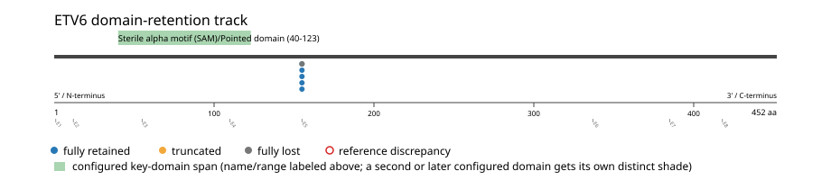
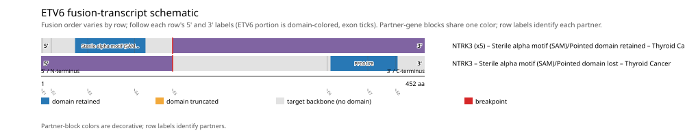

# ETV6 real-data fusion benchmark: thca_tcga_pan_can_atlas_2018

Retrieved from public cBioPortal and Genome Nexus on 2026-10-29.

## Results

- Structural variants returned for ETV6: 6
- Protein-fusion records found: 6
- Protein-fusion records mapped: 6
- Malformed/unmappable fusion records skipped: 0
- In-frame among known-frame events: 6/6 (100.0%)
- Unknown frame status: 0/6
- Sterile alpha motif (SAM)/Pointed domain (40-123 aa) retained: 5/6 (83.3%)
- In-frame and Sterile alpha motif (SAM)/Pointed domain-retained: 5/6
- Fisher exact test (one-sided): odds ratio unavailable, p=1
- Breakpoint-permutation empirical p-value: 0.001998
- Contingency table `[[retained/in-frame, retained/other], [not-retained/in-frame, not-retained/other]]`: `[[5, 0], [0, 0]]`

- Mutation/CNA co-occurrence: not computed (ETV6 has no mutual_exclusivity_targets configured; co-occurrence/mutual-exclusivity analysis was skipped.)

### Mechanistic interpretation

**Curated mechanism:** ETV6 is typically the *partner*, not the target, in its recurrent fusions -- it contributes an oligomerization module rather than being itself the kinase/effector under domain-retention selection. Retention of ETV6's SAM/Pointed domain lets the fusion protein head-to-tail self-polymerize; in ETV6-NTRK3, single-residue mutagenesis at the SAM polymer interface (Lys-99/Asp-101) shows this native polymeric assembly -- not merely forced proximity of two kinase domains -- is what is required to force NTRK3 kinase trans-autophosphorylation/activation independent of ligand; substituting an unrelated dimerization module for the SAM domain preserves kinase activation but still fails to transform. In ETV6-RUNX1/ETV6-PDGFRB and related fusions, the same SAM-domain oligomerization instead drives constitutive activity of a transcription factor or a different kinase. The shared mechanistic thread is oligomerization, not a target-kinase-specific autoinhibition mechanism.

**Sterile alpha motif (SAM)/Pointed domain retention:** nominal support not established (nominal p=1, odds ratio=unavailable; FDR not assessed). No counter-pattern classification was made.

### Domain retention and discrepancies

*Domain-retention positions for analyzed fusion events; red outlines mark reference discrepancies.*

### Fusion-transcript schematic

*One row per recurrent partner/breakpoint group, sharing one amino-acid x-axis for ETV6's full protein length; the partner-contributed portion is colored per partner, the retained target-gene portion is colored by domain-retention status, and a red line marks the breakpoint.*

## Method

The cBioPortal `thca_tcga_pan_can_atlas_2018_structural_variants` structural-variant profile was queried by the configured Entrez gene ID. Fusion-annotated records were adapted to the production SV schema and normalized; when `site2EffectOnFrame=NA`, frame status was resolved from `Event_Info`, not copied into `FusionEvent.Frame_status`.

ETV6 genomic breakpoints were mapped against the Genome Nexus canonical transcript, and retention was classified against its returned Sterile alpha motif (SAM)/Pointed domain coordinates. Counts are event-level with no patient deduplication. In-frame percentage uses only events explicitly called in-frame or out-of-frame; unknown-frame events are reported separately and excluded from that denominator. The Fisher comparison's `other` column combines out-of-frame and unknown-frame events, as pre-specified by the domain-retention algorithm.

For each fusion, breakpoint selection preferred the Genome Nexus canonical transcript's exon-spanned target locus over cBioPortal site labels; malformed rows with no unambiguous target-locus coordinate were skipped and listed in Warnings.

## Full-suite highlights

- Registered algorithms executed: composite_score, confidence_stats, cutpoint_detection, domain_disruption, domain_retention, exon_retention, expression_association, frequency, genomic_position_recurrence, joint_partner, junction_concentration, mechanistic_interpretation, mutation_cooccurrence, window_detection
- Cutpoint detection: not determinable (fewer than 2 distinct breakpoint positions to scan).
- Genomic-position recurrence: All 5 events sharing protein position 155 aa share the exact same genomic breakpoint -- consistent with a real DNA-level recurrent breakpoint, not just a protein-coordinate coincidence.
- Top composite score: NTRK3 (6 events), 0.652364.
- Expression association: ETV6: fusion-positive-vs-negative expression comparison skipped; no sample had both established SV assay coverage and measured expression, so no fusion-negative group could be defined.

## Partners

NTRK3 (6)

## Warnings

- Kept one of several distinct ETV6 fusions in 1 patient(s), dropping 1 so each patient counts once in inferential tests.
- Expression comparison: 498 measured samples excluded from the fusion-positive/negative denominator because SV gene coverage was not established.

## Interpretation

These values describe the live study named above.
