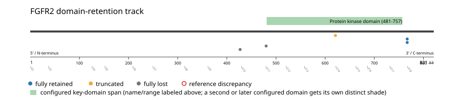
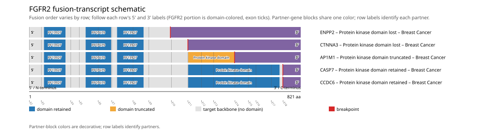

# FGFR2 real-data fusion benchmark: brca_tcga_pan_can_atlas_2018

Retrieved from public cBioPortal and Genome Nexus on 2026-10-29.

## Results

- Structural variants returned for FGFR2: 5
- Protein-fusion records found: 5
- Protein-fusion records mapped: 5
- Malformed/unmappable fusion records skipped: 0
- In-frame among known-frame events: 4/4 (100.0%)
- Unknown frame status: 1/5
- Protein kinase domain (481-757 aa) retained: 2/5 (40.0%)
- In-frame and Protein kinase domain-retained: 2/4
- Fisher exact test (one-sided): odds ratio unavailable, p=0.6
- Breakpoint-permutation empirical p-value: 0.010989
- Contingency table `[[retained/in-frame, retained/other], [not-retained/in-frame, not-retained/other]]`: `[[2, 0], [2, 1]]`

- Mutation/CNA co-occurrence: not computed (No jointly assessed samples for FGFR2 point_mutation (S252W); skipped.)

### Mechanistic interpretation

**Curated mechanism:** Loss of a C-terminal autoinhibitory element is the best-supported primary driver, not partner-driven dimerization. FGFR2 breakpoints in cholangiocarcinoma fall essentially invariably in intron 17, retaining the full extracellular ligand-binding domains, transmembrane segment, and kinase domain intact while truncating the exon-18-encoded C-terminal tail. That tail normally folds back onto and suppresses the kinase domain; Zingg et al. (Cancer Research 2025) identified a specific phenylalanine-serine motif within it that physically binds and suppresses the kinase domain, and reconstructing this suppression motif together with the tail's other regulatory sites was sufficient to phenocopy the oncogenic competence of exon-18 truncation. The partner-contributed BICC1 SAM oligomerization domain adds ligand-independent dimerization, but isogenic in vivo screening showed it is dispensable for signaling and transformation once the C-terminal tail is already lost -- Fgfr2-DeltaE18 alone (no fusion partner at all) produces equivalent pathway activation to the full Fgfr2-DeltaE18-Bicc1 fusion. This is not a promoter-swap/overexpression fusion either: FGFR2 is the 5' partner and retains its own promoter. Caution: the partner-dimerization model does hold for the paralogous FGFR3-TACC3 fusion, where exon-18-equivalent truncation alone is insufficient without a dimerizing partner -- this is a paralog-specific distinction, and the FGFR2 mechanism above should not be generalized to FGFR3 or vice versa.

**Protein kinase domain retention:** nominal support not established (nominal p=0.6, odds ratio=unavailable; FDR not assessed). No counter-pattern classification was made.

**C-terminal autoinhibitory tail (exon 18) disruption:** nominal support not established (nominal p=1, odds ratio=unavailable; FDR not assessed). No counter-pattern classification was made.

### Domain retention and discrepancies

*Domain-retention positions for analyzed fusion events; red outlines mark reference discrepancies.*

### Fusion-transcript schematic

*One row per recurrent partner/breakpoint group, sharing one amino-acid x-axis for FGFR2's full protein length; the partner-contributed portion is colored per partner, the retained target-gene portion is colored by domain-retention status, and a red line marks the breakpoint.*

## Method

The cBioPortal `brca_tcga_pan_can_atlas_2018_structural_variants` structural-variant profile was queried by the configured Entrez gene ID. Fusion-annotated records were adapted to the production SV schema and normalized; when `site2EffectOnFrame=NA`, frame status was resolved from `Event_Info`, not copied into `FusionEvent.Frame_status`.

FGFR2 genomic breakpoints were mapped against the Genome Nexus canonical transcript, and retention was classified against its returned Protein kinase domain coordinates. Counts are event-level with no patient deduplication. In-frame percentage uses only events explicitly called in-frame or out-of-frame; unknown-frame events are reported separately and excluded from that denominator. The Fisher comparison's `other` column combines out-of-frame and unknown-frame events, as pre-specified by the domain-retention algorithm.

For each fusion, breakpoint selection preferred the Genome Nexus canonical transcript's exon-spanned target locus over cBioPortal site labels; malformed rows with no unambiguous target-locus coordinate were skipped and listed in Warnings.

## Full-suite highlights

- Registered algorithms executed: composite_score, confidence_stats, cutpoint_detection, domain_disruption, domain_retention, exon_retention, expression_association, frequency, genomic_position_recurrence, joint_partner, junction_concentration, mechanistic_interpretation, mutation_cooccurrence, window_detection
- Cutpoint detection (descriptive): inferred breakpoint 621 aa (exon 13); label-permutation p=0.200799, not a selection test.
- Genomic-position recurrence: All 2 events sharing protein position 767 aa share the exact same genomic breakpoint -- consistent with a real DNA-level recurrent breakpoint, not just a protein-coordinate coincidence.
- Top composite score: AP1M1 (1 events), 0.168979.
- Expression association: Among fusion-positive samples, FGFR2 expression is not significantly lower in kinase-domain-retained fusions (n=2) than not-retained fusions (n=3) (mann_whitney_u, p=0.2).

## Partners

AP1M1 (1), CASP7 (1), CCDC6 (1), CTNNA3 (1), ENPP2 (1)

## Warnings

- FGFR2 point_mutation: 1084 cohort samples excluded because joint gene/assay coverage was not established.
- Expression comparison: 1082 measured samples excluded from the fusion-positive/negative denominator because SV gene coverage was not established.

## Interpretation

These values describe the live study named above.
