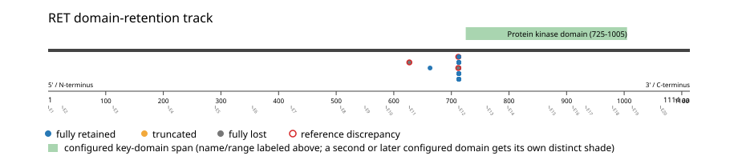
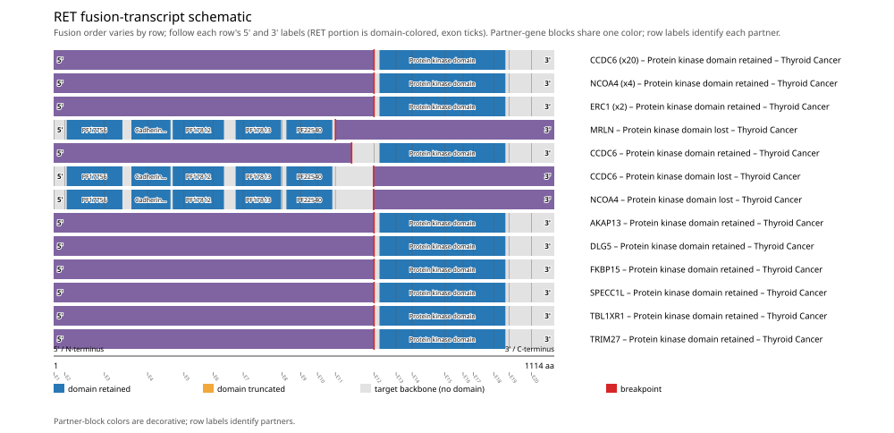
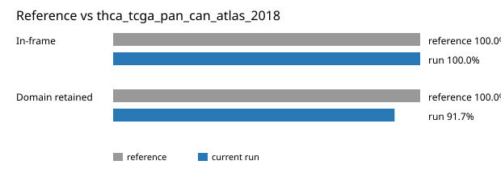

# RET real-data fusion benchmark: thca_tcga_pan_can_atlas_2018

Retrieved from public cBioPortal and Genome Nexus on 2026-10-29.

## Results

- Structural variants returned for RET: 36
- Protein-fusion records found: 36
- Protein-fusion records mapped: 36
- Malformed/unmappable fusion records skipped: 0
- In-frame among known-frame events: 35/35 (100.0%)
- Unknown frame status: 1/36
- Protein kinase domain (725-1005 aa) retained: 33/36 (91.7%)
- In-frame and Protein kinase domain-retained: 33/35
- Fisher exact test (one-sided): odds ratio unavailable, p=1
- Breakpoint-permutation empirical p-value: 0.001998
- Contingency table `[[retained/in-frame, retained/other], [not-retained/in-frame, not-retained/other]]`: `[[32, 0], [1, 0]]`

- Mutation/CNA co-occurrence: not computed (RET has no mutual_exclusivity_targets configured; co-occurrence/mutual-exclusivity analysis was skipped.)

### Mechanistic interpretation

**Curated mechanism:** Ligand-independent dimerization via extracellular-domain replacement, with a contributory promoter-swap component. Full-length RET is a receptor tyrosine kinase normally dimerized and activated only by a GDNF-family ligand bound through GFRalpha co-receptors and its extracellular cadherin-like domain. A fusion that retains the intracellular kinase domain while losing the cadherin-like repeats, cysteine-rich region, and transmembrane segment removes this ligand dependence entirely -- it does not work by unmasking a separate autoinhibitory domain, but simply by deleting the ligand requirement; the partner gene's own coiled-coil dimerization domain (e.g. KIF5B's, CCDC6's) substitutes in its place, driving constitutive dimerization and kinase activation with no ligand or co-receptor required. A second, additive mechanism contributes in KIF5B::RET specifically: the ubiquitously active KIF5B promoter drives markedly increased RET transcription in an epithelial compartment that does not normally express it -- overexpression alone is insufficient for transformation, but adds to the fused kinase's own activity.

**Protein kinase domain retention:** nominal support not established (nominal p=1, odds ratio=unavailable; FDR not assessed). No counter-pattern classification was made.

**Cadherin domain disruption:** nominal support not established (nominal p=1, odds ratio=unavailable; FDR not assessed). No counter-pattern classification was made.

### Domain retention and discrepancies

*Domain-retention positions for analyzed fusion events; red outlines mark reference discrepancies.*

### Fusion-transcript schematic

*One row per recurrent partner/breakpoint group, sharing one amino-acid x-axis for RET's full protein length; the partner-contributed portion is colored per partner, the retained target-gene portion is colored by domain-retention status, and a red line marks the breakpoint.*

## Method

The cBioPortal `thca_tcga_pan_can_atlas_2018_structural_variants` structural-variant profile was queried by the configured Entrez gene ID. Fusion-annotated records were adapted to the production SV schema and normalized; when `site2EffectOnFrame=NA`, frame status was resolved from `Event_Info`, not copied into `FusionEvent.Frame_status`.

RET genomic breakpoints were mapped against the Genome Nexus canonical transcript, and retention was classified against its returned Protein kinase domain coordinates. Counts are event-level with no patient deduplication. In-frame percentage uses only events explicitly called in-frame or out-of-frame; unknown-frame events are reported separately and excluded from that denominator. The Fisher comparison's `other` column combines out-of-frame and unknown-frame events, as pre-specified by the domain-retention algorithm.

For each fusion, breakpoint selection preferred the Genome Nexus canonical transcript's exon-spanned target locus over cBioPortal site labels; malformed rows with no unambiguous target-locus coordinate were skipped and listed in Warnings.

## Full-suite highlights

- Registered algorithms executed: composite_score, confidence_stats, cutpoint_detection, domain_disruption, domain_retention, exon_retention, expression_association, frequency, genomic_position_recurrence, joint_partner, junction_concentration, mechanistic_interpretation, mutation_cooccurrence, window_detection
- Cutpoint detection (descriptive): inferred breakpoint 712 aa (exon 11); label-permutation p=0.0659341, not a selection test.
- Genomic-position recurrence: All 31 events sharing protein position 713 aa share the exact same genomic breakpoint -- consistent with a real DNA-level recurrent breakpoint, not just a protein-coordinate coincidence.
- Top composite score: CCDC6 (22 events), 0.430348.
- Expression association: RET: fusion-positive-vs-negative expression comparison skipped; no sample had both established SV assay coverage and measured expression, so no fusion-negative group could be defined.

## Partners

AKAP13 (1), CCDC6 (22), DLG5 (1), ERC1 (2), FKBP15 (1), MRLN (1), NCOA4 (5), SPECC1L (1), TBL1XR1 (1), TRIM27 (1)

## Warnings

- Kept one of several distinct RET fusions in 3 patient(s), dropping 3 so each patient counts once in inferential tests.
- Expression comparison: 498 measured samples excluded from the fusion-positive/negative denominator because SV gene coverage was not established.

## Reference comparison

| Metric | PMCID: PMC6430196 (KIF5B-RET) | This run |
|---|---:|---:|
| In-frame | 100.0% | 100.0% |
| Domain retained | 100.0% | 91.7% |

*Published reference percentages compared with this run.*

## Interpretation

These values describe the live study named above.
